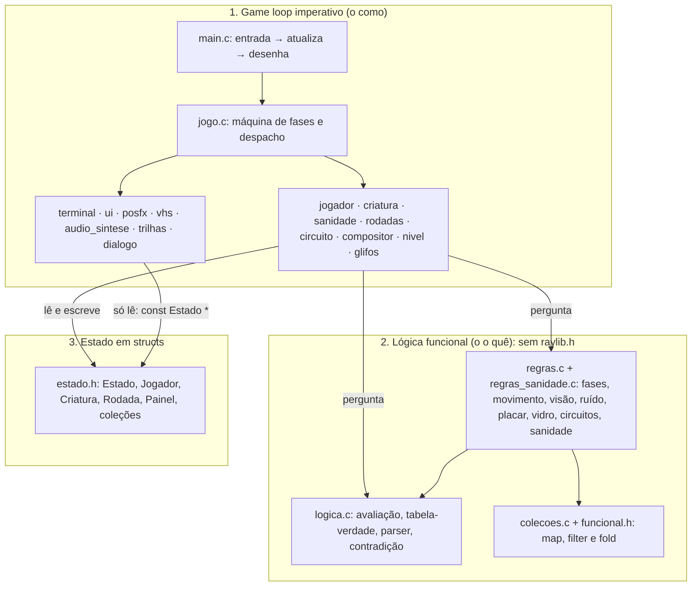

# PRECURSOR

> O nome do jogo fica em `src/config.h` (`TITULO_JOGO`); `TITULO_PROVISORIO` em 1 volta a mostrar o aviso de nome provisório.

Terror em primeira pessoa: em 1985, numa base secreta do SNI, você é o lógico chamado para traduzir uma criatura cuja língua é lógica pura, e cada tradução certa a deixa mais perto de sair.


**Status:** jogável do menu aos dois finais, com história nova (professor ou professora, nome), sons gravados, filtro VHS com presets e sistema de sanidade. `make` compila sem avisos, `make test` passa 100% e `make smoke` joga a partida inteira sozinho. Compilado e testado no macOS (Apple Silicon, raylib 6.2) e no Linux (Fedora 44, raylib 5.5); o caminho do Windows segue o mesmo `Makefile` e o CMake, mas ainda precisa ser testado pela equipe.

## Contexto acadêmico

Projeto Integrador da disciplina **Programação Imperativa e Funcional (PIF)**, Aula 19 ("Projeto Integrador: um jogo em Raylib"), do Prof. Ronierison Maciel, CESAR School, 2026.2, ligado também ao desafio de **Lógica para Computação**. A tese dos slides guia a arquitetura: *o game loop imperativo orquestra (o "como"), a lógica em estilo funcional decide (o "o quê") e o estado em structs guarda tudo*. Aqui, o loop em `main.c` e `jogo.c` só orquestra; quem decide são funções puras (`regras.c`, `logica.c`) que não incluem a raylib e são testadas sem janela; e todo o estado mora numa `struct Estado`.

**Por que 3D?** Os slides descrevem um "jogo 2D", mas aceitam tema próprio "desde que respeite os requisitos". O terror pede primeira pessoa: o vidro entre o jogador e a criatura, os corredores escuros, o armário. Todos os requisitos (RF1 a RF6, RNF1 a RNF6) continuam cumpridos e apontados no código; a raylib desenha o 3D com as mesmas primitivas e o mesmo game loop.

## Conceito

- **Premissa:** Brasil, 14 de março de 1985, véspera da posse do primeiro presidente civil depois de 21 anos de ditadura. No Posto 7, uma base subterrânea do SNI na Serra do Roncador (MT), está contido desde 1977 um ser que o governo chama de Precursor. Um professor ou uma professora de lógica da USP (quem joga escolhe e diz o nome; sem nome, "Moura") é convocado à força para "traduzir" o que ele diz. A língua dele não tem palavras: é estrutura pura, verdadeiro e falso.
- **Gênero:** terror em primeira pessoa com quebra-cabeças de lógica e furtividade (sem combate).
- **Duração:** de 5 a 8 minutos, pensada para a feira de games: entende-se sem explicação e volta sozinha ao menu.
- **Mecânica central:** na sala de observação, acender as luzes da cela e ouvir o Precursor responder VERDADEIRO ou FALSO para decifrar cada conectivo pela tabela-verdade, e depois traduzir uma frase dele. Entre as rodadas, a energia cai e é preciso religar painéis de circuito nos corredores, fugindo dele e se escondendo nos armários. Quanto mais perto dele, mais a **sanidade** cai e mais a vista embaça e a imagem se degrada, como uma fita VHS gasta.
- **Dois finais:** no fim, o jogador monta e transmite uma frase. Um dos finais é vitória; o outro, derrota.

<details><summary>Spoilers</summary>

**O twist:** cada tradução correta ensina a nossa língua ao Precursor e enfraquece a contenção; a última frase traduzida é, literalmente, a chave da cela. **A solução do final bom** está no diário da Dra. Sampaio, no Arquivo: ele só consegue agir sobre o que *pode* ser verdade. Transmitir uma contradição, como `P E NÃO P` (`[VOCÊ FALAR] [E] [NÃO] [VOCÊ FALAR]`), o cala para sempre. Qualquer frase satisfazível (que pode ser verdadeira) o liberta.

</details>

## Como jogar

**Objetivo:** descobrir o que o Precursor diz, sobreviver às quedas de energia e, no fim, dar a resposta certa.

**Fases:** Intro ("Professor ou professora?", o nome — vazio vira "Moura" —, o texto datilografado e a carta do Gen. Varela pelo rádio) → Rodada 1 → Saída 1 (gerador) → Rodada 2 → Saída 2 (Arquivo) → Rodada 3 → Resposta final → Final → menu. Cada erro numa rodada racha o vidro; no 3º erro ele rompe e a rodada recomeça. Ser pego nos corredores recomeça a saída. A sala do segundo gerador (o Arquivo) fica trancada: na segunda queda de energia, um aviso manda pegar a chave no chaveiro atrás do jogador, ao lado do quadro da sala de observação. A porta da sala de observação começa fechada em cada saída: o jogador a abre e fecha com E (o Precursor, chegando nela fechada, abre com um tranco). Com a energia de volta, ao entrar na sala, uma cena curta assume o jogador: ele vira, fecha a porta e entra na sala, e a rodada seguinte começa ali, sem corte; no fim da cena, o controle volta.

| Ação | Teclado | Controle (Xbox) |
| :---- | :---- | :---- |
| Andar | W A S D | analógico esquerdo |
| Olhar | mouse | analógico direito |
| Correr (4 s de fôlego; faz barulho) | Shift | LB, LT ou clicar o analógico esquerdo |
| Interagir: console, painel, diário, armário (entrar e sair), porta da sala (abrir e fechar, nas saídas) | E | A |
| Lanterna: liga e desliga (sem bateria; apaga sozinha no armário) | F | Y |
| Segurar a respiração no armário (só se ele te seguiu até a porta): quando a linha vermelha passar sobre a faixa branca | ESPAÇO | A |
| Sair do terminal, do painel ou do diário | Esc | B |
| Pausar (andando) | Esc | Start |
| Ajuda dos conectivos (terminal e painéis) | H | View |
| Comandos: abre e fecha, no canto da tela, a lista das teclas que valem agora | B | RB |
| Luzes A e B da cela (no console) | 1 e 2 | X e Y |
| Chaves A, B e C (painéis 1 e 2) | 1, 2 e 3 | direcional e A (X e Y também ligam A e B) |
| Escolher no terminal, nos painéis e nas fichas | setas e ENTER | direcional (ou analógico esquerdo) e A |
| Fora do andar (menu, pausa, perguntas da intro, terminal, painéis, fichas, avaliação): passar por cima escolhe, clicar confirma; as teclas da barra do rodapé também são clicáveis | mouse (botão esquerdo) | — |
| Começo da intro: escolher professor ou professora; digitar o nome (até 16 letras, com acento), apagar, confirmar | setas · teclado · Backspace · ENTER | direcional · — · — · A (sem teclado, fica o nome padrão) |

**Controle:** qualquer controle que a raylib reconheça (Xbox, com fio ou pelo adaptador/Bluetooth) funciona junto com o teclado, sem configurar nada (`src/controle.c`). **No Mac, ligue o controle de Xbox pelo Bluetooth:** pelo cabo USB, o macOS até mostra o controle, mas não entrega nenhum botão (o protocolo do Xbox por cabo não é HID); o mapa do Xbox Series pelo Bluetooth no Mac está em `src/controle.c`. As dicas da tela (o "Comandos" e a "Lanterna" no canto, a lista de comandos, a barra do rodapé no menu, "A — usar o console", a tecla embaixo da barra da respiração) trocam para os botões do controle assim que ele é usado e voltam para as teclas quando alguém mexe no teclado ou no mouse. Sensibilidade, zona morta e curva do analógico ficam em `CONTROLE_*` (`src/config.h`). Ao conectar, o log mostra `CONTROLE: 0 conectado (nome)`.

**Teclas de debug:** F1 troca o filtro VHS (desligado, original, fita caseira, fita gasta, monitor CRT, câmera de vigilância; o nome aparece no canto) · F2 pula a fase · F3 mostra o estado e o caminho da criatura, a sanidade e a força do efeito · F5 reinicia a fase · F7 troca a qualidade gráfica (baixa, média, alta, ultra) · F9 vai à resposta final · F12 salva uma captura em `docs/img/`. Para desligá-las, mude `#define TECLAS_DEBUG 1` para `0` em `src/config.h`; no modo feira (`--feira`) elas ficam desligadas sozinhas.

**Nome de quem joga (pensado para a feira):** fica só na memória, durante a partida. Entra nas falas pelos marcadores `{NOME}`, `{PROF}` e `{x|y}` de `dialogo.c` (sempre como "Professora Inês"), no alto do terminal e na tela final. Fora da partida, o nome só vai para um lugar: o ranking da feira (`ranking.txt`, na pasta do jogo e fora do git), com o placar, o tempo e o resultado, e aparece no menu (o 1º lugar) e na tabela do ranking. Isso foi decidido de propósito (decisão 101): quem joga no estande digita o nome para aparecer no ranking. A avaliação do jogo em estrelas vai para outro arquivo (`avaliacoes.csv`) sem nome. O nome não é impresso no terminal. Na memória, ele é apagado ao voltar ao menu (fim de jogo, pausa, inatividade no modo feira, partida nova) e ao fechar o jogo; recomeçar uma fase não o apaga. **Atenção:** uma captura (F12 ou `--captura`) das perguntas da intro, das legendas, do terminal ou da tela final grava o nome na imagem.

**Linha de comando:** `--feira` (sem SAIR no menu, sem debug, volta ao menu após 90 s sem ninguém mexer, inclusive nas perguntas da intro e na pausa) · `--mudo` · `--fase S2` (começa direto numa fase) · `--smoke` (pula as perguntas e usa o nome padrão) · `--captura arquivo.png --captura-em 2 [--captura-fase R1]` · `--exporta-sons pasta` (grava os sons sintetizados em WAV) · `--vhs N` (abre com o preset N do filtro VHS; 0 = desligado) · `--sanidade N` (começa com sanidade N, de 0 a 100, já com o efeito no ponto; para capturas) · `--vitrine-vhs [s]` (troca de preset sozinho a cada s segundos, padrão 4) · `--galeria-vhs pasta` (salva `pasta/vhs_<N>.png` com o mesmo quadro em cada preset e fecha; combine com `--fase S1 --captura-fase S1 --captura-em 5`) · `--qualidade baixa|media|alta|ultra` (padrão: alta) · `--sem ssao,volume,bloom,sombra,reflexo,mapas,pos` (desliga esses efeitos) · bancada de capturas e desempenho: `--olhar x,z,yaw,pitch`, `--lanterna`, `--energia`, `--tamanho LxA`, `--medir s` (veja `docs/graficos.md`).

**Escolher o filtro VHS:** rode `--galeria-vhs` (ou `--vitrine-vhs`) para comparar, depois mude `VHS_PRESET_PADRAO` em `src/config.h`. Os valores de cada preset ficam em `VHS_PRESETS`, uma linha por preset.

### Sanidade


A barra no topo da tela mostra a **SANIDADE** em porcentagem, também com o painel ou o bilhete abertos: quando ela cai, ele está perto (nas salas, cheia, ela some). Ela é verde, fica âmbar abaixo de 60% e vermelha e pulsando abaixo de 30%; o pedaço que a criatura acabou de tirar aparece em vermelho escuro por um instante.

- **Cai** nos corredores quando o Precursor está a menos de 15 m, mais rápido quanto mais perto: cerca de 2 pontos por segundo na borda e 24 colado nele (de 100% a 0% em uns 4 s). Escondido no armário, cai pela metade.
- **Sobe de forma contínua** quando ele se afasta: 2 pontos por segundo, sempre no mesmo ritmo, assim que ele está a mais de 10 m e não está chegando mais perto; entre 10 e 15 m, ela cai se ele se aproxima e sobe se ele se afasta (nas salas, sobe sempre), e **sobe bastante** ao concluir tarefas: +35 por rodada, +40 por saída e +10 por conectivo decifrado. Ser pego ou romper o vidro recomeça a fase com pelo menos 60%.
- **Na tela**, o efeito tem força proporcional ao que falta: 100% não tem nada, 20% tem 80% da força. É uma mistura de cansaço (a vista embaça em ondas lentas, mais nas bordas que no centro, a visão fecha em túnel e as cores desbotam) e fita VHS gasta (ruído em estrias horizontais, ruído de cor nas sombras, riscos claros e, abaixo de 25%, linhas que tremem). Mesmo com 0% o cenário, a criatura e os textos continuam visíveis.
- **Em 0%**, a visão começa a falhar: apagões curtos, alternados e um pouco aleatórios, com as linhas escorregando de lado, e uma vinheta vermelho-sangue fecha as bordas. O efeito some aos poucos assim que a sanidade volta a subir.
- **Zerar não mata:** a criatura é a única ameaça. Como em Call of Cthulhu e Amnesia, a sanidade pesa sem encerrar a partida.

Os números ficam em `src/config.h` (`SANIDADE_*`) e as regras em `src/regras_sanidade.c` (puras e testadas). O efeito funciona com qualquer preset do VHS, inclusive desligado.

## Como compilar e rodar

### Windows (passo a passo para iniciantes)

1. Instale a **raylib 6.0** pelo instalador oficial para Windows (em [raylib.com](https://www.raylib.com)); ele traz o compilador **w64devkit**.
2. Coloque `C:\raylib\w64devkit\bin` no PATH do Windows e abra um terminal novo. Confira: `gcc --version` e `make --version` precisam responder.
3. Na pasta do projeto: `make` compila e `make run` abre o jogo (ou `build.bat` e `build.bat run`).

Se a raylib estiver em outra pasta: `make RAYLIB_PATH=C:/minha/raylib` (o `Makefile` procura `raylib.h` e `libraylib.a` em `RAYLIB_PATH/src`).

### Linux

Com a raylib 5.5 ou mais nova instalada e visível pelo `pkg-config raylib`: `make` e `make run` (ou `./build.sh run`). Se a sua distribuição tiver uma raylib mais antiga, use o CMake abaixo, que baixa a 6.0 (para compilar a raylib, instale antes `build-essential cmake libx11-dev libxrandr-dev libxinerama-dev libxcursor-dev libxi-dev libgl1-mesa-dev libasound2-dev`).

### macOS

`brew install raylib pkg-config`, depois `make` e `make run`.

### Alternativa: CMake (baixa a raylib se não estiver instalada)

```bash
cmake -B build
cmake --build build
ctest --test-dir build
cmake --build build --target smoke
```

### Testes

`make test` roda os testes sem janela; `make smoke` abre o jogo no piloto automático e joga a partida inteira pelos dois finais (sai com 0 ou 1). Detalhes na seção [Testes](#testes).

### Fonte com acentos (opcional)

Sem fonte externa, o jogo usa a fonte padrão da raylib e translitera os acentos (á → a). Para ver os acentos, rode `tools/baixa_fonte.sh` (ou `tools\baixa_fonte.bat`), que baixa a VT323 (licença OFL) para `assets/fontes/`.

### Texturas do mapa (opcional)

Paredes, piso, teto, móveis e portas têm texturas **geradas em código** quando o jogo abre (cerca de 0,1 s, uma vez só): concreto de forma com juntas, furos de tirante, escorridos e umidade; barrado de tinta oliva descascando; piso de granilite em placas; forro manchado; metal pintado com ferrugem; porta com almofadas. A mesma semente dá sempre a mesma imagem.

Para trocar uma delas, ponha um PNG em `assets/texturas/` com um destes nomes: `concreto.png`, `oliva.png`, `piso.png`, `teto.png`, `metal.png`, `porta.png`. Recomendado: 256 × 256 (o concreto, 512 × 256), sem emenda nas bordas, porque a textura se repete pelo mapa. Repetição: concreto a cada 6 m na horizontal e 3 m na vertical (presa ao teto: a parte de cima da imagem fica no teto); oliva a cada 3 m; piso e teto a cada 2 m; metal a cada 1 m; a porta estica a imagem na folha inteira. O `metal.png` deve ser cinza claro e neutro, porque cada móvel tinge o metal com a própria cor. Imagens fora de potência de 2, ou maiores que 1024 px, são redimensionadas ao carregar. Sem o arquivo (ou com um arquivo que não abre), o jogo usa a textura procedural e só registra no log.

### Problemas comuns

- **raylib não encontrada** (`raylib.h: No such file` ou `cannot find -lraylib`): confira o PATH e o `RAYLIB_PATH` no Windows, o `pkg-config raylib` no Linux e no macOS, ou use o CMake.
- **Texto sem acentos:** é o fallback sem fonte externa; rode `tools/baixa_fonte`.
- **Tela preta ou janela que fecha:** o jogo pede OpenGL 3.3; atualize o driver de vídeo. F1 troca o filtro VHS (o preset 0 é desligado). As mensagens do jogo no terminal começam com `PRECURSOR:`.
- **macOS, testes automáticos:** a janela só abre com a tela acordada (`caffeinate -u -t 5` antes do `make smoke`).

## Estrutura do projeto

```
Makefile                 build principal (Windows, Linux, macOS): make, run, test, smoke, readme-check, clean
CMakeLists.txt           alternativa com CMake e CTest (baixa a raylib 6.0 se precisar)
build.sh · build.bat     atalhos que só chamam o make
CLAUDE.md                regras para o Claude Code de cada membro da equipe
.clang-format            estilo do código
.gitignore · .gitattributes   arquivos ignorados · binários no Git LFS
src/main.c               game loop imperativo (entrada → atualiza → desenha), modo feira, --smoke
src/config.h             constantes ajustáveis: título, velocidades, tempos, VHS, sanidade, debug, capacidades, cores
src/estado.h             struct Estado: todo o estado do jogo
src/jogo.c/.h            aplica regras_proxima_fase e despacha atualiza/desenha por fase
src/logica.c/.h          motor de lógica proposicional (puro)
src/regras.c/.h          regras do jogo (puras)
src/regras_texto.c       regras puras de texto: marcadores do roteiro, nome digitado, legenda com defeito
src/regras_ranking.c     regras puras do ranking: lugar da partida, linha do arquivo <-> partida
src/regras_sanidade.c    regras da sanidade (puras): queda pela distância, recuperação, bônus, força do efeito
src/regras_som.c         som no espaço (puro): volume pela distância e lado esquerdo/direito
src/regras_porta.c       a porta da sala e a volta à sala (puro): a folha, a colisão, a coreografia da cena
src/regras_cena.c        a cena do final bom (puro): as etapas, a subida, a escotilha, a volta lá fora e a nave
src/colecoes.c/.h        as 6 coleções: ruídos, partículas, rachaduras, eventos, interativos, paredes
src/funcional.h          fx_map, fx_filter_inplace, fx_fold
src/glifos.c/.h          os glifos da língua do Precursor e a projeção no vidro
src/rodadas.c/.h         dados e fluxo das 3 rodadas
src/terminal.c/.h        interface do ANALISADOR SEMÂNTICO SNI-85
src/manual.c/.h          o manual dos conectivos (lâmpada, ✓/✗, mini-tabela, cartão), do terminal e dos painéis
src/crt.c/.h             a cara de monitor das telas de tarefa: moldura com quinas, scanlines, varredura, caixas e faixas
src/teclas.c/.h          as teclas que valem agora: na partida, B abre a lista no canto; no menu e no fim, a barra do rodapé
src/clique.c/.h          o mouse nas telas: as áreas clicáveis de cada quadro e o clique nas teclas da barra
src/compositor.c/.h      resposta final por fichas e os dois finais
src/circuito.c/.h        painéis de circuito 1 e 2
src/nivel.c/.h           mapa ASCII → geometria, paredes, interativos e luzes
src/jogador.c/.h         câmera, movimento, fôlego, armário, mira, passo até o console e para trás
src/respiracao.c/.h      segurar a respiração no armário: se ele vinha atrás, vai até a porta; 3 chances
src/lanterna.c/.h        a lanterna: tecla F, luz em cone saindo dos olhos, modelo na mão
src/criatura.c/.h        o Precursor: IA, A*, captura e o desenho do corpo
src/esqueleto.c/.h       o rig do Precursor (puro): cinemática direta, skinning e IK
src/modelos_criatura.c   o modelo do Precursor (puro): 22 ossos medidos no arquivo, olhos, rosto, postura
src/regras_animacao.c/.h a animação procedural (pura): camadas, crossfade, passada com os pés plantados, tiques
src/regras_animacao_cenas.c os passos e as cenas: saída do bueiro (e a descida pela tubulação da cela), distorção, convulsão (puro)
src/animacao.c/.h        liga o jogo à animação: lê o estado da criatura e monta a entrada de cada quadro
src/rig.c/.h             os pesos dos ossos em cada vértice do .glb (ao carregar) e o skinning na GPU
src/cela.c/.h            o Precursor contido: no centro da cela, olhando o vidro
src/sanidade.c/.h        a sanidade a cada quadro e a barra no topo da tela
src/susto.c/.h           o jumpscare: o rosto do modelo pula até a câmera, treme e abre uma boca de dentes; dura o trecho alto do som
src/dialogo.c/.h         todos os textos do jogo
src/audio_sintese.c/.h   sons curtos gerados em código (e substituição por .ogg, .wav ou .mp3)
src/tubulacao_som.c/.h   os sons da tubulação: a tampa ao entrar e ao sair e os passos que atravessam da cela ao corredor
src/trilhas.c/.h         sons longos gravados (assets/audio): trilha do menu, vozes, coração e passos
src/posfx.c/.h           render target, luz e névoa
src/vhs.c/.h             filtro VHS: shader, presets (F1), efeito de sanidade (cansaço + fita)
src/ui.c/.h              fonte com fallback, HUD, legendas, diário, pausa
src/menu.c/.h            a tela de início: título à esquerda, o Precursor à vista, opções em faixas, convite do ranking
src/fita.c/.h            a fita do avistamento por trás da intro: 3 fotos, tremida, OSD da câmera e o sinal caindo
src/console_modelo.c/.h   o computador de época sobre a mesa do console (assets/modelos/terminal.glb, opcional)
src/caixas.c/.h          pilhas de caixotes do Exército nas salas, com colisão (assets/modelos/caixas.glb, opcional)
src/escotilha.c/.h       a escotilha do teto e a escada da sala de observação, ao lado dos caixotes (só cenário; abre no final bom)
src/mesa_bilhete.c/.h    a mesa do bilhete no Arquivo: escrivaninha, folhas, a lâmpada âmbar que pisca e o brilho do bilhete
src/armario_modelo.c/.h  a aparência dos armários de esconderijo (assets/modelos/armario.glb, opcional)
src/porta_bunker.c/.h    o modelo da porta de bunker da sala de observação (a folha gira na dobradiça)
src/porta_sala.c/.h      a porta da sala de observação: trancada nas rodadas; nas saídas, abre e fecha com E, sem som
src/retorno.c/.h         a volta à sala sem corte: vira, fecha a porta e entra; a rodada seguinte começa no meio da cena
src/cameras.c/.h         câmeras de segurança nas salas e corredores (LED de REC piscando); as que veem o jogador viram para ele, em silêncio
src/quadro.c/.h          o quadro de investigação da sala de observação (jornal Rede Bola, relatório do SNI, fichas)
src/chave.c/.h           a porta trancada do Arquivo (a sala do segundo gerador) e a chave dela, no chaveiro ao lado do quadro
src/lampada_sala.c/.h    a lâmpada pendurada da sala de observação, com o bulbo aceso (assets/modelos/lampada.glb, opcional)
src/corpo.c/.h           o corpo coberto do consultor americano no fim do rastro de arrasto (E — examinar)
src/cena_final.c/.h      o final bom como cena: sobe a escada da sala, abre a escotilha do teto, o clarão e a fita lá fora, na base com a mata
src/tela_fim.c/.h        depois do final: desempenho, avaliação do jogo em estrelas e o ranking
src/ranking.c/.h         ranking.txt e avaliacoes.csv no disco do estande (nada no --smoke)
src/identidade.c/.h      "Professor ou professora?" e o nome, no começo da intro (só em memória, só na partida)
src/materiais.c/.h       desenho das texturas procedurais e UV de mundo (puro, testado sem janela)
src/texturas.c/.h        gera/carrega as texturas uma vez, libera ao sair; caixa e quadro texturizados
src/cenario.c/.h         ambientação sem colisão: placas, umidade, arrasto, chão molhado, eletrodutos, fios, halos
src/goteira.c/.h         o cano pingando na sala do gerador: gota, ondas na poça e o pingo no espaço
src/entulho.c/.h         sujeira do chão sorteada por célula: poeira no pé da parede, cacos, papéis, lascas
src/bancada.c/.h         bancada de capturas e desempenho: --olhar, --lanterna, --energia, --tamanho, --medir
src/mapas.c/.h           mapas PBR dos materiais gerados em C: cor, normal (da altura) e ORM
src/materiais_parede.c   paredes e teto (puros): azulejo esmaltado, tinta descascando, laje manchada
src/sombreadores.c/.h    os textos GLSL: luz PBR (330) e o fallback 100, tone mapping, emissivo
src/sombreadores_pos.c   os textos GLSL dos passes de tela: SSAO, névoa volumétrica, bloom, composição
src/efeitos.c/.h         sombra da lanterna e passes de tela da cena HDR (SSAO, névoa, bloom, gradação)
src/qualidade.c/.h       presets gráficos (baixa, média, alta, ultra) e o liga/desliga de cada efeito
src/painel_modelo.c/.h   o quadro elétrico dos geradores em aço pintado (só desenho; a colisão é a caixa)
src/menu_inicial.c/.h    menu inicial com visual VHS/CRT (em desenvolvimento; teste visual: make test-menu)
tests/checagem.h         a macro CHECK
tests/test_logica.c      conectivos, classificações, parser, painéis
tests/test_regras.c      regras puras (inclusive sanidade) e coleções, com as bordas
tests/test_fluxo.c       partidas inteiras pela máquina de fases
tests/test_menu.c        teste visual do menu inicial (abre janela; não entra no make test)
assets/fontes/ · assets/modelos/ · assets/audio/ · assets/texturas/   opcionais (por enquanto, modelos/precursor_papelao.glb, modelos/lanterna.glb, modelos/terminal.glb, modelos/caixas.glb, modelos/mesa.glb, modelos/papeis.glb, modelos/armario.glb, modelos/porta_bunker.glb, modelos/camera.glb, modelos/quadro.glb, modelos/lampada.glb, modelos/corpo.glb, modelos/base.glb, modelos/arvores.glb, texturas/sangue.png, audio/jumpscare.mp3 e os sons gravados em audio/; texturas: ver "Texturas do mapa")
docs/ESPECIFICACAO_PROJETO_PRECURSOR.md   a especificação (fonte da verdade do design)
docs/ARQUITETURA.md · docs/DECISOES.md · docs/PROGRESSO.md   arquitetura · decisões · progresso da v0
docs/img/                capturas de tela
tools/baixa_fonte.sh · tools/baixa_fonte.bat   baixam a fonte VT323 (opcional)
tools/check_readme_refs.sh   confere as referências do README (make readme-check)
```

## Arquitetura



**Puro × impuro.** As funções de `logica.c` e `regras.c` recebem dados e devolvem resultados: não leem teclado, não desenham, não tocam som, não usam globais nem `GetFrameTime()`, e não incluem `raylib.h` (só o `raymath.h`, que é só de cabeçalho). O mesmo vale para `regras_sanidade.c`. Por isso os três testes rodam sem janela. O lado impuro (`jogador.c`, `criatura.c`, `rodadas.c`...) coleta o que a raylib sabe (teclas, raycasts, colisões), pergunta às regras e aplica a resposta ao `Estado`; o desenho só lê (`const Estado *`). Um exemplo: `criatura.c` faz o raycast contra as paredes e o fold dos ruídos, e quem decide se ela patrulha, investiga, persegue ou procura é `regras_proximo_estado_criatura`. Mais detalhes em [docs/ARQUITETURA.md](docs/ARQUITETURA.md).

## Como o projeto atende ao que é cobrado

<!-- [REQ:RNF5] documentação: este README (seções na ordem pedida, tabelas e trechos conferidos por make readme-check), docs/ARQUITETURA.md, docs/DECISOES.md e CLAUDE.md -->
Cada trecho que cumpre um requisito tem, logo acima, um comentário-âncora `// [REQ:<ID>]`. As tabelas abaixo apontam o arquivo e as linhas; `make readme-check` confere se cada âncora citada está a no máximo 3 linhas da linha do link, se nenhum ID obrigatório ficou de fora e se os trechos de código copiados aqui são iguais aos do arquivo.

### Requisitos funcionais

| Requisito | Onde | Âncora | Como foi cumprido |
| :---- | :---- | :---- | :---- |
| RF1 Janela e game loop a 60 FPS com `GetFrameTime()` | [src/main.c#L705-L706](src/main.c#L705-L706)<br>[src/main.c#L615-L624](src/main.c#L615-L624)<br>[src/criatura.c#L288-L289](src/criatura.c#L288-L289) | `[REQ:RF1]` | `SetTargetFPS(60)`; `dt = GetFrameTime()` limitado a 0,05 s e passado a todo `xxx_atualiza`, que multiplica movimento, temporizadores e animações (aqui, o passo da criatura). |
| RF2 Controle do jogador por teclado/mouse (e controle de Xbox) | [src/main.c#L55-L99](src/main.c#L55-L99)<br>[src/jogador.c#L86-L102](src/jogador.c#L86-L102)<br>[src/jogador.c#L151-L159](src/jogador.c#L151-L159) | `[REQ:RF2]` | Câmera em 1ª pessoa pelo mouse; WASD, Shift (corrida com fôlego), E, 1/2/3, setas, ENTER e Esc, lidos uma vez por quadro numa `struct Entrada`; o controle soma por cima em `src/controle.c` (o analógico direito gira a câmera em rad/s, multiplicado por `dt`). |
| RF3 Coleção (vetor) de múltiplos objetos | [src/estado.h#L450-L456](src/estado.h#L450-L456) | `[REQ:RF3]` | Seis coleções de capacidade fixa com contador (ruídos, partículas, rachaduras, eventos, interativos, paredes), sem `malloc` por quadro; ver a tabela de map, filter e fold. |
| RF4 Colisões com funções da Raylib | [src/jogador.c#L105-L112](src/jogador.c#L105-L112)<br>[src/colecoes.c#L186-L196](src/colecoes.c#L186-L196)<br>[src/colecoes.c#L145-L165](src/colecoes.c#L145-L165)<br>[src/criatura.c#L189-L190](src/criatura.c#L189-L190)<br>[src/criatura.c#L296-L303](src/criatura.c#L296-L303) | `[REQ:RF4]` | `CheckCollisionBoxes` (jogador × paredes, vidro, móveis e armários, eixo por eixo), `GetRayCollisionBox` (mira de interação e visão da criatura contra as paredes) e `CheckCollisionSpheres` (captura). |
| RF5 Placar, vidas, telas de início e fim | [src/jogo.c#L65-L70](src/jogo.c#L65-L70)<br>[src/menu.c#L156-L187](src/menu.c#L156-L187)<br>[src/tela_fim.c#L88-L124](src/tela_fim.c#L88-L124) | `[REQ:RF5]` | Placar = fold dos eventos; vidas = integridade do vidro (fold das rachaduras), recalculados a cada quadro; tela de início com o título, o gancho, as opções INICIAR, RANKING e SAIR, o convite do 1º lugar ("você pode ser o próximo") e o aviso de nome provisório, intro e tela de fim só com o principal: resultado, placar e lugar no ranking, mais a avaliação do jogo em estrelas. |
| RF6 Condição de vitória/derrota | [src/compositor.c#L63-L77](src/compositor.c#L63-L77)<br>[src/tela_fim.c#L88-L124](src/tela_fim.c#L88-L124) | `[REQ:RF6]` | A frase transmitida vai para `regras_avalia_transmissao`: contradição → final bom (VITÓRIA); satisfazível → final ruim (DERROTA); inválida → SINTAXE INVÁLIDA, sem penalidade. |

### Map, filter e fold nas coleções

Cada laço leva o comentário `// padrão MAP`, `// padrão FILTER` ou `// padrão FOLD`, e o filter compacta o próprio vetor (`v[j++] = v[i]`). As versões genéricas de `src/funcional.h` (`fx_map`, `fx_filter_inplace`, `fx_fold`, com `void*`, tamanho e ponteiro de função) são usadas em quatro lugares: no map e no filter das partículas, no filter dos interativos e no fold das paredes.

| Requisito | Onde | Âncora | Como foi cumprido |
| :---- | :---- | :---- | :---- |
| Ruídos: map | [src/colecoes.c#L24-L27](src/colecoes.c#L24-L27) | `[REQ:MAP-ruidos]` | A intensidade de cada ruído (passos, corrida, portas, painéis) cai com `dt`. |
| Ruídos: filter | [src/colecoes.c#L29-L34](src/colecoes.c#L29-L34) | `[REQ:FILTER-ruidos]` | Os ruídos esgotados saem do vetor por compactação. |
| Ruídos: fold | [src/colecoes.c#L37-L51](src/colecoes.c#L37-L51) | `[REQ:FOLD-ruidos]` | Escolhe o ruído percebido mais forte (atenuado pela distância por `regras_ruido_percebido`); é ele que leva a criatura a INVESTIGA. |
| Partículas: map | [src/colecoes.c#L87-L88](src/colecoes.c#L87-L88) | `[REQ:MAP-particulas]` | `fx_map` move e envelhece cada fagulha, poeira e fragmento. |
| Partículas: filter | [src/colecoes.c#L89-L90](src/colecoes.c#L89-L90) | `[REQ:FILTER-particulas]` | `fx_filter_inplace` remove as mortas e as que saíram do mapa. |
| Rachaduras: map | [src/colecoes.c#L101-L106](src/colecoes.c#L101-L106) | `[REQ:MAP-rachaduras]` | Anima o crescimento de cada rachadura (de 1 a 3 por erro). |
| Rachaduras: fold | [src/regras.c#L315-L325](src/regras.c#L315-L325) | `[REQ:FOLD-rachaduras]` | Soma o dano das rachaduras: a integridade do vidro são as vidas. |
| Eventos: fold | [src/regras.c#L289-L296](src/regras.c#L289-L296) | `[REQ:FOLD-eventos]` | O placar total é a soma dos eventos (rodada sem erro +100, erro −25, saída sem ser pego +50, bônus de tempo, final bom +200). |
| Eventos: filter + fold | [src/regras.c#L298-L308](src/regras.c#L298-L308) | `[REQ:FILTER-eventos]` | Os pontos por fase da tela de fim. Para a função continuar pura, o filter compacta uma cópia local dos eventos, não o vetor da partida. |
| Interativos: filter | [src/colecoes.c#L136-L139](src/colecoes.c#L136-L139) | `[REQ:FILTER-interativos]` | Ao entrar em cada fase, ficam só os interativos ativos nela (console nas rodadas, painéis e armários nas saídas...). |
| Interativos e paredes: filter (a chave e a porta do Arquivo) | [src/chave.c#L27-L35](src/chave.c#L27-L35)<br>[src/chave.c#L37-L44](src/chave.c#L37-L44) | `[REQ:FILTER-interativos-usados]` `[REQ:FILTER-parede-porta]` | A chave pega e a porta aberta saem da coleção de interativos; destrancada, a porta sai das paredes de colisão (compactando o vetor). |
| Paredes: filter (a porta da sala) | [src/porta_sala.c#L22-L28](src/porta_sala.c#L22-L28) | `[REQ:FILTER-parede-porta-sala]` | Abrindo, a folha da porta da sala sai das paredes de colisão (compactando o vetor); quase fechada (`regras_porta_solida`), ela volta. |
| Interativos: fold | [src/colecoes.c#L145-L165](src/colecoes.c#L145-L165) | `[REQ:FOLD-interativos]` | Acha o mais próximo no campo de visão (`GetRayCollisionBox` na mira): é o que a tecla E aciona. |
| Paredes: fold | [src/colecoes.c#L186-L196](src/colecoes.c#L186-L196) | `[REQ:FOLD-paredes]` | "Colidiu com alguma?" é um fold com OU sobre `CheckCollisionBoxes` (`fx_fold`). |

### Funções puras e onde são testadas

| Requisito | Onde (função · teste) | Âncora | Como foi cumprido |
| :---- | :---- | :---- | :---- |
| `regras_nova_posicao` | [src/regras.c#L141-L168](src/regras.c#L141-L168)<br>[tests/test_regras.c#L17-L52](tests/test_regras.c#L17-L52) | `[REQ:PURA-regras_nova_posicao]` | Posição nova a partir da entrada, da velocidade e do `dt`; a diagonal não é mais rápida. |
| `regras_criatura_ve_jogador` | [src/regras.c#L161-L171](src/regras.c#L161-L171)<br>[tests/test_regras.c#L42-L52](tests/test_regras.c#L42-L52) | `[REQ:PURA-regras_criatura_ve_jogador]` | Cone de 70°, 14 m, resultado do raycast recebido pronto, invisível no armário. |
| `regras_ruido_percebido` | [src/regras.c#L173-L179](src/regras.c#L173-L179)<br>[tests/test_regras.c#L54-L62](tests/test_regras.c#L54-L62) | `[REQ:PURA-regras_ruido_percebido]` | O ruído enfraquece com a distância e some fora do raio. |
| `regras_proximo_estado_criatura` | [src/regras.c#L181-L196](src/regras.c#L181-L196)<br>[tests/test_regras.c#L64-L81](tests/test_regras.c#L64-L81) | `[REQ:PURA-regras_proximo_estado_criatura]` | PATRULHA → INVESTIGA → PERSEGUE → PROCURA (6 s) → PATRULHA; quem se escondeu com ele atrás é perseguido até a porta do armário. |
| `esqueleto_ik` (o rig) | [src/esqueleto.c#L104-L122](src/esqueleto.c#L104-L122)<br>[tests/test_regras.c#L83-L110](tests/test_regras.c#L83-L110) | `[REQ:PURA-esqueleto]` | O rig do Precursor tem 22 ossos medidos no modelo (quadril, coluna, pescoço, cabeça, mandíbula, ombros, braços, mãos, dedos, pernas e pés). O IK de dois ossos põe o pé ou a mão no alvo dobrando a articulação para o lado certo; perto do alcance máximo a distância é comprimida suavemente (o joelho não estala nem trava esticado). Em repouso, as matrizes de skinning são a identidade. |
| `esqueleto_modelo` · a tabela de `modelos_criatura.c` | [src/esqueleto.c#L8-L11](src/esqueleto.c#L8-L11)<br>[tests/test_regras.c#L112-L142](tests/test_regras.c#L112-L142) | `[REQ:PURA-modelos_criatura]` | O Precursor (o alien do papelão) tem uma tabela de ossos e medidas; o teste confere pais antes dos filhos, ossos com comprimento, o lado esquerdo em +x e joelho e cotovelo com plano de dobra (o IK precisa). |
| `esqueleto_marca_pontos` | [src/esqueleto.c#L125-L137](src/esqueleto.c#L125-L137)<br>[tests/test_regras.c#L129-L141](tests/test_regras.c#L129-L141) | `[REQ:PURA-esqueleto_marca_pontos]` | Os olhos do rosto liso do Precursor: um meio-disco por olho, com a reta em cima e a curva embaixo, na direção da pele; o teste confere que a borda fica no círculo e na metade de baixo. |
| `regras_anim_passo` | [src/regras_animacao.c#L444-L458](src/regras_animacao.c#L444-L458)<br>[tests/test_regras.c#L164-L203](tests/test_regras.c#L164-L203) | `[REQ:PURA-regras_anim_passo]` | Um quadro da animação: camadas com crossfade (parado, andar, perseguir, escutar, lanterna, fala, mão no vidro, tiques) e as cenas (saída do bueiro, distorção, convulsão). Testado: os pés alternam e o plantado não desliza, os passos variam, ele se acomoda ao parar, os tiques são raros, nenhum osso salta de pose entre estados e a saída do bueiro mostra primeiro só as mãos. |
| `regras_no_cone` | [src/regras.c#L220-L227](src/regras.c#L220-L227)<br>[tests/test_regras.c#L330-L339](tests/test_regras.c#L330-L339) | `[REQ:PURA-regras_no_cone]` | O ponto está no facho da lanterna (dentro do alcance e da abertura do cone)? É o que faz a lanterna falhar ao mirar o Precursor. |
| `regras_falha_lanterna` | [src/regras.c#L213-L218](src/regras.c#L213-L218)<br>[tests/test_regras.c#L313-L328](tests/test_regras.c#L313-L328) | `[REQ:PURA-regras_falha_lanterna]` | A lanterna com mau contato: a cada 50 ms, um sorteio (sem `rand()`) decide se a luz cai para 5–35% ou fica acesa. |
| `regras_piscada_cela` | [src/regras.c#L229-L239](src/regras.c#L229-L239)<br>[tests/test_regras.c#L341-L358](tests/test_regras.c#L341-L358) | `[REQ:PURA-regras_piscada_cela]` | Lâmpada com defeito na cela apagada: piscada dupla a cada ~3 s (2,1 a 3,9 s, às vezes pula), sem `rand()`: repetível. |
| `regras_volumes_trilhas` | [src/regras.c#L242-L261](src/regras.c#L242-L261)<br>[tests/test_regras.c#L360-L400](tests/test_regras.c#L360-L400) | `[REQ:PURA-regras_volumes_trilhas]` | Volume de cada som longo a partir da situação: silêncio vence tudo; passo devagar ou rápido; coração nada além de 16 m, normal até 6 m e rápido abaixo. |
| `regras_quadro_susto` | [src/regras.c#L268-L286](src/regras.c#L268-L286)<br>[tests/test_regras.c#L402-L433](tests/test_regras.c#L402-L433) | `[REQ:PURA-regras_quadro_susto]` | O susto quadro a quadro: o rosto pula de 2,6 m até 0,2 m da câmera em 0,16 s e treme (posição e giro novos 40 vezes por segundo), com um clarão na chegada; logo depois, a boca de dentes escancara em 0,25 s e fica mastigando. Sem `rand()`: repetível. |
| `regras_placar` | [src/regras.c#L289-L296](src/regras.c#L289-L296)<br>[tests/test_regras.c#L435-L448](tests/test_regras.c#L435-L448) | `[REQ:PURA-regras_placar]` | Fold dos eventos (sem eventos, 0). |
| `regras_integridade_vidro` | [src/regras.c#L315-L325](src/regras.c#L315-L325)<br>[tests/test_regras.c#L536-L549](tests/test_regras.c#L536-L549) | `[REQ:PURA-regras_integridade_vidro]` | Vidas = máximo − fold do dano das rachaduras. |
| `regras_evento_do_erro` | [src/regras.c#L327-L330](src/regras.c#L327-L330)<br>[tests/test_regras.c#L459-L464](tests/test_regras.c#L459-L464) | `[REQ:PURA-regras_evento_do_erro]` | Só o 3º erro rompe o vidro e recomeça a rodada. |
| `regras_tenta_porta_arquivo` | [src/regras.c#L358-L362](src/regras.c#L358-L362)<br>[tests/test_regras.c#L466-L473](tests/test_regras.c#L466-L473) | `[REQ:PURA-regras_tenta_porta_arquivo]` | A porta do Arquivo só abre na S2 (a 2ª queda de energia) e com a chave; na S1, "não é por aqui". |
| `regras_chave_visivel` | [src/regras.c#L364-L367](src/regras.c#L364-L367)<br>[tests/test_regras.c#L475-L487](tests/test_regras.c#L475-L487) | `[REQ:PURA-regras_chave_visivel]` | A chave só aparece no chaveiro na S2, até o jogador pegá-la. |
| `regras_porta_passo` · `regras_porta_solida` | [src/regras_porta.c#L11-L15](src/regras_porta.c#L11-L15)<br>[src/regras_porta.c#L17-L20](src/regras_porta.c#L17-L20)<br>[tests/test_regras.c#L489-L504](tests/test_regras.c#L489-L504) | `[REQ:PURA-regras_porta_passo]` `[REQ:PURA-regras_porta_solida]` | A folha da porta da sala anda para aberta ou fechada no tempo de cada movimento, sem passar dos limites; abaixo de 35% de abertura ela já fecha o vão (entra na colisão). |
| `regras_retorno_pose` · `_faixa` · `_luz` | [src/regras_porta.c#L39-L54](src/regras_porta.c#L39-L54)<br>[src/regras_porta.c#L56-L60](src/regras_porta.c#L56-L60)<br>[src/regras_porta.c#L62-L66](src/regras_porta.c#L62-L66)<br>[tests/test_regras.c#L506-L534](tests/test_regras.c#L506-L534) | `[REQ:PURA-regras_retorno_pose]` `[REQ:PURA-regras_retorno_faixa]` `[REQ:PURA-regras_retorno_luz]` | A volta à sala como função do tempo: onde o jogador está e para onde olha (vira para a porta pelo lado mais curto, para enquanto puxa a folha, entra na sala virando para a cela), as faixas de cinema entrando e saindo e a luz da saída passando para a da rodada. |
| `regras_cena_etapa` · `_pose` · `_escotilha` · `_fora` · `_branco` · `_nave_altura` | [src/regras_cena.c#L15-L26](src/regras_cena.c#L15-L26)<br>[src/regras_cena.c#L57-L72](src/regras_cena.c#L57-L72)<br>[src/regras_cena.c#L74-L81](src/regras_cena.c#L74-L81)<br>[src/regras_cena.c#L89-L99](src/regras_cena.c#L89-L99)<br>[src/regras_cena.c#L101-L111](src/regras_cena.c#L101-L111)<br>[src/regras_cena.c#L122-L130](src/regras_cena.c#L122-L130)<br>[tests/test_regras.c#L1036-L1089](tests/test_regras.c#L1036-L1089) | `[REQ:PURA-regras_cena_etapa]` `[REQ:PURA-regras_cena_pose]` `[REQ:PURA-regras_cena_escotilha]` `[REQ:PURA-regras_cena_fora]` `[REQ:PURA-regras_cena_branco]` `[REQ:PURA-regras_cena_nave]` | A cena do final bom como função do tempo: em que parte ela está, o caminho do console até o pé da escada e a subida degrau a degrau (o olhar sobe até a escotilha, e o olho nunca passa do teto), a tampa que emperra num tranco e abre, o clarão que estoura em branco, a volta lá fora na altura dos olhos (sai pela porta da base, gira 360° e olha para o céu) e a luz da nave subindo. |
| `regras_avaliar_circuito` | [src/regras.c#L409-L420](src/regras.c#L409-L420)<br>[tests/test_logica.c#L122-L152](tests/test_logica.c#L122-L152) | `[REQ:PURA-regras_avaliar_circuito]` | Avalia porta a porta (cada LED) com a semântica de `logica_aplica`; o Painel 2 acende em 3 das 8 combinações e não se resolve com uma troca só. |
| `regras_circuito_bloqueio` | [src/regras.c#L422-L439](src/regras.c#L422-L439)<br>[tests/test_logica.c#L171-L185](tests/test_logica.c#L171-L185) | `[REQ:PURA-regras_circuito_bloqueio]` | Da SAÍDA para trás, de porta apagada em porta apagada, acha a entrada que trava a corrente: o painel aponta esse ponto, uma pergunta por vez. |
| `regras_bonus_movimentos` | [src/regras.c#L441-L447](src/regras.c#L441-L447)<br>[tests/test_regras.c#L450-L457](tests/test_regras.c#L450-L457) | `[REQ:PURA-regras_bonus_movimentos]` | Painel resolvido com poucos movimentos vale bônus (metade com alguns a mais; nada para quem chuta). |
| `regras_respiracao_linha` · `_periodo` · `_acertou` | [src/regras.c#L449-L466](src/regras.c#L449-L466)<br>[tests/test_regras.c#L930-L952](tests/test_regras.c#L930-L952) | `[REQ:PURA-regras_respiracao]` | Segurar a respiração no armário: a linha vermelha vai e volta (0 → 1 → 0), cada erro a deixa mais rápida e acertar é ela estar dentro da faixa branca. |
| `regras_armario_perseguido` · `_chegou` | [src/regras.c#L468-L476](src/regras.c#L468-L476)<br>[tests/test_regras.c#L954-L967](tests/test_regras.c#L954-L967) | `[REQ:PURA-regras_armario]` | O armário esconde: o Precursor só vem até a porta se vinha atrás de quem entrou (vendo, perseguindo ou procurando); aí ele vai até lá, e a respiração começa quando ele chega a 3 m. |
| `regras_fita_tomada` | [src/regras.c#L478-L497](src/regras.c#L478-L497)<br>[tests/test_regras.c#L969-L989](tests/test_regras.c#L969-L989) | `[REQ:PURA-regras_fita_tomada]` | A fita do avistamento na intro: qual foto aparece em cada linha datilografada (a do feixe entra com "desceu da nave", mesmo pulando com ENTER) e quanto o sinal falha no corte, ao pegar e ao cair. |
| `regras_intro_escuro` | [src/regras.c#L499-L503](src/regras.c#L499-L503)<br>[tests/test_regras.c#L991-L1003](tests/test_regras.c#L991-L1003) | `[REQ:PURA-regras_intro_escuro]` | Sem corte seco para o jogo: depois da intro, a sala sai do preto em 2 s, devagar no começo e no fim. |
| `regras_ranking_insere` | [src/regras_ranking.c#L14-L26](src/regras_ranking.c#L14-L26)<br>[tests/test_regras.c#L795-L815](tests/test_regras.c#L795-L815) | `[REQ:PURA-regras_ranking_insere]` | Põe a partida no lugar dela: maior placar primeiro; empate, o mais rápido; empate total, quem chegou antes. Cheio (100), a pior sai. |
| `regras_ranking_le_linha` | [src/regras_ranking.c#L28-L45](src/regras_ranking.c#L28-L45)<br>[tests/test_regras.c#L817-L832](tests/test_regras.c#L817-L832) | `[REQ:PURA-regras_ranking_le_linha]` | Converte uma linha do `ranking.txt` em partida (e de volta); uma linha estragada é recusada sem derrubar o ranking. |
| `regras_proxima_fase` | [src/regras.c#L59-L87](src/regras.c#L59-L87)<br>[tests/test_fluxo.c#L25-L41](tests/test_fluxo.c#L25-L41) | `[REQ:PURA-regras_proxima_fase]` | A máquina de fases inteira: (fase, evento) → próxima fase. |
| `regras_avalia_transmissao` | [src/regras.c#L121-L134](src/regras.c#L121-L134)<br>[tests/test_fluxo.c#L44-L73](tests/test_fluxo.c#L44-L73) | `[REQ:PURA-regras_avalia_transmissao]` | Inválida, contradição (final bom) ou satisfazível (final ruim). |
| `regras_monta_texto` | [src/regras_texto.c#L56-L79](src/regras_texto.c#L56-L79)<br>[tests/test_regras.c#L631-L647](tests/test_regras.c#L631-L647) | `[REQ:PURA-regras_monta_texto]` | Troca `{NOME}`, `{PROF}` e `{x\ |
| `regras_nome_edita` | [src/regras_texto.c#L104-L129](src/regras_texto.c#L104-L129)<br>[tests/test_regras.c#L649-L677](tests/test_regras.c#L649-L677) | `[REQ:PURA-regras_nome_edita]` | Edita o nome digitado: letras com acento (UTF-8), Backspace, até 16 letras, maiúscula no começo de cada palavra, sem espaço sobrando. |
| `regras_falha_texto` | [src/regras_texto.c#L141-L158](src/regras_texto.c#L141-L158)<br>[tests/test_regras.c#L766-L793](tests/test_regras.c#L766-L793) | `[REQ:PURA-regras_falha_texto]` | A legenda do rádio falso falha de leve: em janelas curtas e irregulares, letras viram símbolos; repetível e sem quebrar acentos. |
| `regras_radio_falso` | [src/regras.c#L114-L118](src/regras.c#L114-L118)<br>[tests/test_fluxo.c#L158-L165](tests/test_fluxo.c#L158-L165) | `[REQ:PURA-regras_radio_falso]` | O plot twist: a partir da S2, quem fala no rádio é o Precursor imitando o Varela (troca as falas de pego, vidro e porta pela versão falsa). |
| `regras_sanidade_passo` | [src/regras_sanidade.c#L15-L31](src/regras_sanidade.c#L15-L31)<br>[tests/test_regras.c#L834-L854](tests/test_regras.c#L834-L854) | `[REQ:SANIDADE]` | Um quadro de sanidade: cai a menos de 15 m da criatura (de 1,5× a 2× mais rápido quanto mais perto, metade no armário) e volta num ritmo contínuo e sempre igual (2 pontos por segundo) assim que ela está a mais de 10 m sem se aproximar; nas rodadas, sobe no mesmo ritmo. Os bônus e a força do efeito (1 − sanidade/100) também são funções puras, testadas em seguida. |
| `regras_surto_passo` · `regras_surto_piscada` | [src/regras_sanidade.c#L59-L73](src/regras_sanidade.c#L59-L73)<br>[tests/test_regras.c#L907-L928](tests/test_regras.c#L907-L928) | `[REQ:PURA-regras_surto]` | Sanidade zerada: o surto entra em 0,5 s e some em 1,2 s quando ela volta; a visão falha em apagões curtos sorteados 11 vezes por segundo, nunca dois seguidos (falha e volta, alternando), sempre iguais para o mesmo instante. |
| `regras_som_espacial` | [src/regras_som.c#L6-L25](src/regras_som.c#L6-L25)<br>[tests/test_regras.c#L1005-L1034](tests/test_regras.c#L1005-L1034) | `[REQ:PURA-regras_som_espacial]` | Som no espaço (a raylib não posiciona som em 3D): cheio até 4 m, depois cai até 28 dB no alcance numa curva (suave perto, forte longe); um pouco mais baixo atrás e abafado com parede no meio; o pan (esquerda/direita) vem do lado em que a fonte está em relação a onde a pessoa olha. É o que deixa ouvir de onde vêm os passos do Precursor. |
| `logica_avalia` | [src/logica.c#L56-L65](src/logica.c#L56-L65)<br>[tests/test_logica.c#L24-L35](tests/test_logica.c#L24-L35) | `[REQ:PURA-logica_avalia]` | Avalia a árvore da frase para uma valoração das luzes; é daqui que saem as respostas do Precursor. |
| `logica_eh_contradicao` | [src/logica.c#L99-L102](src/logica.c#L99-L102)<br>[tests/test_logica.c#L37-L58](tests/test_logica.c#L37-L58) | `[REQ:PURA-logica_eh_contradicao]` | Nenhuma linha da tabela-verdade é verdadeira (a chave do final bom). |
| `logica_parse_fichas` | [src/logica.c#L249-L258](src/logica.c#L249-L258)<br>[tests/test_logica.c#L65-L100](tests/test_logica.c#L65-L100) | `[REQ:PURA-logica_parse_fichas]` | Fichas → árvore, com precedência ¬ > ∧ > ∨ > → > ↔ e mensagem amigável no erro. |

### Requisitos não funcionais

| Requisito | Onde | Âncora | Como foi cumprido |
| :---- | :---- | :---- | :---- |
| RNF1 Legibilidade | [.clang-format#L1-L12](.clang-format#L1-L12) | `[REQ:RNF1]` | Nomes em português, claros e consistentes (`atualiza_…`, `desenha_…`, `colidiu_…`); funções de até ~40 linhas (a única exceção, em `audio_sintese.c`, está comentada); o código segue o `.clang-format` (`clang-format --dry-run` sem avisos). |
| RNF2 Modularização | [src/estado.h#L399-L475](src/estado.h#L399-L475) | `[REQ:RNF2]` | Uma struct por objeto, uma função por responsabilidade, um módulo por sistema; o maior arquivo tem menos de 500 linhas. |
| RNF3 Separação update/render | [src/main.c#L511-L524](src/main.c#L511-L524) | `[REQ:RNF3]` | Todo módulo tem `xxx_atualiza(Estado *e, float dt)` e `xxx_desenha(const Estado *e)`; o `const` garante que desenhar não muda nada; nenhum `Draw*` em `*_atualiza` (auditado com grep). |
| RNF4 Robustez | [src/colecoes.c#L9-L14](src/colecoes.c#L9-L14)<br>[src/main.c#L615-L624](src/main.c#L615-L624)<br>[src/nivel.c#L52-L56](src/nivel.c#L52-L56)<br>[src/ui.c#L64-L91](src/ui.c#L64-L91)<br>[src/criatura.c#L30-L57](src/criatura.c#L30-L57) | `[REQ:RNF4]` | Vetor cheio descarta com `TraceLog`, sem travar; listas vazias (sem ruídos, sem eventos) testadas; `dt` limitado; fora do mapa conta como parede; sem fonte, som ou modelo, entra o placeholder. |
| RNF5 Documentação | [README.md#L258-L258](README.md#L258-L258) | `[REQ:RNF5]` | Este README, `docs/ARQUITETURA.md`, `docs/DECISOES.md` (as escolhas e por quê), `docs/PROGRESSO.md` e `CLAUDE.md`. |
| RNF6 Versionamento + Makefile | [Makefile#L1-L2](Makefile#L1-L2) | `[REQ:RNF6]` | `Makefile` como build principal (com `test`, `smoke`, `readme-check`); um commit por marco na v0 (M0 a M9) e, daqui em diante, branch por card e PR (ver Metodologia). |

### Critérios de avaliação

| Critério | Onde | Âncora | Como foi cumprido |
| :---- | :---- | :---- | :---- |
| Jogo funcional e jogável (25%) | [Requisitos funcionais](#requisitos-funcionais): as linhas RF1 a RF6<br>[Testes](#testes): `make smoke` | RF1–RF6 | Do menu aos dois finais; o `make smoke` joga a partida inteira duas vezes, inclusive com erro, vidro rompido e captura. |
| Padrões funcionais na lógica (25%) | [Map, filter e fold](#map-filter-e-fold-nas-coleções): as 12 linhas<br>[Funções puras](#funções-puras-e-onde-são-testadas): as 20 linhas<br>[A lógica proposicional no jogo](#a-lógica-proposicional-no-jogo) | MAP, FILTER, FOLD, PURA | Seis coleções com map/filter/fold de verdade na jogabilidade, `funcional.h` genérico, regras e lógica puras e testadas. |
| Raylib e C (20%) | [Requisitos funcionais](#requisitos-funcionais): as linhas RF1 e RF4<br>[Requisitos não funcionais](#requisitos-não-funcionais): a linha RNF3<br>[Trechos do código final](#trechos-do-código-final): game loop e colisão | RF1, RF4, RNF3 | C99, colisões e raycasts da raylib, render target, shaders de luz/névoa e VHS (com o efeito de sanidade), áudio gerado em código e trilhas gravadas por streaming. |
| Qualidade do código (15%) | [Requisitos não funcionais](#requisitos-não-funcionais): as linhas RNF1 a RNF4 | RNF1–RNF4 | Estilo único, módulos pequenos, `const` no desenho, robustez nas bordas, `-Wall -Wextra` sem avisos. |
| Documentação e versionamento (10%) | [Requisitos não funcionais](#requisitos-não-funcionais): as linhas RNF5 e RNF6<br>[Metodologia e versionamento](#metodologia-e-versionamento) | RNF5, RNF6 | Este README conferido por `make readme-check`, docs, `Makefile`, fluxo Git. |
| Apresentação (5%) | [Conceito](#conceito) e [Como jogar](#como-jogar) | — | Atmosfera (VHS, luz e névoa, som, sanidade que degrada a imagem), partidas curtas, modo feira com volta automática ao menu. |

### Trechos do código final

**O game loop (RF1):** `dt` limitado e o quadro entrada → atualiza → desenha.

```c
// src/main.c#L615-L625
static void quadro(Estado *e) {
    // [REQ:RF1] [REQ:RNF4] dt de GetFrameTime() limitado a DT_MAXIMO; no smoke, passo fixo (velocidade
    // acelerada)
    float dt = e->modo_smoke ? DT_MAXIMO : GetFrameTime();
    if (dt > DT_MAXIMO) dt = DT_MAXIMO;
    if (e->modo_smoke)
        piloto_entrada(e, &e->in, dt);
    else
        le_entrada(&e->in);
    atualiza(e, dt);
    desenha(e);
```

**Uma colisão com a raylib (RF4):** a captura pela criatura, com `CheckCollisionSpheres`.

```c
// src/criatura.c#L296-L303
// [REQ:RF4] captura com CheckCollisionSpheres: duas esferas de 0,8 m (pego quando a distância < 1,6 m)
static void tenta_capturar(Estado *e) {
    const Criatura *c = &e->cri;
    if (e->jog.modo == MODO_ARMARIO || susto_ativo(e)) return;
    Vector3 corpo_c = {c->pos.x, 1.0f, c->pos.z}, corpo_j = {e->jog.pos.x, 1.0f, e->jog.pos.z};
    if (CheckCollisionSpheres(corpo_c, CRIATURA_RAIO_CAPTURA, corpo_j, CRIATURA_RAIO_CAPTURA))
        criatura_captura(e);
}
```

**O placar (RF5):** dois folds recalculados a cada quadro.

```c
// src/jogo.c#L65-L70
// [REQ:RF5] placar = fold dos eventos; vidas = integridade do vidro (fold das rachaduras).
// Recalculados a cada quadro, para o HUD e o terminal mostrarem o erro na hora.
static void atualiza_folds(Estado *e) {
    e->vidas = regras_integridade_vidro(e->rachaduras.itens, e->rachaduras.n, VIDAS_VIDRO);
    e->placar = regras_placar(e->eventos.itens, e->eventos.n);
}
```

**Um map e um filter (ruídos):** a intensidade cai com `dt` e os esgotados saem por compactação.

```c
// src/colecoes.c#L23-L35
void col_ruidos_atualiza(ColRuidos *c, float dt) {
    // [REQ:MAP-ruidos] cada ruído perde intensidade com o tempo (multiplicado por dt)
    // padrão MAP
    for (int i = 0; i < c->n; i++)
        c->itens[i].intensidade -= RUIDO_DECAIMENTO * dt;

    // [REQ:FILTER-ruidos] remove os ruídos esgotados, compactando o vetor
    int j = 0;
    // padrão FILTER
    for (int i = 0; i < c->n; i++)
        if (c->itens[i].intensidade > 0.0f) c->itens[j++] = c->itens[i];
    c->n = j;
}
```

**Um fold (ruídos):** o ruído percebido mais forte, que leva a criatura a INVESTIGA.

```c
// src/colecoes.c#L37-L51
// [REQ:FOLD-ruidos] escolhe o ruído percebido mais forte (atenuado pela distância); −1 se não houver nenhum
int col_ruidos_mais_forte(const ColRuidos *c, Vector3 ouvinte, float *intensidade) {
    int melhor = -1;
    float maior = 0.0f;
    // padrão FOLD
    for (int i = 0; i < c->n; i++) {
        float percebido = regras_ruido_percebido(c->itens[i], ouvinte);
        if (percebido > maior) {
            maior = percebido;
            melhor = i;
        }
    }
    if (intensidade != NULL) *intensidade = maior;
    return melhor;
}
```

**Uma função pura e o teste dela:** a integridade do vidro.

```c
// src/regras.c#L315-L325
// [REQ:FOLD-rachaduras] [REQ:PURA-regras_integridade_vidro] vidas = máximo − soma (fold) do dano das
// rachaduras
int regras_integridade_vidro(const Rachadura *rachaduras, int n, int vidas_max) {
    float dano = 0.0f;
    // padrão FOLD
    for (int i = 0; i < n; i++)
        dano += rachaduras[i].dano;
    int vidas = vidas_max - (int)floorf(dano + 0.01f);
    if (vidas < 0) return 0;
    return vidas > vidas_max ? vidas_max : vidas;
}
```

```c
// tests/test_regras.c#L536-L549
// [REQ:PURA-regras_integridade_vidro] testa as vidas depois de 0, 1, 2 e 3 erros
static void testa_vidro(void) {
    CHECK(regras_integridade_vidro(NULL, 0, VIDAS_VIDRO) == 3); // sem rachaduras
    Rachadura r[6] = {0};
    r[0].dano = 0.5f;
    r[1].dano = 0.5f; // 1º erro em duas rachaduras
    CHECK(regras_integridade_vidro(r, 2, VIDAS_VIDRO) == 2);
    r[2].dano = 1.0f / 3.0f;
    r[3].dano = 1.0f / 3.0f;
    r[4].dano = 1.0f / 3.0f; // 2º erro em três rachaduras
    CHECK(regras_integridade_vidro(r, 5, VIDAS_VIDRO) == 1);
    r[5].dano = 1.0f;
    CHECK(regras_integridade_vidro(r, 6, VIDAS_VIDRO) == 0); // 3º erro: o vidro rompe
}
```

**Desenhar só lê o estado (RNF3):**

```c
// src/main.c#L511-L524
// [REQ:RNF3] desenhar recebe const Estado *: não muda nada; o loop é entrada → atualiza → desenha
static void desenha(const Estado *e) {
    clique_limpa();   // as telas registram de novo, ao se desenhar, onde estão as opções clicáveis
    susto_prepara(e); // o rosto do susto, na textura dele
    posfx_inicia_cena(e);
    jogo_desenha_cena(e);
    posfx_termina_cena(e);

    BeginDrawing();
    ClearBackground(BLACK);
    posfx_desenha(e);
    jogo_desenha_interface(e);
    vhs_desenha(e);
    EndDrawing();
```

## A lógica proposicional no jogo

| Conceito | Onde | Âncora | Mecânica |
| :---- | :---- | :---- | :---- |
| Conectivos ¬ ∧ ∨ → ↔ | [src/logica.c#L33-L50](src/logica.c#L33-L50) | `[REQ:PURA-logica_aplica]` | A semântica de cada conectivo, num lugar só; as portas dos painéis usam a mesma. |
| Valoração | [src/logica.c#L56-L65](src/logica.c#L56-L65) | `[REQ:PURA-logica_avalia]` | As luzes A e B são os átomos; ao mudar as luzes, o Precursor responde com o valor da frase. |
| Tabela-verdade | [src/logica.c#L72-L82](src/logica.c#L72-L82) | `[REQ:PURA-logica_tabela_verdade]` | O terminal preenche uma linha por combinação; o padrão revela o conectivo (NÃO, E, OU, SE…ENTÃO). |
| Sintaxe e precedência | [src/logica.c#L249-L258](src/logica.c#L249-L258) | `[REQ:PURA-logica_parse_fichas]` | A resposta final é montada com fichas; frases mal formadas dão SINTAXE INVÁLIDA com a explicação. |
| Contradição e satisfatibilidade | [src/logica.c#L99-L102](src/logica.c#L99-L102)<br>[src/regras.c#L121-L134](src/regras.c#L121-L134) | `[REQ:PURA-logica_eh_contradicao]` `[REQ:PURA-regras_avalia_transmissao]` | Uma frase que nunca pode ser verdadeira (P ∧ ¬P) cala o Precursor; qualquer frase satisfazível (até uma tautologia, P ∨ ¬P) o liberta. |
| Circuitos lógicos | [src/regras.c#L409-L420](src/regras.c#L409-L420) | `[REQ:PURA-regras_avaliar_circuito]` | Painel 1: (A ∧ ¬B) ∧ C; Painel 2: (¬A ∨ B) ∧ C, em que o OU do meio acende como A → B (prenúncio da R3). |

O trecho que avalia a frase para as luzes atuais:

```c
// src/logica.c#L56-L65
// [REQ:PURA-logica_avalia] avalia a árvore para uma valoração dos átomos (recursiva, sem efeitos)
bool logica_avalia(const PoolLogico *pool, int raiz, const bool *valores) {
    if (!no_valido(pool, raiz)) return false;
    const NoLogico *no = &pool->nos[raiz];
    if (no->op == OP_ATOMO) return valores[no->atomo];
    bool a = logica_avalia(pool, no->esq, valores);
    if (no->op == OP_NAO) return logica_aplica(OP_NAO, a, false);
    bool b = logica_avalia(pool, no->dir, valores);
    return logica_aplica(no->op, a, b);
}
```

## Testes

**`make test`** roda três programas sem janela, com a macro `CHECK` (sem framework):

- `test_logica`: as tabelas dos 5 conectivos; `P ∧ ¬P` contradição; `P ∨ ¬P` tautologia; `P → Q` satisfazível e não tautologia; o parser (precedência ¬ > ∧ > ∨ > → > ↔, associatividade, erros); as três soluções do Painel 2 (e que ele não se resolve com uma troca só) e a solução única do Painel 1; o pool cheio.
- `test_regras`: movimento, visão, ruído percebido, estados da criatura, placar e placar por fase, vidro e a regra do 3º erro, volume das trilhas, montagem dos textos com nome e gênero, edição do nome, a sanidade (queda pela distância, armário, espera da recuperação, bônus, piso no recomeço e força linear do efeito) e as coleções nas bordas: lista vazia, vetor cheio, ruído esgotado, criatura sem ruídos, placar sem eventos, partículas fora do mapa, colisão e mira.
- `test_fluxo`: partidas inteiras só com `regras_proxima_fase` e eventos: acertar tudo e transmitir uma contradição chega ao FIM_BOM; uma frase satisfazível chega ao FIM_RUIM; 3 erros reiniciam a rodada; ser pego reinicia a saída; uma partida com esses tropeços no meio ainda chega ao fim; eventos fora de hora são ignorados.

**`make test-menu`** (ou `./build/test_menu` no CMake) abre só o menu inicial VHS/CRT, para conferir o visual. Ele tem janela, então fica fora do `make test` e do `ctest`. O arquivo fica em `tests/` (não em `src/`) porque tem o próprio `main()`: em `src/` ele entrava no executável do jogo pelo CMake e o link falhava com "múltiplas definições de main".

```
test_logica   37/37  checagens ok
test_regras  173/173 checagens ok
test_fluxo    57/57  checagens ok
```

**`make smoke`** abre o jogo e o joga sozinho em velocidade acelerada, duas vezes (final ruim e final bom), com as mesmas teclas do jogador. A cada troca de fase confere a sequência contra `regras_roteiro_partida` (o mesmo roteiro do `test_fluxo`); no caminho, anda até o vidro para conferir a colisão, erra três vezes na R3 (o vidro rompe e a rodada recomeça), fica parado no corredor fazendo barulho até a criatura ouvir, ver e pegar, se esconde num armário sem ninguém atrás (ela patrulha e não vem até a porta) e depois de ser visto, com ela perdendo o rastro a ~18 m (mesmo assim ela vai até a porta e começa a respiração), lê o diário e transmite primeiro uma frase inválida. Sai com 0, ou com 1 e a fase onde travou. A semente do sorteio é fixa, então o resultado é sempre o mesmo.

```
SMOKE  partida 1: MENU -> INTRO
SMOKE  partida 1: INTRO -> R1
SMOKE  nome ok: perguntas puladas, nome padrão em uso
SMOKE  partida 1: R1 -> S1
SMOKE  colisão ok: andou até z=7.62 e parou antes do vidro (z=7.00)
SMOKE  partida 1: S1 -> R2
SMOKE  partida 1: R2 -> S2
SMOKE  criatura ok: ouviu (INVESTIGA), viu (PERSEGUE) e pegou; a saída recomeça
SMOKE  partida 1: S2 recomeçou (0 erro(s) na fase)
SMOKE  partida 1: S2 -> R3
SMOKE  partida 1: R3 recomeçou (3 erro(s) na fase)
SMOKE  partida 1: R3 -> RESPOSTA_FINAL
SMOKE  partida 1: RESPOSTA_FINAL -> FIM_RUIM
SMOKE  partida 1: FIM_RUIM -> MENU
SMOKE  nome ok: buffer zerado no menu
SMOKE  partida 2: MENU -> INTRO
SMOKE  partida 2: INTRO -> R1
SMOKE  nome ok: perguntas puladas, nome padrão em uso
SMOKE  partida 2: R1 -> S1
SMOKE  armário ok: escondido sem perseguição, ele patrulhou e não veio até a porta
SMOKE  armário ok: perseguindo, ele veio até a porta; respiração sem erro
SMOKE  partida 2: S1 -> R2
SMOKE  partida 2: R2 -> S2
SMOKE  partida 2: S2 -> R3
SMOKE  partida 2: R3 -> RESPOSTA_FINAL
SMOKE  partida 2: RESPOSTA_FINAL -> FIM_BOM
SMOKE  partida 2: FIM_BOM -> MENU
SMOKE  nome ok: buffer zerado no menu
SMOKE OK: a partida foi jogada até os dois finais.
```

## Metodologia e versionamento

- **`main`** guarda só versões estáveis: recebe merge da `develop` ao fim de cada etapa (E1 a E4) e na build da feira.
- **`develop`** é a branch de integração. Ninguém commita direto na `main` nem na `develop`.
- **Uma branch por card**, criada a partir da `develop` (`feat/S2-05-ia-precursor`, `fix/BUG-03-armario`), com commits pequenos no padrão `tipo: descrição`. Antes do PR: `git pull --rebase origin develop`, `make`, `make test` e `make smoke`.
- **Pull request** para a `develop`, revisado por um colega. Binários (`.png`, `.ogg`, `.ttf`, `.glb`) vão pelo Git LFS.
- **Kanban no monday.com:** cada card tem um código (`S2-05`); ao começar, o card vai para *Fazendo*; ao terminar, para *Revisão*, com um update (o que foi feito, arquivos, branch/commit, como testar, próximos passos). Só humanos movem para *Feito*, depois de revisar o PR. Defeitos viram cards `BUG-`.
- **Etapas E1 a E4:** cada etapa dos slides termina com um PR da `develop` para a `main`, revisado, que vira uma versão estável.
- **Como a v0 foi feita:** em 10 marcos (M0 a M9), cada um verificado (`make` sem avisos, `make test`, `make smoke`) e registrado num commit na `develop`. O registro de cada marco está em [docs/PROGRESSO.md](docs/PROGRESSO.md) e as escolhas em [docs/DECISOES.md](docs/DECISOES.md). O `CLAUDE.md` mantém o Claude Code de cada membro da equipe seguindo estas regras.

## Créditos e licenças

- **raylib**, de Ramon Santamaria e colaboradores, licença zlib/libpng: [raylib.com](https://www.raylib.com). Não vem copiada no repositório.
- **Fonte VT323** (opcional), de Peter Hull, licença SIL Open Font License 1.1: [fonts.google.com/specimen/VT323](https://fonts.google.com/specimen/VT323). É baixada por `tools/baixa_fonte` e não vem no repositório.
- **Modelo 3D da lanterna** (`assets/modelos/lanterna.glb`): *"Lowpoly Flashlight (Lanterna)"* by **EnrycoDosSantos**, publicado no Sketchfab, licensed under [Creative Commons Attribution 4.0 (CC BY 4.0)](https://creativecommons.org/licenses/by/4.0/). <!-- colar aqui o link da página do modelo no Sketchfab --> Usado sem alterações. Sem o arquivo, o jogo desenha uma lanterna de cilindros.
- **Modelo 3D da lâmpada da sala de observação** (`assets/modelos/lampada.glb`): *"Old Lamp"* by **_surovic_** ([Samuel Surovic](https://sketchfab.com/samuelsurovic)), publicado no [Sketchfab](https://sketchfab.com/3d-models/old-lamp-9ba4921431114368887bf058dee1f752), licensed under [Creative Commons Attribution 4.0 (CC BY 4.0)](https://creativecommons.org/licenses/by/4.0/). Alterações feitas pela equipe: a malha foi simplificada de ~471 mil para ~37 mil triângulos e as texturas reduzidas de 1024 para 512 px (com o [gltf-transform](https://gltf-transform.dev)); no jogo, o vidro ganhou um tom fraco no lugar da "transmissão", que a raylib não lê. Sem o arquivo, o jogo desenha uma lâmpada simples.
- **Modelo 3D do Precursor** (`assets/modelos/precursor_papelao.glb`, o alien do papelão): gerado por IA a partir do desenho do Precursor feito pela equipe para o estande. A arte conceitual limpa saiu do [Meshy](https://www.meshy.ai) e a malha, do [Hunyuan3D 2.1](https://huggingface.co/spaces/tencent/Hunyuan3D-2.1) (Tencent Hunyuan 3D, Tencent Hunyuan Community License). Alterações feitas pela equipe: a malha foi soldada e simplificada de ~97 mil para ~44 mil triângulos (com o [gltf-transform](https://gltf-transform.dev)), e ganhou normais, um material cinza-escuro e cor por vértice nas cavidades. A frente do rosto foi alisada (sem a fenda), e os olhos são meios-discos desenhados pelo jogo. As mãos (a IA devolveu os dedos colados) foram refeitas em código pela equipe: palma e quatro dedos longos e separados, com garra. As referências usadas ficam em `referencias_alien/`. Sem o arquivo, o jogo usa o corpo procedural.
- **Sons gravados** (`assets/audio/`: trilha do menu, voz do Precursor, voz do rádio, coração, passos e a porta do armário abrindo e fechando): reunidos pela equipe. <!-- preencher: origem (site/autor) e licença de cada som --> A trilha do menu foi amplificada 5× e os arquivos foram convertidos para WAV de 16 bits quando preciso. Os dois sons do armário (`armario_abre.wav` e `armario_fecha.wav`) foram recortados de uma gravação só: a trava e o começo do rangido de abrir; o rangido curto e a batida de fechar.
- **Voz do Precursor** (`assets/audio/voz_precursor_robo.wav`): *"Robot monster receiving damage and coughing"* by **_javier_rodas**, publicado no [Freesound](https://freesound.org/people/_javier_rodas/sounds/862695/), licença [Creative Commons 0 (CC0)](https://creativecommons.org/publicdomain/zero/1.0/). Alteração feita pela equipe: ganho de +5,5 dB. Toca enquanto o Precursor "diz" uma frase em glifos no vidro; sem o arquivo, entra a voz sintetizada. A voz gravada anterior (`voz_precursor_fala.wav`) continua no repositório, sem uso.
- **Função de ruído do shader VHS** (`hash12` de *"Hash without Sine"*), de **Dave Hoskins**, licença MIT: [shadertoy.com/view/4djSRW](https://www.shadertoy.com/view/4djSRW). Adaptada em `src/vhs.c`.
- **Fotos do avistamento** (`assets/fita/avistamento_1..3.png`): escolhidas pela equipe para a intro. A equipe recortou as fotos para 16:9 (saíram a borda serrilhada, o "REC" gravado e o ruído de baixo) e reduziu para 1024 × 576; o OSD da câmera é desenhado pelo jogo. Sem os arquivos, a intro fica com a tela preta.
- **Ícones do controle** (`assets/botoes/*.png`): "Xbox Series Button Icons & Controls", de Zacksly (licença CC BY). Cada botão foi recortado da folha e passou a branco com fundo transparente (o jogo pinta com a cor fósforo); o ↑↓ e o ←→ do direcional juntam duas variações da folha. Sem um arquivo, aquele botão aparece como texto na barra de teclas.
- **Sons curtos, glifos e texturas do mapa:** gerados em código pela equipe. Se outro asset for adicionado em `assets/`, credite-o aqui.
- **Equipe:** <!-- preencher: nome e usuário do GitHub de cada integrante -->
