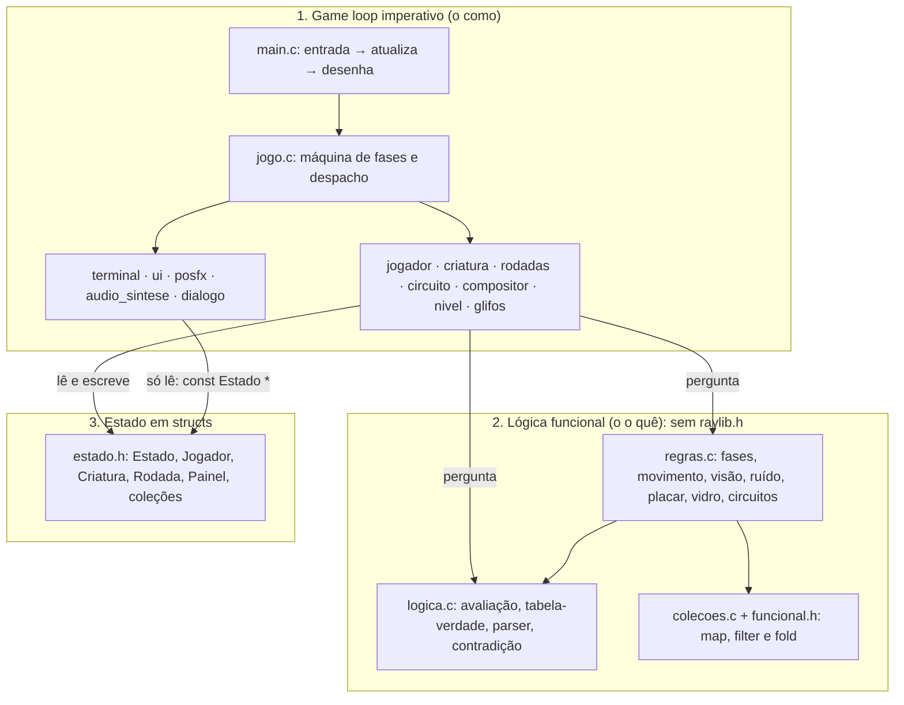

# PROJETO PRECURSOR

> **Nome provisório.** O título final ainda vai ser definido; para trocar, mudam só duas linhas em `src/config.h` (`TITULO_JOGO` e `TITULO_PROVISORIO`).

Terror em primeira pessoa: em 1985, numa base secreta do SNI, você é o lógico chamado para traduzir uma criatura cuja língua é lógica pura, e cada tradução certa a deixa mais perto de sair.


**Status:** v0 jogável, do menu aos dois finais. `make` compila sem avisos, `make test` passa 100% e `make smoke` joga a partida inteira sozinho. A v0 foi compilada e testada no macOS (Apple Silicon, raylib 6.2); os caminhos de Windows e Linux seguem o mesmo `Makefile` e o CMake, mas ainda precisam ser testados pela equipe.

## Contexto acadêmico

Projeto Integrador da disciplina **Programação Imperativa e Funcional (PIF)**, Aula 19 ("Projeto Integrador: um jogo em Raylib"), do Prof. Ronierison Maciel, CESAR School, 2026.2, ligado também ao desafio de **Lógica para Computação**. A tese dos slides guia a arquitetura: *o game loop imperativo orquestra (o "como"), a lógica em estilo funcional decide (o "o quê") e o estado em structs guarda tudo*. Aqui, o loop em `main.c` e `jogo.c` só orquestra; quem decide são funções puras (`regras.c`, `logica.c`) que não incluem a raylib e são testadas sem janela; e todo o estado mora numa `struct Estado`.

**Por que 3D?** Os slides descrevem um "jogo 2D", mas aceitam tema próprio "desde que respeite os requisitos". O terror pede primeira pessoa: o vidro entre o jogador e a criatura, os corredores escuros, o armário. Todos os requisitos (RF1 a RF6, RNF1 a RNF6) continuam cumpridos e apontados no código; a raylib desenha o 3D com as mesmas primitivas e o mesmo game loop.

## Conceito

- **Premissa:** Brasil, 14 de março de 1985, véspera da posse do primeiro presidente civil depois de 21 anos de ditadura. No Posto 7, uma base subterrânea do SNI na Serra do Roncador (MT), está contido desde 1977 um ser que o governo chama de Precursor. O Prof. Elias Moura, lógico da USP, é convocado à força para "traduzir" o que ele diz. A língua dele não tem palavras: é estrutura pura, verdadeiro e falso.
- **Gênero:** terror em primeira pessoa com quebra-cabeças de lógica e furtividade (sem combate).
- **Duração:** de 5 a 8 minutos, pensada para a feira de games: entende-se sem explicação e volta sozinha ao menu.
- **Mecânica central:** na sala de observação, acender as luzes da cela e ouvir o Precursor responder VERDADEIRO ou FALSO para decifrar cada conectivo pela tabela-verdade, e depois traduzir uma frase dele. Entre as rodadas, a energia cai e é preciso religar painéis de circuito nos corredores, fugindo dele e se escondendo nos armários.
- **Dois finais:** no fim, o jogador monta e transmite uma frase. Um dos finais é vitória; o outro, derrota.

<details><summary>Spoilers</summary>

**O twist:** cada tradução correta ensina a nossa língua ao Precursor e enfraquece a contenção; a última frase traduzida é, literalmente, a chave da cela. **A solução do final bom** está no diário da Dra. Sampaio, no Arquivo: ele só consegue agir sobre o que *pode* ser verdade. Transmitir uma contradição, como `P E NÃO P` (`[VOCÊ FALAR] [E] [NÃO] [VOCÊ FALAR]`), o cala para sempre. Qualquer frase satisfazível (que pode ser verdadeira) o liberta.

</details>

## Como jogar

**Objetivo:** descobrir o que o Precursor diz, sobreviver às quedas de energia e, no fim, dar a resposta certa.

**Fases:** Intro (texto datilografado e o interfone do Cel. Varela) → Rodada 1 → Saída 1 (gerador) → Rodada 2 → Saída 2 (Arquivo) → Rodada 3 → Resposta final → Final → menu. Cada erro numa rodada racha o vidro; no 3º erro ele rompe e a rodada recomeça. Ser pego nos corredores recomeça a saída.

| Ação | Tecla |
| :---- | :---- |
| Andar | W A S D |
| Olhar | mouse |
| Correr (4 s de fôlego; faz barulho) | Shift |
| Interagir: console, painel, diário, armário (entrar e sair) | E |
| Sair do terminal, do painel ou do diário; pausar | Esc |
| Luzes A e B da cela (no console) | 1 e 2 |
| Chaves A, B e C (painel 1) | 1, 2 e 3 |
| Escolher no terminal, nos painéis e nas fichas | setas e ENTER |

**Teclas de debug:** F1 liga/desliga o VHS · F2 pula a fase · F3 mostra o estado e o caminho da criatura · F5 reinicia a fase · F9 vai à resposta final · F12 salva uma captura em `docs/img/`. Para desligá-las, mude `#define TECLAS_DEBUG 1` para `0` em `src/config.h`; no modo feira (`--feira`) elas ficam desligadas sozinhas.

**Linha de comando:** `--feira` (sem SAIR no menu, sem debug, volta ao menu após 90 s sem ninguém mexer) · `--mudo` · `--fase S2` (começa direto numa fase) · `--smoke` · `--captura arquivo.png --captura-em 2 [--captura-fase R1]` · `--exporta-sons pasta` (grava os sons sintetizados em WAV).

## Como compilar e rodar

### Windows (passo a passo para iniciantes)

1. Instale a **raylib 6.0** pelo instalador oficial para Windows (em [raylib.com](https://www.raylib.com)); ele traz o compilador **w64devkit**.
2. Coloque `C:\raylib\w64devkit\bin` no PATH do Windows e abra um terminal novo. Confira: `gcc --version` e `make --version` precisam responder.
3. Na pasta do projeto: `make` compila e `make run` abre o jogo (ou `build.bat` e `build.bat run`).

Se a raylib estiver em outra pasta: `make RAYLIB_PATH=C:/minha/raylib` (o `Makefile` procura `raylib.h` e `libraylib.a` em `RAYLIB_PATH/src`).

### Linux

Com a raylib 5.5 ou mais nova instalada e visível pelo `pkg-config raylib`: `make` e `make run` (ou `./build.sh run`). Se a sua distribuição tiver uma raylib mais antiga, use o CMake abaixo, que baixa a 6.0 (para compilar a raylib, instale antes `build-essential cmake libx11-dev libxrandr-dev libxinerama-dev libxcursor-dev libxi-dev libgl1-mesa-dev libasound2-dev`).

### macOS

`brew install raylib pkg-config`, depois `make` e `make run`.

### Alternativa: CMake (baixa a raylib se não estiver instalada)

```bash
cmake -B build
cmake --build build
ctest --test-dir build
cmake --build build --target smoke
```

### Testes

`make test` roda os testes sem janela; `make smoke` abre o jogo no piloto automático e joga a partida inteira pelos dois finais (sai com 0 ou 1). Detalhes na seção [Testes](#testes).

### Fonte com acentos (opcional)

Sem fonte externa, o jogo usa a fonte padrão da raylib e translitera os acentos (á → a). Para ver os acentos, rode `tools/baixa_fonte.sh` (ou `tools\baixa_fonte.bat`), que baixa a VT323 (licença OFL) para `assets/fontes/`.

### Problemas comuns

- **raylib não encontrada** (`raylib.h: No such file` ou `cannot find -lraylib`): confira o PATH e o `RAYLIB_PATH` no Windows, o `pkg-config raylib` no Linux e no macOS, ou use o CMake.
- **Texto sem acentos:** é o fallback sem fonte externa; rode `tools/baixa_fonte`.
- **Tela preta ou janela que fecha:** o jogo pede OpenGL 3.3; atualize o driver de vídeo. F1 desliga o filtro VHS. As mensagens do jogo no terminal começam com `PRECURSOR:`.
- **macOS, testes automáticos:** a janela só abre com a tela acordada (`caffeinate -u -t 5` antes do `make smoke`).

## Estrutura do projeto

```
Makefile                 build principal (Windows, Linux, macOS): make, run, test, smoke, readme-check, clean
CMakeLists.txt           alternativa com CMake e CTest (baixa a raylib 6.0 se precisar)
build.sh · build.bat     atalhos que só chamam o make
CLAUDE.md                regras para o Claude Code de cada membro da equipe
.clang-format            estilo do código
.gitignore · .gitattributes   arquivos ignorados · binários no Git LFS
src/main.c               game loop imperativo (entrada → atualiza → desenha), modo feira, --smoke
src/config.h             constantes ajustáveis: título, velocidades, tempos, VHS, debug, capacidades, cores
src/estado.h             struct Estado: todo o estado do jogo
src/jogo.c/.h            aplica regras_proxima_fase e despacha atualiza/desenha por fase
src/logica.c/.h          motor de lógica proposicional (puro)
src/regras.c/.h          regras do jogo (puras)
src/colecoes.c/.h        as 6 coleções: ruídos, partículas, rachaduras, eventos, interativos, paredes
src/funcional.h          fx_map, fx_filter_inplace, fx_fold
src/glifos.c/.h          os glifos da língua do Precursor e a projeção no vidro
src/rodadas.c/.h         dados e fluxo das 3 rodadas
src/terminal.c/.h        interface do ANALISADOR SEMÂNTICO SNI-85
src/compositor.c/.h      resposta final por fichas e os dois finais
src/circuito.c/.h        painéis de circuito 1 e 2
src/nivel.c/.h           mapa ASCII → geometria, paredes, interativos e luzes
src/jogador.c/.h         câmera, movimento, fôlego, armário, mira
src/criatura.c/.h        o Precursor: IA, A*, placeholder procedural, captura, susto
src/dialogo.c/.h         todos os textos do jogo
src/audio_sintese.c/.h   sons gerados em código (e substituição por .ogg)
src/posfx.c/.h           render target, luz e névoa, filtro VHS
src/ui.c/.h              fonte com fallback, menu, HUD, legendas, diário, tela de fim
tests/checagem.h         a macro CHECK
tests/test_logica.c      conectivos, classificações, parser, painéis
tests/test_regras.c      regras puras e coleções, com as bordas
tests/test_fluxo.c       partidas inteiras pela máquina de fases
assets/fontes/ · assets/modelos/ · assets/audio/ · assets/texturas/   opcionais (vazios na v0)
docs/ESPECIFICACAO_PROJETO_PRECURSOR.md   a especificação (fonte da verdade do design)
docs/ARQUITETURA.md · docs/DECISOES.md · docs/PROGRESSO.md   arquitetura · decisões · progresso da v0
docs/img/                capturas de tela
tools/baixa_fonte.sh · tools/baixa_fonte.bat   baixam a fonte VT323 (opcional)
tools/check_readme_refs.sh   confere as referências do README (make readme-check)
```

## Arquitetura



**Puro × impuro.** As funções de `logica.c` e `regras.c` recebem dados e devolvem resultados: não leem teclado, não desenham, não tocam som, não usam globais nem `GetFrameTime()`, e não incluem `raylib.h` (só o `raymath.h`, que é só de cabeçalho). Por isso os três testes rodam sem janela. O lado impuro (`jogador.c`, `criatura.c`, `rodadas.c`...) coleta o que a raylib sabe (teclas, raycasts, colisões), pergunta às regras e aplica a resposta ao `Estado`; o desenho só lê (`const Estado *`). Um exemplo: `criatura.c` faz o raycast contra as paredes e o fold dos ruídos, e quem decide se ela patrulha, investiga, persegue ou procura é `regras_proximo_estado_criatura`. Mais detalhes em [docs/ARQUITETURA.md](docs/ARQUITETURA.md).

## Como o projeto atende ao que é cobrado

<!-- [REQ:RNF5] documentação: este README (seções na ordem pedida, tabelas e trechos conferidos por make readme-check), docs/ARQUITETURA.md, docs/DECISOES.md e CLAUDE.md -->
Cada trecho que cumpre um requisito tem, logo acima, um comentário-âncora `// [REQ:<ID>]`. As tabelas abaixo apontam o arquivo e as linhas; `make readme-check` confere se cada âncora citada está a no máximo 3 linhas da linha do link, se nenhum ID obrigatório ficou de fora e se os trechos de código copiados aqui são iguais aos do arquivo.

### Requisitos funcionais

| Requisito | Onde | Âncora | Como foi cumprido |
| :---- | :---- | :---- | :---- |
| RF1 Janela e game loop a 60 FPS com `GetFrameTime()` | [src/main.c#L395-L396](src/main.c#L395-L396)<br>[src/main.c#L345-L354](src/main.c#L345-L354)<br>[src/criatura.c#L292-L293](src/criatura.c#L292-L293) | `[REQ:RF1]` | `SetTargetFPS(60)`; `dt = GetFrameTime()` limitado a 0,05 s e passado a todo `xxx_atualiza`, que multiplica movimento, temporizadores e animações (aqui, o passo da criatura). |
| RF2 Controle do jogador por teclado/mouse | [src/main.c#L26-L54](src/main.c#L26-L54)<br>[src/jogador.c#L41-L49](src/jogador.c#L41-L49)<br>[src/jogador.c#L94-L102](src/jogador.c#L94-L102) | `[REQ:RF2]` | Câmera em 1ª pessoa pelo mouse; WASD, Shift (corrida com fôlego), E, 1/2/3, setas, ENTER e Esc, lidos uma vez por quadro numa `struct Entrada`. |
| RF3 Coleção (vetor) de múltiplos objetos | [src/estado.h#L215-L222](src/estado.h#L215-L222) | `[REQ:RF3]` | Seis coleções de capacidade fixa com contador (ruídos, partículas, rachaduras, eventos, interativos, paredes), sem `malloc` por quadro; ver a tabela de map, filter e fold. |
| RF4 Colisões com funções da Raylib | [src/jogador.c#L52-L59](src/jogador.c#L52-L59)<br>[src/colecoes.c#L186-L196](src/colecoes.c#L186-L196)<br>[src/colecoes.c#L145-L165](src/colecoes.c#L145-L165)<br>[src/criatura.c#L199-L200](src/criatura.c#L199-L200)<br>[src/criatura.c#L300-L307](src/criatura.c#L300-L307) | `[REQ:RF4]` | `CheckCollisionBoxes` (jogador × paredes, vidro, móveis e armários, eixo por eixo), `GetRayCollisionBox` (mira de interação e visão da criatura contra as paredes) e `CheckCollisionSpheres` (captura). |
| RF5 Placar, vidas, telas de início e fim | [src/jogo.c#L45-L50](src/jogo.c#L45-L50)<br>[src/ui.c#L275-L288](src/ui.c#L275-L288)<br>[src/ui.c#L424-L461](src/ui.c#L424-L461) | `[REQ:RF5]` | Placar = fold dos eventos; vidas = integridade do vidro (fold das rachaduras), recalculados a cada quadro; menu com o aviso de nome provisório, intro e tela de fim com placar por fase. |
| RF6 Condição de vitória/derrota | [src/compositor.c#L59-L73](src/compositor.c#L59-L73)<br>[src/ui.c#L424-L461](src/ui.c#L424-L461) | `[REQ:RF6]` | A frase transmitida vai para `regras_avalia_transmissao`: contradição → final bom (VITÓRIA); satisfazível → final ruim (DERROTA); inválida → SINTAXE INVÁLIDA, sem penalidade. |

### Map, filter e fold nas coleções

Cada laço leva o comentário `// padrão MAP`, `// padrão FILTER` ou `// padrão FOLD`, e o filter compacta o próprio vetor (`v[j++] = v[i]`). As versões genéricas de `src/funcional.h` (`fx_map`, `fx_filter_inplace`, `fx_fold`, com `void*`, tamanho e ponteiro de função) são usadas em quatro lugares: no map e no filter das partículas, no filter dos interativos e no fold das paredes.

| Requisito | Onde | Âncora | Como foi cumprido |
| :---- | :---- | :---- | :---- |
| Ruídos: map | [src/colecoes.c#L24-L27](src/colecoes.c#L24-L27) | `[REQ:MAP-ruidos]` | A intensidade de cada ruído (passos, corrida, portas, painéis) cai com `dt`. |
| Ruídos: filter | [src/colecoes.c#L29-L34](src/colecoes.c#L29-L34) | `[REQ:FILTER-ruidos]` | Os ruídos esgotados saem do vetor por compactação. |
| Ruídos: fold | [src/colecoes.c#L37-L51](src/colecoes.c#L37-L51) | `[REQ:FOLD-ruidos]` | Escolhe o ruído percebido mais forte (atenuado pela distância por `regras_ruido_percebido`); é ele que leva a criatura a INVESTIGA. |
| Partículas: map | [src/colecoes.c#L87-L88](src/colecoes.c#L87-L88) | `[REQ:MAP-particulas]` | `fx_map` move e envelhece cada fagulha, poeira e fragmento. |
| Partículas: filter | [src/colecoes.c#L89-L90](src/colecoes.c#L89-L90) | `[REQ:FILTER-particulas]` | `fx_filter_inplace` remove as mortas e as que saíram do mapa. |
| Rachaduras: map | [src/colecoes.c#L101-L106](src/colecoes.c#L101-L106) | `[REQ:MAP-rachaduras]` | Anima o crescimento de cada rachadura (de 1 a 3 por erro). |
| Rachaduras: fold | [src/regras.c#L213-L223](src/regras.c#L213-L223) | `[REQ:FOLD-rachaduras]` | Soma o dano das rachaduras: a integridade do vidro são as vidas. |
| Eventos: fold | [src/regras.c#L187-L194](src/regras.c#L187-L194) | `[REQ:FOLD-eventos]` | O placar total é a soma dos eventos (rodada sem erro +100, erro −25, saída sem ser pego +50, bônus de tempo, final bom +200). |
| Eventos: filter + fold | [src/regras.c#L196-L206](src/regras.c#L196-L206) | `[REQ:FILTER-eventos]` | Os pontos por fase da tela de fim. Para a função continuar pura, o filter compacta uma cópia local dos eventos, não o vetor da partida. |
| Interativos: filter | [src/colecoes.c#L136-L139](src/colecoes.c#L136-L139) | `[REQ:FILTER-interativos]` | Ao entrar em cada fase, ficam só os interativos ativos nela (console nas rodadas, painéis e armários nas saídas...). |
| Interativos: fold | [src/colecoes.c#L145-L165](src/colecoes.c#L145-L165) | `[REQ:FOLD-interativos]` | Acha o mais próximo no campo de visão (`GetRayCollisionBox` na mira): é o que a tecla E aciona. |
| Paredes: fold | [src/colecoes.c#L186-L196](src/colecoes.c#L186-L196) | `[REQ:FOLD-paredes]` | "Colidiu com alguma?" é um fold com OU sobre `CheckCollisionBoxes` (`fx_fold`). |

### Funções puras e onde são testadas

| Requisito | Onde (função · teste) | Âncora | Como foi cumprido |
| :---- | :---- | :---- | :---- |
| `regras_nova_posicao` | [src/regras.c#L132-L141](src/regras.c#L132-L141)<br>[tests/test_regras.c#L13-L24](tests/test_regras.c#L13-L24) | `[REQ:PURA-regras_nova_posicao]` | Posição nova a partir da entrada, da velocidade e do `dt`; a diagonal não é mais rápida. |
| `regras_criatura_ve_jogador` | [src/regras.c#L143-L153](src/regras.c#L143-L153)<br>[tests/test_regras.c#L26-L36](tests/test_regras.c#L26-L36) | `[REQ:PURA-regras_criatura_ve_jogador]` | Cone de 70°, 14 m, resultado do raycast recebido pronto, invisível no armário. |
| `regras_ruido_percebido` | [src/regras.c#L155-L161](src/regras.c#L155-L161)<br>[tests/test_regras.c#L38-L46](tests/test_regras.c#L38-L46) | `[REQ:PURA-regras_ruido_percebido]` | O ruído enfraquece com a distância e some fora do raio. |
| `regras_proximo_estado_criatura` | [src/regras.c#L163-L178](src/regras.c#L163-L178)<br>[tests/test_regras.c#L48-L63](tests/test_regras.c#L48-L63) | `[REQ:PURA-regras_proximo_estado_criatura]` | PATRULHA → INVESTIGA → PERSEGUE → PROCURA (6 s) → PATRULHA. |
| `regras_placar` | [src/regras.c#L187-L194](src/regras.c#L187-L194)<br>[tests/test_regras.c#L65-L78](tests/test_regras.c#L65-L78) | `[REQ:PURA-regras_placar]` | Fold dos eventos (sem eventos, 0). |
| `regras_integridade_vidro` | [src/regras.c#L213-L223](src/regras.c#L213-L223)<br>[tests/test_regras.c#L87-L100](tests/test_regras.c#L87-L100) | `[REQ:PURA-regras_integridade_vidro]` | Vidas = máximo − fold do dano das rachaduras. |
| `regras_evento_do_erro` | [src/regras.c#L225-L228](src/regras.c#L225-L228)<br>[tests/test_regras.c#L80-L85](tests/test_regras.c#L80-L85) | `[REQ:PURA-regras_evento_do_erro]` | Só o 3º erro rompe o vidro e recomeça a rodada. |
| `regras_avaliar_circuito` | [src/regras.c#L289-L300](src/regras.c#L289-L300)<br>[tests/test_logica.c#L121-L138](tests/test_logica.c#L121-L138) | `[REQ:PURA-regras_avaliar_circuito]` | Avalia porta a porta (cada LED) com a semântica de `logica_aplica`; o Painel 2 tem exatamente duas soluções. |
| `regras_proxima_fase` | [src/regras.c#L59-L89](src/regras.c#L59-L89)<br>[tests/test_fluxo.c#L25-L41](tests/test_fluxo.c#L25-L41) | `[REQ:PURA-regras_proxima_fase]` | A máquina de fases inteira: (fase, evento) → próxima fase. |
| `regras_avalia_transmissao` | [src/regras.c#L112-L125](src/regras.c#L112-L125)<br>[tests/test_fluxo.c#L44-L73](tests/test_fluxo.c#L44-L73) | `[REQ:PURA-regras_avalia_transmissao]` | Inválida, contradição (final bom) ou satisfazível (final ruim). |
| `logica_avalia` | [src/logica.c#L56-L65](src/logica.c#L56-L65)<br>[tests/test_logica.c#L24-L35](tests/test_logica.c#L24-L35) | `[REQ:PURA-logica_avalia]` | Avalia a árvore da frase para uma valoração das luzes; é daqui que saem as respostas do Precursor. |
| `logica_eh_contradicao` | [src/logica.c#L99-L102](src/logica.c#L99-L102)<br>[tests/test_logica.c#L37-L58](tests/test_logica.c#L37-L58) | `[REQ:PURA-logica_eh_contradicao]` | Nenhuma linha da tabela-verdade é verdadeira (a chave do final bom). |
| `logica_parse_fichas` | [src/logica.c#L249-L258](src/logica.c#L249-L258)<br>[tests/test_logica.c#L65-L100](tests/test_logica.c#L65-L100) | `[REQ:PURA-logica_parse_fichas]` | Fichas → árvore, com precedência ¬ > ∧ > ∨ > → > ↔ e mensagem amigável no erro. |

### Requisitos não funcionais

| Requisito | Onde | Âncora | Como foi cumprido |
| :---- | :---- | :---- | :---- |
| RNF1 Legibilidade | [.clang-format#L1-L12](.clang-format#L1-L12) | `[REQ:RNF1]` | Nomes em português, claros e consistentes (`atualiza_…`, `desenha_…`, `colidiu_…`); funções de até ~40 linhas (a única exceção, em `audio_sintese.c`, está comentada); o código segue o `.clang-format` (`clang-format --dry-run` sem avisos). |
| RNF2 Modularização | [src/estado.h#L190-L237](src/estado.h#L190-L237) | `[REQ:RNF2]` | Uma struct por objeto, uma função por responsabilidade, um módulo por sistema; o maior arquivo tem menos de 500 linhas. |
| RNF3 Separação update/render | [src/main.c#L283-L294](src/main.c#L283-L294) | `[REQ:RNF3]` | Todo módulo tem `xxx_atualiza(Estado *e, float dt)` e `xxx_desenha(const Estado *e)`; o `const` garante que desenhar não muda nada; nenhum `Draw*` em `*_atualiza` (auditado com grep). |
| RNF4 Robustez | [src/colecoes.c#L9-L14](src/colecoes.c#L9-L14)<br>[src/main.c#L345-L354](src/main.c#L345-L354)<br>[src/nivel.c#L36-L40](src/nivel.c#L36-L40)<br>[src/ui.c#L26-L53](src/ui.c#L26-L53)<br>[src/criatura.c#L22-L38](src/criatura.c#L22-L38) | `[REQ:RNF4]` | Vetor cheio descarta com `TraceLog`, sem travar; listas vazias (sem ruídos, sem eventos) testadas; `dt` limitado; fora do mapa conta como parede; sem fonte, som ou modelo, entra o placeholder. |
| RNF5 Documentação | [README.md#L167-L167](README.md#L167-L167) | `[REQ:RNF5]` | Este README, `docs/ARQUITETURA.md`, `docs/DECISOES.md` (as escolhas e por quê), `docs/PROGRESSO.md` e `CLAUDE.md`. |
| RNF6 Versionamento + Makefile | [Makefile#L1-L2](Makefile#L1-L2) | `[REQ:RNF6]` | `Makefile` como build principal (com `test`, `smoke`, `readme-check`); um commit por marco na v0 (M0 a M9) e, daqui em diante, branch por card e PR (ver Metodologia). |

### Critérios de avaliação

| Critério | Onde | Âncora | Como foi cumprido |
| :---- | :---- | :---- | :---- |
| Jogo funcional e jogável (25%) | [Requisitos funcionais](#requisitos-funcionais): as linhas RF1 a RF6<br>[Testes](#testes): `make smoke` | RF1–RF6 | Do menu aos dois finais; o `make smoke` joga a partida inteira duas vezes, inclusive com erro, vidro rompido e captura. |
| Padrões funcionais na lógica (25%) | [Map, filter e fold](#map-filter-e-fold-nas-coleções): as 12 linhas<br>[Funções puras](#funções-puras-e-onde-são-testadas): as 13 linhas<br>[A lógica proposicional no jogo](#a-lógica-proposicional-no-jogo) | MAP, FILTER, FOLD, PURA | Seis coleções com map/filter/fold de verdade na jogabilidade, `funcional.h` genérico, regras e lógica puras e testadas. |
| Raylib e C (20%) | [Requisitos funcionais](#requisitos-funcionais): as linhas RF1 e RF4<br>[Requisitos não funcionais](#requisitos-não-funcionais): a linha RNF3<br>[Trechos do código final](#trechos-do-código-final): game loop e colisão | RF1, RF4, RNF3 | C99, colisões e raycasts da raylib, render target, shaders de luz/névoa e VHS, áudio gerado em código. |
| Qualidade do código (15%) | [Requisitos não funcionais](#requisitos-não-funcionais): as linhas RNF1 a RNF4 | RNF1–RNF4 | Estilo único, módulos pequenos, `const` no desenho, robustez nas bordas, `-Wall -Wextra` sem avisos. |
| Documentação e versionamento (10%) | [Requisitos não funcionais](#requisitos-não-funcionais): as linhas RNF5 e RNF6<br>[Metodologia e versionamento](#metodologia-e-versionamento) | RNF5, RNF6 | Este README conferido por `make readme-check`, docs, `Makefile`, fluxo Git. |
| Apresentação (5%) | [Conceito](#conceito) e [Como jogar](#como-jogar) | — | Atmosfera (VHS, luz e névoa, som), partidas curtas, modo feira com volta automática ao menu. |

### Trechos do código final

**O game loop (RF1):** `dt` limitado e o quadro entrada → atualiza → desenha.

```c
// src/main.c#L344-L354
static void quadro(Estado *e) {
    // [REQ:RF1] [REQ:RNF4] dt de GetFrameTime() limitado a DT_MAXIMO; no smoke, passo fixo (velocidade
    // acelerada)
    float dt = e->modo_smoke ? DT_MAXIMO : GetFrameTime();
    if (dt > DT_MAXIMO) dt = DT_MAXIMO;
    if (e->modo_smoke)
        piloto_entrada(e, &e->in, dt);
    else
        le_entrada(&e->in);
    atualiza(e, dt);
    desenha(e);
```

**Uma colisão com a raylib (RF4):** a captura pela criatura, com `CheckCollisionSpheres`.

```c
// src/criatura.c#L300-L307
// [REQ:RF4] captura com CheckCollisionSpheres: duas esferas de 0,5 m (pego quando a distância < 1 m)
static void tenta_capturar(Estado *e) {
    const Criatura *c = &e->cri;
    if (e->jog.modo == MODO_ARMARIO || criatura_em_susto(e)) return;
    Vector3 corpo_c = {c->pos.x, 1.0f, c->pos.z}, corpo_j = {e->jog.pos.x, 1.0f, e->jog.pos.z};
    if (CheckCollisionSpheres(corpo_c, CRIATURA_RAIO_CAPTURA, corpo_j, CRIATURA_RAIO_CAPTURA))
        criatura_captura(e);
}
```

**O placar (RF5):** dois folds recalculados a cada quadro.

```c
// src/jogo.c#L45-L50
// [REQ:RF5] placar = fold dos eventos; vidas = integridade do vidro (fold das rachaduras).
// Recalculados a cada quadro, para o HUD e o terminal mostrarem o erro na hora.
static void atualiza_folds(Estado *e) {
    e->vidas = regras_integridade_vidro(e->rachaduras.itens, e->rachaduras.n, VIDAS_VIDRO);
    e->placar = regras_placar(e->eventos.itens, e->eventos.n);
}
```

**Um map e um filter (ruídos):** a intensidade cai com `dt` e os esgotados saem por compactação.

```c
// src/colecoes.c#L23-L35
void col_ruidos_atualiza(ColRuidos *c, float dt) {
    // [REQ:MAP-ruidos] cada ruído perde intensidade com o tempo (multiplicado por dt)
    // padrão MAP
    for (int i = 0; i < c->n; i++)
        c->itens[i].intensidade -= RUIDO_DECAIMENTO * dt;

    // [REQ:FILTER-ruidos] remove os ruídos esgotados, compactando o vetor
    int j = 0;
    // padrão FILTER
    for (int i = 0; i < c->n; i++)
        if (c->itens[i].intensidade > 0.0f) c->itens[j++] = c->itens[i];
    c->n = j;
}
```

**Um fold (ruídos):** o ruído percebido mais forte, que leva a criatura a INVESTIGA.

```c
// src/colecoes.c#L37-L51
// [REQ:FOLD-ruidos] escolhe o ruído percebido mais forte (atenuado pela distância); −1 se não houver nenhum
int col_ruidos_mais_forte(const ColRuidos *c, Vector3 ouvinte, float *intensidade) {
    int melhor = -1;
    float maior = 0.0f;
    // padrão FOLD
    for (int i = 0; i < c->n; i++) {
        float percebido = regras_ruido_percebido(c->itens[i], ouvinte);
        if (percebido > maior) {
            maior = percebido;
            melhor = i;
        }
    }
    if (intensidade != NULL) *intensidade = maior;
    return melhor;
}
```

**Uma função pura e o teste dela:** a integridade do vidro.

```c
// src/regras.c#L213-L223
// [REQ:FOLD-rachaduras] [REQ:PURA-regras_integridade_vidro] vidas = máximo − soma (fold) do dano das
// rachaduras
int regras_integridade_vidro(const Rachadura *rachaduras, int n, int vidas_max) {
    float dano = 0.0f;
    // padrão FOLD
    for (int i = 0; i < n; i++)
        dano += rachaduras[i].dano;
    int vidas = vidas_max - (int)floorf(dano + 0.01f);
    if (vidas < 0) return 0;
    return vidas > vidas_max ? vidas_max : vidas;
}
```

```c
// tests/test_regras.c#L87-L100
// [REQ:PURA-regras_integridade_vidro] testa as vidas depois de 0, 1, 2 e 3 erros
static void testa_vidro(void) {
    CHECK(regras_integridade_vidro(NULL, 0, VIDAS_VIDRO) == 3); // sem rachaduras
    Rachadura r[6] = {0};
    r[0].dano = 0.5f;
    r[1].dano = 0.5f; // 1º erro em duas rachaduras
    CHECK(regras_integridade_vidro(r, 2, VIDAS_VIDRO) == 2);
    r[2].dano = 1.0f / 3.0f;
    r[3].dano = 1.0f / 3.0f;
    r[4].dano = 1.0f / 3.0f; // 2º erro em três rachaduras
    CHECK(regras_integridade_vidro(r, 5, VIDAS_VIDRO) == 1);
    r[5].dano = 1.0f;
    CHECK(regras_integridade_vidro(r, 6, VIDAS_VIDRO) == 0); // 3º erro: o vidro rompe
}
```

**Desenhar só lê o estado (RNF3):**

```c
// src/main.c#L283-L294
// [REQ:RNF3] desenhar recebe const Estado *: não muda nada; o loop é entrada → atualiza → desenha
static void desenha(const Estado *e) {
    posfx_inicia_cena(e);
    jogo_desenha_cena(e);
    posfx_termina_cena(e);

    BeginDrawing();
    ClearBackground(BLACK);
    posfx_desenha(e);
    jogo_desenha_interface(e);
    EndDrawing();
}
```

## A lógica proposicional no jogo

| Conceito | Onde | Âncora | Mecânica |
| :---- | :---- | :---- | :---- |
| Conectivos ¬ ∧ ∨ → ↔ | [src/logica.c#L33-L50](src/logica.c#L33-L50) | `[REQ:PURA-logica_aplica]` | A semântica de cada conectivo, num lugar só; os painéis (OU-EXCLUSIVO = ¬(A ↔ B), NÃO-E = ¬(A ∧ B)) usam a mesma. |
| Valoração | [src/logica.c#L56-L65](src/logica.c#L56-L65) | `[REQ:PURA-logica_avalia]` | As luzes A e B são os átomos; ao mudar as luzes, o Precursor responde com o valor da frase. |
| Tabela-verdade | [src/logica.c#L72-L82](src/logica.c#L72-L82) | `[REQ:PURA-logica_tabela_verdade]` | O terminal preenche uma linha por combinação; o padrão revela o conectivo (NÃO, E, OU, SE…ENTÃO). |
| Sintaxe e precedência | [src/logica.c#L249-L258](src/logica.c#L249-L258) | `[REQ:PURA-logica_parse_fichas]` | A resposta final é montada com fichas; frases mal formadas dão SINTAXE INVÁLIDA com a explicação. |
| Contradição e satisfatibilidade | [src/logica.c#L99-L102](src/logica.c#L99-L102)<br>[src/regras.c#L112-L125](src/regras.c#L112-L125) | `[REQ:PURA-logica_eh_contradicao]` `[REQ:PURA-regras_avalia_transmissao]` | Uma frase que nunca pode ser verdadeira (P ∧ ¬P) cala o Precursor; qualquer frase satisfazível (até uma tautologia, P ∨ ¬P) o liberta. |
| Circuitos lógicos | [src/regras.c#L289-L300](src/regras.c#L289-L300) | `[REQ:PURA-regras_avaliar_circuito]` | Painel 1: (A ∧ ¬B) ∧ C; Painel 2: escolher as portas para a saída bater com A → B (prenúncio da R3). |

O trecho que avalia a frase para as luzes atuais:

```c
// src/logica.c#L56-L65
// [REQ:PURA-logica_avalia] avalia a árvore para uma valoração dos átomos (recursiva, sem efeitos)
bool logica_avalia(const PoolLogico *pool, int raiz, const bool *valores) {
    if (!no_valido(pool, raiz)) return false;
    const NoLogico *no = &pool->nos[raiz];
    if (no->op == OP_ATOMO) return valores[no->atomo];
    bool a = logica_avalia(pool, no->esq, valores);
    if (no->op == OP_NAO) return logica_aplica(OP_NAO, a, false);
    bool b = logica_avalia(pool, no->dir, valores);
    return logica_aplica(no->op, a, b);
}
```

## Testes

**`make test`** roda três programas sem janela, com a macro `CHECK` (sem framework):

- `test_logica`: as tabelas dos 5 conectivos; `P ∧ ¬P` contradição; `P ∨ ¬P` tautologia; `P → Q` satisfazível e não tautologia; o parser (precedência ¬ > ∧ > ∨ > → > ↔, associatividade, erros); as duas soluções do Painel 2 e a solução única do Painel 1; o pool cheio.
- `test_regras`: movimento, visão, ruído percebido, estados da criatura, placar e placar por fase, vidro e a regra do 3º erro, e as coleções nas bordas: lista vazia, vetor cheio, ruído esgotado, criatura sem ruídos, placar sem eventos, partículas fora do mapa, colisão e mira.
- `test_fluxo`: partidas inteiras só com `regras_proxima_fase` e eventos: acertar tudo e transmitir uma contradição chega ao FIM_BOM; uma frase satisfazível chega ao FIM_RUIM; 3 erros reiniciam a rodada; ser pego reinicia a saída; uma partida com esses tropeços no meio ainda chega ao fim; eventos fora de hora são ignorados.

```
test_logica   37/37  checagens ok
test_regras   61/61  checagens ok
test_fluxo    46/46  checagens ok
```

**`make smoke`** abre o jogo e o joga sozinho em velocidade acelerada, duas vezes (final ruim e final bom), com as mesmas teclas do jogador. A cada troca de fase confere a sequência contra `regras_roteiro_partida` (o mesmo roteiro do `test_fluxo`); no caminho, anda até o vidro para conferir a colisão, erra três vezes na R3 (o vidro rompe e a rodada recomeça), fica parado no corredor fazendo barulho até a criatura ouvir, ver e pegar, entra e sai de um armário, lê o diário e transmite primeiro uma frase inválida. Sai com 0, ou com 1 e a fase onde travou. A semente do sorteio é fixa, então o resultado é sempre o mesmo.

```
SMOKE  partida 1: MENU -> INTRO
SMOKE  partida 1: INTRO -> R1
SMOKE  partida 1: R1 -> S1
SMOKE  colisão ok: andou até z=7.62 e parou antes do vidro (z=7.00)
SMOKE  partida 1: S1 -> R2
SMOKE  partida 1: R2 -> S2
SMOKE  criatura ok: ouviu (INVESTIGA), viu (PERSEGUE) e pegou; a saída recomeça
SMOKE  partida 1: S2 recomeçou (0 erro(s) na fase)
SMOKE  partida 1: S2 -> R3
SMOKE  partida 1: R3 recomeçou (3 erro(s) na fase)
SMOKE  partida 1: R3 -> RESPOSTA_FINAL
SMOKE  partida 1: RESPOSTA_FINAL -> FIM_RUIM
SMOKE  partida 1: FIM_RUIM -> MENU
SMOKE  partida 2: MENU -> INTRO
SMOKE  partida 2: INTRO -> R1
SMOKE  partida 2: R1 -> S1
SMOKE  armário ok: entrou e saiu
SMOKE  partida 2: S1 -> R2
SMOKE  partida 2: R2 -> S2
SMOKE  partida 2: S2 -> R3
SMOKE  partida 2: R3 -> RESPOSTA_FINAL
SMOKE  partida 2: RESPOSTA_FINAL -> FIM_BOM
SMOKE  partida 2: FIM_BOM -> MENU
SMOKE OK: a partida foi jogada até os dois finais.
```

## Metodologia e versionamento

- **`main`** guarda só versões estáveis: recebe merge da `develop` ao fim de cada etapa (E1 a E4) e na build da feira.
- **`develop`** é a branch de integração. Ninguém commita direto na `main` nem na `develop`.
- **Uma branch por card**, criada a partir da `develop` (`feat/S2-05-ia-precursor`, `fix/BUG-03-armario`), com commits pequenos no padrão `tipo: descrição`. Antes do PR: `git pull --rebase origin develop`, `make`, `make test` e `make smoke`.
- **Pull request** para a `develop`, revisado por um colega. Binários (`.png`, `.ogg`, `.ttf`, `.glb`) vão pelo Git LFS.
- **Kanban no monday.com:** cada card tem um código (`S2-05`); ao começar, o card vai para *Fazendo*; ao terminar, para *Revisão*, com um update (o que foi feito, arquivos, branch/commit, como testar, próximos passos). Só humanos movem para *Feito*, depois de revisar o PR. Defeitos viram cards `BUG-`.
- **Etapas E1 a E4:** cada etapa dos slides termina com um PR da `develop` para a `main`, revisado, que vira uma versão estável.
- **Como a v0 foi feita:** em 10 marcos (M0 a M9), cada um verificado (`make` sem avisos, `make test`, `make smoke`) e registrado num commit na `develop`. O registro de cada marco está em [docs/PROGRESSO.md](docs/PROGRESSO.md) e as escolhas em [docs/DECISOES.md](docs/DECISOES.md). O `CLAUDE.md` mantém o Claude Code de cada membro da equipe seguindo estas regras.

## Créditos e licenças

- **raylib**, de Ramon Santamaria e colaboradores, licença zlib/libpng: [raylib.com](https://www.raylib.com). Não vem copiada no repositório.
- **Fonte VT323** (opcional), de Peter Hull, licença SIL Open Font License 1.1: [fonts.google.com/specimen/VT323](https://fonts.google.com/specimen/VT323). É baixada por `tools/baixa_fonte` e não vem no repositório.
- **Sons, glifos e modelo do Precursor:** gerados em código pela equipe; nenhum asset de terceiros na v0. Se um asset for adicionado em `assets/`, credite-o aqui.
- **Equipe:** <!-- preencher: nome e usuário do GitHub de cada integrante -->
