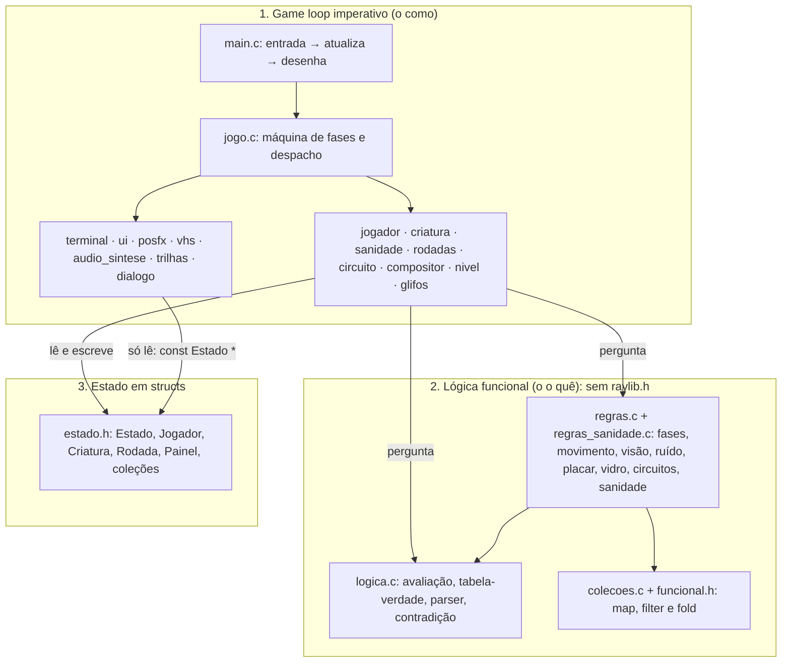

# PROJETO PRECURSOR

> **Nome provisório.** O título final ainda vai ser definido; para trocar, mudam só duas linhas em `src/config.h` (`TITULO_JOGO` e `TITULO_PROVISORIO`).

Terror em primeira pessoa: em 1985, numa base secreta do SNI, você é o lógico chamado para traduzir uma criatura cuja língua é lógica pura, e cada tradução certa a deixa mais perto de sair.


**Status:** jogável do menu aos dois finais, com história nova (professor ou professora, nome), sons gravados, filtro VHS com presets e sistema de sanidade. `make` compila sem avisos, `make test` passa 100% e `make smoke` joga a partida inteira sozinho. Compilado e testado no macOS (Apple Silicon, raylib 6.2) e no Linux (Fedora 44, raylib 5.5); o caminho do Windows segue o mesmo `Makefile` e o CMake, mas ainda precisa ser testado pela equipe.

## Contexto acadêmico

Projeto Integrador da disciplina **Programação Imperativa e Funcional (PIF)**, Aula 19 ("Projeto Integrador: um jogo em Raylib"), do Prof. Ronierison Maciel, CESAR School, 2026.2, ligado também ao desafio de **Lógica para Computação**. A tese dos slides guia a arquitetura: *o game loop imperativo orquestra (o "como"), a lógica em estilo funcional decide (o "o quê") e o estado em structs guarda tudo*. Aqui, o loop em `main.c` e `jogo.c` só orquestra; quem decide são funções puras (`regras.c`, `logica.c`) que não incluem a raylib e são testadas sem janela; e todo o estado mora numa `struct Estado`.

**Por que 3D?** Os slides descrevem um "jogo 2D", mas aceitam tema próprio "desde que respeite os requisitos". O terror pede primeira pessoa: o vidro entre o jogador e a criatura, os corredores escuros, o armário. Todos os requisitos (RF1 a RF6, RNF1 a RNF6) continuam cumpridos e apontados no código; a raylib desenha o 3D com as mesmas primitivas e o mesmo game loop.

## Conceito

- **Premissa:** Brasil, 14 de março de 1985, véspera da posse do primeiro presidente civil depois de 21 anos de ditadura. No Posto 7, uma base subterrânea do SNI na Serra do Roncador (MT), está contido desde 1977 um ser que o governo chama de Precursor. Um professor ou uma professora de lógica da USP (quem joga escolhe e diz o nome; sem nome, "Moura") é convocado à força para "traduzir" o que ele diz. A língua dele não tem palavras: é estrutura pura, verdadeiro e falso.
- **Gênero:** terror em primeira pessoa com quebra-cabeças de lógica e furtividade (sem combate).
- **Duração:** de 5 a 8 minutos, pensada para a feira de games: entende-se sem explicação e volta sozinha ao menu.
- **Mecânica central:** na sala de observação, acender as luzes da cela e ouvir o Precursor responder VERDADEIRO ou FALSO para decifrar cada conectivo pela tabela-verdade, e depois traduzir uma frase dele. Entre as rodadas, a energia cai e é preciso religar painéis de circuito nos corredores, fugindo dele e se escondendo nos armários. Quanto mais perto dele, mais a **sanidade** cai e mais a vista embaça e a imagem se degrada, como uma fita VHS gasta.
- **Dois finais:** no fim, o jogador monta e transmite uma frase. Um dos finais é vitória; o outro, derrota.

<details><summary>Spoilers</summary>

**O twist:** cada tradução correta ensina a nossa língua ao Precursor e enfraquece a contenção; a última frase traduzida é, literalmente, a chave da cela. **A solução do final bom** está no diário da Dra. Sampaio, no Arquivo: ele só consegue agir sobre o que *pode* ser verdade. Transmitir uma contradição, como `P E NÃO P` (`[VOCÊ FALAR] [E] [NÃO] [VOCÊ FALAR]`), o cala para sempre. Qualquer frase satisfazível (que pode ser verdadeira) o liberta.

</details>

## Como jogar

**Objetivo:** descobrir o que o Precursor diz, sobreviver às quedas de energia e, no fim, dar a resposta certa.

**Fases:** Intro ("Professor ou professora?", o nome — vazio vira "Moura" —, o texto datilografado e a carta do Gen. Varela pelo rádio) → Rodada 1 → Saída 1 (gerador) → Rodada 2 → Saída 2 (Arquivo) → Rodada 3 → Resposta final → Final → menu. Cada erro numa rodada racha o vidro; no 3º erro ele rompe e a rodada recomeça. Ser pego nos corredores recomeça a saída.

| Ação | Tecla |
| :---- | :---- |
| Andar | W A S D |
| Olhar | mouse |
| Correr (4 s de fôlego; faz barulho) | Shift |
| Interagir: console, painel, diário, armário (entrar e sair) | E |
| Lanterna: liga e desliga (sem bateria; apaga sozinha no armário) | F |
| Sair do terminal, do painel ou do diário; pausar | Esc |
| Luzes A e B da cela (no console) | 1 e 2 |
| Chaves A, B e C (painel 1) | 1, 2 e 3 |
| Escolher no terminal, nos painéis e nas fichas | setas e ENTER |
| Começo da intro: escolher professor ou professora; digitar o nome (até 16 letras, com acento), apagar, confirmar | setas · teclado · Backspace · ENTER |

**Teclas de debug:** F1 troca o filtro VHS (desligado, original, fita caseira, fita gasta, monitor CRT, câmera de vigilância; o nome aparece no canto) · F2 pula a fase · F3 mostra o estado e o caminho da criatura, a sanidade e a força do efeito · F5 reinicia a fase · F9 vai à resposta final · F12 salva uma captura em `docs/img/`. Para desligá-las, mude `#define TECLAS_DEBUG 1` para `0` em `src/config.h`; no modo feira (`--feira`) elas ficam desligadas sozinhas.

**Nome de quem joga (pensado para a feira):** fica só na memória, durante a partida. Entra nas falas pelos marcadores `{NOME}`, `{PROF}` e `{x|y}` de `dialogo.c` (sempre como "Professora Inês"), no alto do terminal e na tela final. Fora da partida, o nome só vai para um lugar: o ranking da feira (`ranking.txt`, na pasta do jogo e fora do git), com o placar, o tempo e o resultado, e aparece no menu (o 1º lugar) e na tabela do ranking. Isso foi decidido de propósito (decisão 101): quem joga no estande digita o nome para aparecer no ranking. A avaliação do jogo em estrelas vai para outro arquivo (`avaliacoes.csv`) sem nome. O nome não é impresso no terminal. Na memória, ele é apagado ao voltar ao menu (fim de jogo, pausa, inatividade no modo feira, partida nova) e ao fechar o jogo; recomeçar uma fase não o apaga. **Atenção:** uma captura (F12 ou `--captura`) das perguntas da intro, das legendas, do terminal ou da tela final grava o nome na imagem.

**Linha de comando:** `--feira` (sem SAIR no menu, sem debug, volta ao menu após 90 s sem ninguém mexer, inclusive nas perguntas da intro e na pausa) · `--mudo` · `--fase S2` (começa direto numa fase) · `--smoke` (pula as perguntas e usa o nome padrão) · `--captura arquivo.png --captura-em 2 [--captura-fase R1]` · `--exporta-sons pasta` (grava os sons sintetizados em WAV) · `--vhs N` (abre com o preset N do filtro VHS; 0 = desligado) · `--sanidade N` (começa com sanidade N, de 0 a 100, já com o efeito no ponto; para capturas) · `--vitrine-vhs [s]` (troca de preset sozinho a cada s segundos, padrão 4) · `--galeria-vhs pasta` (salva `pasta/vhs_<N>.png` com o mesmo quadro em cada preset e fecha; combine com `--fase S1 --captura-fase S1 --captura-em 5`).

**Escolher o filtro VHS:** rode `--galeria-vhs` (ou `--vitrine-vhs`) para comparar, depois mude `VHS_PRESET_PADRAO` em `src/config.h`. Os valores de cada preset ficam em `VHS_PRESETS`, uma linha por preset.

### Sanidade


A barra fixa no topo da tela mostra a **SANIDADE** em porcentagem. Ela é verde, fica âmbar abaixo de 60% e vermelha e pulsando abaixo de 30%; o pedaço que a criatura acabou de tirar aparece em vermelho escuro por um instante.

- **Cai** nos corredores quando o Precursor está a menos de 15 m, mais rápido quanto mais perto: cerca de 2 pontos por segundo na borda e 24 colado nele (de 100% a 0% em uns 4 s). Escondido no armário, cai pela metade.
- **Sobe devagar** enquanto se joga (0,8 ponto por segundo; nos corredores, só depois de 3 s longe dele) e **sobe bastante** ao concluir tarefas: +35 por rodada, +40 por saída e +10 por conectivo decifrado. Ser pego ou romper o vidro recomeça a fase com pelo menos 60%.
- **Na tela**, o efeito tem força proporcional ao que falta: 100% não tem nada, 20% tem 80% da força. É uma mistura de cansaço (a vista embaça em ondas lentas, mais nas bordas que no centro, a visão fecha em túnel e as cores desbotam) e fita VHS gasta (ruído em estrias horizontais, ruído de cor nas sombras, riscos claros e, abaixo de 25%, linhas que tremem). Mesmo com 0% o cenário, a criatura e os textos continuam visíveis.
- **Zerar não mata:** a criatura é a única ameaça. Como em Call of Cthulhu e Amnesia, a sanidade pesa sem encerrar a partida.

Os números ficam em `src/config.h` (`SANIDADE_*`) e as regras em `src/regras_sanidade.c` (puras e testadas). O efeito funciona com qualquer preset do VHS, inclusive desligado.

## Como compilar e rodar

### Windows (passo a passo para iniciantes)

1. Instale a **raylib 6.0** pelo instalador oficial para Windows (em [raylib.com](https://www.raylib.com)); ele traz o compilador **w64devkit**.
2. Coloque `C:\raylib\w64devkit\bin` no PATH do Windows e abra um terminal novo. Confira: `gcc --version` e `make --version` precisam responder.
3. Na pasta do projeto: `make` compila e `make run` abre o jogo (ou `build.bat` e `build.bat run`).

Se a raylib estiver em outra pasta: `make RAYLIB_PATH=C:/minha/raylib` (o `Makefile` procura `raylib.h` e `libraylib.a` em `RAYLIB_PATH/src`).

### Linux

Com a raylib 5.5 ou mais nova instalada e visível pelo `pkg-config raylib`: `make` e `make run` (ou `./build.sh run`). Se a sua distribuição tiver uma raylib mais antiga, use o CMake abaixo, que baixa a 6.0 (para compilar a raylib, instale antes `build-essential cmake libx11-dev libxrandr-dev libxinerama-dev libxcursor-dev libxi-dev libgl1-mesa-dev libasound2-dev`).

### macOS

`brew install raylib pkg-config`, depois `make` e `make run`.

### Alternativa: CMake (baixa a raylib se não estiver instalada)

```bash
cmake -B build
cmake --build build
ctest --test-dir build
cmake --build build --target smoke
```

### Testes

`make test` roda os testes sem janela; `make smoke` abre o jogo no piloto automático e joga a partida inteira pelos dois finais (sai com 0 ou 1). Detalhes na seção [Testes](#testes).

### Fonte com acentos (opcional)

Sem fonte externa, o jogo usa a fonte padrão da raylib e translitera os acentos (á → a). Para ver os acentos, rode `tools/baixa_fonte.sh` (ou `tools\baixa_fonte.bat`), que baixa a VT323 (licença OFL) para `assets/fontes/`.

### Texturas do mapa (opcional)

Paredes, piso, teto, móveis e portas têm texturas **geradas em código** quando o jogo abre (cerca de 0,1 s, uma vez só): concreto de forma com juntas, furos de tirante, escorridos e umidade; barrado de tinta oliva descascando; piso de granilite em placas; forro manchado; metal pintado com ferrugem; porta com almofadas. A mesma semente dá sempre a mesma imagem.

Para trocar uma delas, ponha um PNG em `assets/texturas/` com um destes nomes: `concreto.png`, `oliva.png`, `piso.png`, `teto.png`, `metal.png`, `porta.png`. Recomendado: 256 × 256 (o concreto, 512 × 256), sem emenda nas bordas, porque a textura se repete pelo mapa. Repetição: concreto a cada 6 m na horizontal e 3 m na vertical (presa ao teto: a parte de cima da imagem fica no teto); oliva a cada 3 m; piso e teto a cada 2 m; metal a cada 1 m; a porta estica a imagem na folha inteira. O `metal.png` deve ser cinza claro e neutro, porque cada móvel tinge o metal com a própria cor. Imagens fora de potência de 2, ou maiores que 1024 px, são redimensionadas ao carregar. Sem o arquivo (ou com um arquivo que não abre), o jogo usa a textura procedural e só registra no log.

### Problemas comuns

- **raylib não encontrada** (`raylib.h: No such file` ou `cannot find -lraylib`): confira o PATH e o `RAYLIB_PATH` no Windows, o `pkg-config raylib` no Linux e no macOS, ou use o CMake.
- **Texto sem acentos:** é o fallback sem fonte externa; rode `tools/baixa_fonte`.
- **Tela preta ou janela que fecha:** o jogo pede OpenGL 3.3; atualize o driver de vídeo. F1 troca o filtro VHS (o preset 0 é desligado). As mensagens do jogo no terminal começam com `PRECURSOR:`.
- **macOS, testes automáticos:** a janela só abre com a tela acordada (`caffeinate -u -t 5` antes do `make smoke`).

## Estrutura do projeto

```
Makefile                 build principal (Windows, Linux, macOS): make, run, test, smoke, readme-check, clean
CMakeLists.txt           alternativa com CMake e CTest (baixa a raylib 6.0 se precisar)
build.sh · build.bat     atalhos que só chamam o make
CLAUDE.md                regras para o Claude Code de cada membro da equipe
.clang-format            estilo do código
.gitignore · .gitattributes   arquivos ignorados · binários no Git LFS
src/main.c               game loop imperativo (entrada → atualiza → desenha), modo feira, --smoke
src/config.h             constantes ajustáveis: título, velocidades, tempos, VHS, sanidade, debug, capacidades, cores
src/estado.h             struct Estado: todo o estado do jogo
src/jogo.c/.h            aplica regras_proxima_fase e despacha atualiza/desenha por fase
src/logica.c/.h          motor de lógica proposicional (puro)
src/regras.c/.h          regras do jogo (puras)
src/regras_texto.c       regras puras de texto: marcadores do roteiro, nome digitado, legenda com defeito
src/regras_ranking.c     regras puras do ranking: lugar da partida, linha do arquivo <-> partida
src/regras_sanidade.c    regras da sanidade (puras): queda pela distância, recuperação, bônus, força do efeito
src/colecoes.c/.h        as 6 coleções: ruídos, partículas, rachaduras, eventos, interativos, paredes
src/funcional.h          fx_map, fx_filter_inplace, fx_fold
src/glifos.c/.h          os glifos da língua do Precursor e a projeção no vidro
src/rodadas.c/.h         dados e fluxo das 3 rodadas
src/terminal.c/.h        interface do ANALISADOR SEMÂNTICO SNI-85
src/manual.c/.h          o manual dos conectivos (lâmpada, ✓/✗, mini-tabela, cartão), do terminal e dos painéis
src/teclas.c/.h          a barra de teclas do rodapé e o minimapa do teclado (só as teclas que valem agora)
src/compositor.c/.h      resposta final por fichas e os dois finais
src/circuito.c/.h        painéis de circuito 1 e 2
src/nivel.c/.h           mapa ASCII → geometria, paredes, interativos e luzes
src/jogador.c/.h         câmera, movimento, fôlego, armário, mira
src/lanterna.c/.h        a lanterna: tecla F, luz em cone saindo dos olhos, modelo na mão
src/criatura.c/.h        o Precursor: IA, A*, placeholder procedural, captura
src/sanidade.c/.h        a sanidade a cada quadro e a barra no topo da tela
src/susto.c/.h           o jumpscare: o rosto do modelo pula até a câmera e treme; dura o trecho alto do som
src/dialogo.c/.h         todos os textos do jogo
src/audio_sintese.c/.h   sons curtos gerados em código (e substituição por .ogg, .wav ou .mp3)
src/trilhas.c/.h         sons longos gravados (assets/audio): trilha do menu, vozes, coração e passos
src/posfx.c/.h           render target, luz e névoa
src/vhs.c/.h             filtro VHS: shader, presets (F1), efeito de sanidade (cansaço + fita)
src/ui.c/.h              fonte com fallback, HUD, legendas, diário, pausa
src/menu.c/.h            a tela de início: título à esquerda, o Precursor à vista, opções em faixas, convite do ranking
src/tela_fim.c/.h        depois do final: desempenho, avaliação do jogo em estrelas e o ranking
src/ranking.c/.h         ranking.txt e avaliacoes.csv no disco do estande (nada no --smoke)
src/identidade.c/.h      "Professor ou professora?" e o nome, no começo da intro (só em memória, só na partida)
src/materiais.c/.h       desenho das texturas procedurais e UV de mundo (puro, testado sem janela)
src/texturas.c/.h        gera/carrega as texturas uma vez, libera ao sair; caixa e quadro texturizados
src/cenario.c/.h         ambientação sem colisão: placas, umidade, arrasto, eletrodutos, fios, halos
src/menu_inicial.c/.h    menu inicial com visual VHS/CRT (em desenvolvimento; teste visual: make test-menu)
tests/checagem.h         a macro CHECK
tests/test_logica.c      conectivos, classificações, parser, painéis
tests/test_regras.c      regras puras (inclusive sanidade) e coleções, com as bordas
tests/test_fluxo.c       partidas inteiras pela máquina de fases
tests/test_menu.c        teste visual do menu inicial (abre janela; não entra no make test)
assets/fontes/ · assets/modelos/ · assets/audio/ · assets/texturas/   opcionais (por enquanto, modelos/precursor.glb, modelos/lanterna.glb, audio/jumpscare.mp3 e os sons gravados em audio/; texturas: ver "Texturas do mapa")
docs/ESPECIFICACAO_PROJETO_PRECURSOR.md   a especificação (fonte da verdade do design)
docs/ARQUITETURA.md · docs/DECISOES.md · docs/PROGRESSO.md   arquitetura · decisões · progresso da v0
docs/img/                capturas de tela
tools/baixa_fonte.sh · tools/baixa_fonte.bat   baixam a fonte VT323 (opcional)
tools/check_readme_refs.sh   confere as referências do README (make readme-check)
```

## Arquitetura



**Puro × impuro.** As funções de `logica.c` e `regras.c` recebem dados e devolvem resultados: não leem teclado, não desenham, não tocam som, não usam globais nem `GetFrameTime()`, e não incluem `raylib.h` (só o `raymath.h`, que é só de cabeçalho). O mesmo vale para `regras_sanidade.c`. Por isso os três testes rodam sem janela. O lado impuro (`jogador.c`, `criatura.c`, `rodadas.c`...) coleta o que a raylib sabe (teclas, raycasts, colisões), pergunta às regras e aplica a resposta ao `Estado`; o desenho só lê (`const Estado *`). Um exemplo: `criatura.c` faz o raycast contra as paredes e o fold dos ruídos, e quem decide se ela patrulha, investiga, persegue ou procura é `regras_proximo_estado_criatura`. Mais detalhes em [docs/ARQUITETURA.md](docs/ARQUITETURA.md).

## Como o projeto atende ao que é cobrado

<!-- [REQ:RNF5] documentação: este README (seções na ordem pedida, tabelas e trechos conferidos por make readme-check), docs/ARQUITETURA.md, docs/DECISOES.md e CLAUDE.md -->
Cada trecho que cumpre um requisito tem, logo acima, um comentário-âncora `// [REQ:<ID>]`. As tabelas abaixo apontam o arquivo e as linhas; `make readme-check` confere se cada âncora citada está a no máximo 3 linhas da linha do link, se nenhum ID obrigatório ficou de fora e se os trechos de código copiados aqui são iguais aos do arquivo.

### Requisitos funcionais

| Requisito | Onde | Âncora | Como foi cumprido |
| :---- | :---- | :---- | :---- |
| RF1 Janela e game loop a 60 FPS com `GetFrameTime()` | [src/main.c#L504-L505](src/main.c#L504-L505)<br>[src/main.c#L440-L449](src/main.c#L440-L449)<br>[src/criatura.c#L270-L271](src/criatura.c#L270-L271) | `[REQ:RF1]` | `SetTargetFPS(60)`; `dt = GetFrameTime()` limitado a 0,05 s e passado a todo `xxx_atualiza`, que multiplica movimento, temporizadores e animações (aqui, o passo da criatura). |
| RF2 Controle do jogador por teclado/mouse | [src/main.c#L37-L73](src/main.c#L37-L73)<br>[src/jogador.c#L51-L69](src/jogador.c#L51-L69)<br>[src/jogador.c#L119-L127](src/jogador.c#L119-L127) | `[REQ:RF2]` | Câmera em 1ª pessoa pelo mouse; WASD, Shift (corrida com fôlego), E, 1/2/3, setas, ENTER e Esc, lidos uma vez por quadro numa `struct Entrada`. |
| RF3 Coleção (vetor) de múltiplos objetos | [src/estado.h#L292-L297](src/estado.h#L292-L297) | `[REQ:RF3]` | Seis coleções de capacidade fixa com contador (ruídos, partículas, rachaduras, eventos, interativos, paredes), sem `malloc` por quadro; ver a tabela de map, filter e fold. |
| RF4 Colisões com funções da Raylib | [src/jogador.c#L72-L79](src/jogador.c#L72-L79)<br>[src/colecoes.c#L186-L196](src/colecoes.c#L186-L196)<br>[src/colecoes.c#L145-L165](src/colecoes.c#L145-L165)<br>[src/criatura.c#L174-L175](src/criatura.c#L174-L175)<br>[src/criatura.c#L284-L291](src/criatura.c#L284-L291) | `[REQ:RF4]` | `CheckCollisionBoxes` (jogador × paredes, vidro, móveis e armários, eixo por eixo), `GetRayCollisionBox` (mira de interação e visão da criatura contra as paredes) e `CheckCollisionSpheres` (captura). |
| RF5 Placar, vidas, telas de início e fim | [src/jogo.c#L54-L59](src/jogo.c#L54-L59)<br>[src/menu.c#L166-L194](src/menu.c#L166-L194)<br>[src/tela_fim.c#L74-L105](src/tela_fim.c#L74-L105) | `[REQ:RF5]` | Placar = fold dos eventos; vidas = integridade do vidro (fold das rachaduras), recalculados a cada quadro; tela de início com o título, o gancho, as opções INICIAR, RANKING e SAIR, o convite do 1º lugar ("você pode ser o próximo") e o aviso de nome provisório, intro e tela de fim só com o principal: resultado, placar e lugar no ranking, mais a avaliação do jogo em estrelas. |
| RF6 Condição de vitória/derrota | [src/compositor.c#L61-L75](src/compositor.c#L61-L75)<br>[src/tela_fim.c#L74-L105](src/tela_fim.c#L74-L105) | `[REQ:RF6]` | A frase transmitida vai para `regras_avalia_transmissao`: contradição → final bom (VITÓRIA); satisfazível → final ruim (DERROTA); inválida → SINTAXE INVÁLIDA, sem penalidade. |

### Map, filter e fold nas coleções

Cada laço leva o comentário `// padrão MAP`, `// padrão FILTER` ou `// padrão FOLD`, e o filter compacta o próprio vetor (`v[j++] = v[i]`). As versões genéricas de `src/funcional.h` (`fx_map`, `fx_filter_inplace`, `fx_fold`, com `void*`, tamanho e ponteiro de função) são usadas em quatro lugares: no map e no filter das partículas, no filter dos interativos e no fold das paredes.

| Requisito | Onde | Âncora | Como foi cumprido |
| :---- | :---- | :---- | :---- |
| Ruídos: map | [src/colecoes.c#L24-L27](src/colecoes.c#L24-L27) | `[REQ:MAP-ruidos]` | A intensidade de cada ruído (passos, corrida, portas, painéis) cai com `dt`. |
| Ruídos: filter | [src/colecoes.c#L29-L34](src/colecoes.c#L29-L34) | `[REQ:FILTER-ruidos]` | Os ruídos esgotados saem do vetor por compactação. |
| Ruídos: fold | [src/colecoes.c#L37-L51](src/colecoes.c#L37-L51) | `[REQ:FOLD-ruidos]` | Escolhe o ruído percebido mais forte (atenuado pela distância por `regras_ruido_percebido`); é ele que leva a criatura a INVESTIGA. |
| Partículas: map | [src/colecoes.c#L87-L88](src/colecoes.c#L87-L88) | `[REQ:MAP-particulas]` | `fx_map` move e envelhece cada fagulha, poeira e fragmento. |
| Partículas: filter | [src/colecoes.c#L89-L90](src/colecoes.c#L89-L90) | `[REQ:FILTER-particulas]` | `fx_filter_inplace` remove as mortas e as que saíram do mapa. |
| Rachaduras: map | [src/colecoes.c#L101-L106](src/colecoes.c#L101-L106) | `[REQ:MAP-rachaduras]` | Anima o crescimento de cada rachadura (de 1 a 3 por erro). |
| Rachaduras: fold | [src/regras.c#L302-L312](src/regras.c#L302-L312) | `[REQ:FOLD-rachaduras]` | Soma o dano das rachaduras: a integridade do vidro são as vidas. |
| Eventos: fold | [src/regras.c#L276-L283](src/regras.c#L276-L283) | `[REQ:FOLD-eventos]` | O placar total é a soma dos eventos (rodada sem erro +100, erro −25, saída sem ser pego +50, bônus de tempo, final bom +200). |
| Eventos: filter + fold | [src/regras.c#L285-L295](src/regras.c#L285-L295) | `[REQ:FILTER-eventos]` | Os pontos por fase da tela de fim. Para a função continuar pura, o filter compacta uma cópia local dos eventos, não o vetor da partida. |
| Interativos: filter | [src/colecoes.c#L136-L139](src/colecoes.c#L136-L139) | `[REQ:FILTER-interativos]` | Ao entrar em cada fase, ficam só os interativos ativos nela (console nas rodadas, painéis e armários nas saídas...). |
| Interativos: fold | [src/colecoes.c#L145-L165](src/colecoes.c#L145-L165) | `[REQ:FOLD-interativos]` | Acha o mais próximo no campo de visão (`GetRayCollisionBox` na mira): é o que a tecla E aciona. |
| Paredes: fold | [src/colecoes.c#L186-L196](src/colecoes.c#L186-L196) | `[REQ:FOLD-paredes]` | "Colidiu com alguma?" é um fold com OU sobre `CheckCollisionBoxes` (`fx_fold`). |

### Funções puras e onde são testadas

| Requisito | Onde (função · teste) | Âncora | Como foi cumprido |
| :---- | :---- | :---- | :---- |
| `regras_nova_posicao` | [src/regras.c#L141-L150](src/regras.c#L141-L150)<br>[tests/test_regras.c#L15-L26](tests/test_regras.c#L15-L26) | `[REQ:PURA-regras_nova_posicao]` | Posição nova a partir da entrada, da velocidade e do `dt`; a diagonal não é mais rápida. |
| `regras_criatura_ve_jogador` | [src/regras.c#L152-L162](src/regras.c#L152-L162)<br>[tests/test_regras.c#L28-L38](tests/test_regras.c#L28-L38) | `[REQ:PURA-regras_criatura_ve_jogador]` | Cone de 70°, 14 m, resultado do raycast recebido pronto, invisível no armário. |
| `regras_ruido_percebido` | [src/regras.c#L164-L170](src/regras.c#L164-L170)<br>[tests/test_regras.c#L40-L48](tests/test_regras.c#L40-L48) | `[REQ:PURA-regras_ruido_percebido]` | O ruído enfraquece com a distância e some fora do raio. |
| `regras_proximo_estado_criatura` | [src/regras.c#L172-L187](src/regras.c#L172-L187)<br>[tests/test_regras.c#L50-L65](tests/test_regras.c#L50-L65) | `[REQ:PURA-regras_proximo_estado_criatura]` | PATRULHA → INVESTIGA → PERSEGUE → PROCURA (6 s) → PATRULHA. |
| `regras_postura_criatura` | [src/regras.c#L195-L206](src/regras.c#L195-L206)<br>[tests/test_regras.c#L67-L82](tests/test_regras.c#L67-L82) | `[REQ:PURA-regras_postura_criatura]` | Postura procedural no lugar da animação: corcunda que cresce com a velocidade, balanço da passada (zero parado) e respiração (só parado). |
| `regras_piscada_cela` | [src/regras.c#L217-L227](src/regras.c#L217-L227)<br>[tests/test_regras.c#L84-L101](tests/test_regras.c#L84-L101) | `[REQ:PURA-regras_piscada_cela]` | Lâmpada com defeito na cela apagada: piscada dupla a cada ~3 s (2,1 a 3,9 s, às vezes pula), sem `rand()`: repetível. |
| `regras_volumes_trilhas` | [src/regras.c#L230-L249](src/regras.c#L230-L249)<br>[tests/test_regras.c#L103-L143](tests/test_regras.c#L103-L143) | `[REQ:PURA-regras_volumes_trilhas]` | Volume de cada som longo a partir da situação: silêncio vence tudo; passo devagar ou rápido; coração nada além de 16 m, normal até 6 m e rápido abaixo. |
| `regras_quadro_susto` | [src/regras.c#L256-L273](src/regras.c#L256-L273)<br>[tests/test_regras.c#L145-L176](tests/test_regras.c#L145-L176) | `[REQ:PURA-regras_quadro_susto]` | O susto quadro a quadro: o rosto pula de 2,6 m até 0,2 m da câmera em 0,16 s e treme (posição e giro novos 40 vezes por segundo), com um clarão na chegada. Sem `rand()`: repetível. |
| `regras_placar` | [src/regras.c#L276-L283](src/regras.c#L276-L283)<br>[tests/test_regras.c#L178-L191](tests/test_regras.c#L178-L191) | `[REQ:PURA-regras_placar]` | Fold dos eventos (sem eventos, 0). |
| `regras_integridade_vidro` | [src/regras.c#L302-L312](src/regras.c#L302-L312)<br>[tests/test_regras.c#L209-L222](tests/test_regras.c#L209-L222) | `[REQ:PURA-regras_integridade_vidro]` | Vidas = máximo − fold do dano das rachaduras. |
| `regras_evento_do_erro` | [src/regras.c#L314-L317](src/regras.c#L314-L317)<br>[tests/test_regras.c#L202-L207](tests/test_regras.c#L202-L207) | `[REQ:PURA-regras_evento_do_erro]` | Só o 3º erro rompe o vidro e recomeça a rodada. |
| `regras_avaliar_circuito` | [src/regras.c#L378-L389](src/regras.c#L378-L389)<br>[tests/test_logica.c#L121-L138](tests/test_logica.c#L121-L138) | `[REQ:PURA-regras_avaliar_circuito]` | Avalia porta a porta (cada LED) com a semântica de `logica_aplica`; o Painel 2 tem exatamente duas soluções. |
| `regras_circuito_bloqueio` | [src/regras.c#L401-L418](src/regras.c#L401-L418)<br>[tests/test_logica.c#L157-L171](tests/test_logica.c#L157-L171) | `[REQ:PURA-regras_circuito_bloqueio]` | Da SAÍDA para trás, de porta apagada em porta apagada, acha a entrada que trava a corrente: o painel aponta esse ponto, uma pergunta por vez. |
| `regras_bonus_movimentos` | [src/regras.c#L420-L426](src/regras.c#L420-L426)<br>[tests/test_regras.c#L193-L200](tests/test_regras.c#L193-L200) | `[REQ:PURA-regras_bonus_movimentos]` | Painel resolvido com poucos movimentos vale bônus (metade com alguns a mais; nada para quem chuta). |
| `regras_ranking_insere` | [src/regras_ranking.c#L14-L26](src/regras_ranking.c#L14-L26)<br>[tests/test_regras.c#L464-L484](tests/test_regras.c#L464-L484) | `[REQ:PURA-regras_ranking_insere]` | Põe a partida no lugar dela: maior placar primeiro; empate, o mais rápido; empate total, quem chegou antes. Cheio (100), a pior sai. |
| `regras_ranking_le_linha` | [src/regras_ranking.c#L28-L45](src/regras_ranking.c#L28-L45)<br>[tests/test_regras.c#L486-L501](tests/test_regras.c#L486-L501) | `[REQ:PURA-regras_ranking_le_linha]` | Converte uma linha do `ranking.txt` em partida (e de volta); uma linha estragada é recusada sem derrubar o ranking. |
| `regras_proxima_fase` | [src/regras.c#L59-L87](src/regras.c#L59-L87)<br>[tests/test_fluxo.c#L25-L41](tests/test_fluxo.c#L25-L41) | `[REQ:PURA-regras_proxima_fase]` | A máquina de fases inteira: (fase, evento) → próxima fase. |
| `regras_avalia_transmissao` | [src/regras.c#L121-L134](src/regras.c#L121-L134)<br>[tests/test_fluxo.c#L44-L73](tests/test_fluxo.c#L44-L73) | `[REQ:PURA-regras_avalia_transmissao]` | Inválida, contradição (final bom) ou satisfazível (final ruim). |
| `regras_monta_texto` | [src/regras_texto.c#L56-L79](src/regras_texto.c#L56-L79)<br>[tests/test_regras.c#L304-L320](tests/test_regras.c#L304-L320) | `[REQ:PURA-regras_monta_texto]` | Troca `{NOME}`, `{PROF}` e `{x\ |
| `regras_nome_edita` | [src/regras_texto.c#L104-L129](src/regras_texto.c#L104-L129)<br>[tests/test_regras.c#L322-L350](tests/test_regras.c#L322-L350) | `[REQ:PURA-regras_nome_edita]` | Edita o nome digitado: letras com acento (UTF-8), Backspace, até 16 letras, maiúscula no começo de cada palavra, sem espaço sobrando. |
| `regras_falha_texto` | [src/regras_texto.c#L141-L158](src/regras_texto.c#L141-L158)<br>[tests/test_regras.c#L435-L462](tests/test_regras.c#L435-L462) | `[REQ:PURA-regras_falha_texto]` | A legenda do rádio falso falha de leve: em janelas curtas e irregulares, letras viram símbolos; repetível e sem quebrar acentos. |
| `regras_radio_falso` | [src/regras.c#L114-L118](src/regras.c#L114-L118)<br>[tests/test_fluxo.c#L158-L165](tests/test_fluxo.c#L158-L165) | `[REQ:PURA-regras_radio_falso]` | O plot twist: a partir da S2, quem fala no rádio é o Precursor imitando o Varela (troca as falas de pego, vidro e porta pela versão falsa). |
| `regras_sanidade_passo` | [src/regras_sanidade.c#L15-L28](src/regras_sanidade.c#L15-L28)<br>[tests/test_regras.c#L503-L523](tests/test_regras.c#L503-L523) | `[REQ:SANIDADE]` | Um quadro de sanidade: cai a menos de 15 m da criatura (de 1,5× a 2× mais rápido quanto mais perto, metade no armário) e só volta a subir depois de 3 s longe dela; nas rodadas, sobe sempre devagar. Os bônus e a força do efeito (1 − sanidade/100) também são funções puras, testadas em seguida. |
| `logica_avalia` | [src/logica.c#L56-L65](src/logica.c#L56-L65)<br>[tests/test_logica.c#L24-L35](tests/test_logica.c#L24-L35) | `[REQ:PURA-logica_avalia]` | Avalia a árvore da frase para uma valoração das luzes; é daqui que saem as respostas do Precursor. |
| `logica_eh_contradicao` | [src/logica.c#L99-L102](src/logica.c#L99-L102)<br>[tests/test_logica.c#L37-L58](tests/test_logica.c#L37-L58) | `[REQ:PURA-logica_eh_contradicao]` | Nenhuma linha da tabela-verdade é verdadeira (a chave do final bom). |
| `logica_parse_fichas` | [src/logica.c#L249-L258](src/logica.c#L249-L258)<br>[tests/test_logica.c#L65-L100](tests/test_logica.c#L65-L100) | `[REQ:PURA-logica_parse_fichas]` | Fichas → árvore, com precedência ¬ > ∧ > ∨ > → > ↔ e mensagem amigável no erro. |

### Requisitos não funcionais

| Requisito | Onde | Âncora | Como foi cumprido |
| :---- | :---- | :---- | :---- |
| RNF1 Legibilidade | [.clang-format#L1-L12](.clang-format#L1-L12) | `[REQ:RNF1]` | Nomes em português, claros e consistentes (`atualiza_…`, `desenha_…`, `colidiu_…`); funções de até ~40 linhas (a única exceção, em `audio_sintese.c`, está comentada); o código segue o `.clang-format` (`clang-format --dry-run` sem avisos). |
| RNF2 Modularização | [src/estado.h#L253-L305](src/estado.h#L253-L305) | `[REQ:RNF2]` | Uma struct por objeto, uma função por responsabilidade, um módulo por sistema; o maior arquivo tem menos de 500 linhas. |
| RNF3 Separação update/render | [src/main.c#L339-L351](src/main.c#L339-L351) | `[REQ:RNF3]` | Todo módulo tem `xxx_atualiza(Estado *e, float dt)` e `xxx_desenha(const Estado *e)`; o `const` garante que desenhar não muda nada; nenhum `Draw*` em `*_atualiza` (auditado com grep). |
| RNF4 Robustez | [src/colecoes.c#L9-L14](src/colecoes.c#L9-L14)<br>[src/main.c#L440-L449](src/main.c#L440-L449)<br>[src/nivel.c#L38-L42](src/nivel.c#L38-L42)<br>[src/ui.c#L30-L57](src/ui.c#L30-L57)<br>[src/criatura.c#L24-L40](src/criatura.c#L24-L40) | `[REQ:RNF4]` | Vetor cheio descarta com `TraceLog`, sem travar; listas vazias (sem ruídos, sem eventos) testadas; `dt` limitado; fora do mapa conta como parede; sem fonte, som ou modelo, entra o placeholder. |
| RNF5 Documentação | [README.md#L211-L211](README.md#L211-L211) | `[REQ:RNF5]` | Este README, `docs/ARQUITETURA.md`, `docs/DECISOES.md` (as escolhas e por quê), `docs/PROGRESSO.md` e `CLAUDE.md`. |
| RNF6 Versionamento + Makefile | [Makefile#L1-L2](Makefile#L1-L2) | `[REQ:RNF6]` | `Makefile` como build principal (com `test`, `smoke`, `readme-check`); um commit por marco na v0 (M0 a M9) e, daqui em diante, branch por card e PR (ver Metodologia). |

### Critérios de avaliação

| Critério | Onde | Âncora | Como foi cumprido |
| :---- | :---- | :---- | :---- |
| Jogo funcional e jogável (25%) | [Requisitos funcionais](#requisitos-funcionais): as linhas RF1 a RF6<br>[Testes](#testes): `make smoke` | RF1–RF6 | Do menu aos dois finais; o `make smoke` joga a partida inteira duas vezes, inclusive com erro, vidro rompido e captura. |
| Padrões funcionais na lógica (25%) | [Map, filter e fold](#map-filter-e-fold-nas-coleções): as 12 linhas<br>[Funções puras](#funções-puras-e-onde-são-testadas): as 20 linhas<br>[A lógica proposicional no jogo](#a-lógica-proposicional-no-jogo) | MAP, FILTER, FOLD, PURA | Seis coleções com map/filter/fold de verdade na jogabilidade, `funcional.h` genérico, regras e lógica puras e testadas. |
| Raylib e C (20%) | [Requisitos funcionais](#requisitos-funcionais): as linhas RF1 e RF4<br>[Requisitos não funcionais](#requisitos-não-funcionais): a linha RNF3<br>[Trechos do código final](#trechos-do-código-final): game loop e colisão | RF1, RF4, RNF3 | C99, colisões e raycasts da raylib, render target, shaders de luz/névoa e VHS (com o efeito de sanidade), áudio gerado em código e trilhas gravadas por streaming. |
| Qualidade do código (15%) | [Requisitos não funcionais](#requisitos-não-funcionais): as linhas RNF1 a RNF4 | RNF1–RNF4 | Estilo único, módulos pequenos, `const` no desenho, robustez nas bordas, `-Wall -Wextra` sem avisos. |
| Documentação e versionamento (10%) | [Requisitos não funcionais](#requisitos-não-funcionais): as linhas RNF5 e RNF6<br>[Metodologia e versionamento](#metodologia-e-versionamento) | RNF5, RNF6 | Este README conferido por `make readme-check`, docs, `Makefile`, fluxo Git. |
| Apresentação (5%) | [Conceito](#conceito) e [Como jogar](#como-jogar) | — | Atmosfera (VHS, luz e névoa, som, sanidade que degrada a imagem), partidas curtas, modo feira com volta automática ao menu. |

### Trechos do código final

**O game loop (RF1):** `dt` limitado e o quadro entrada → atualiza → desenha.

```c
// src/main.c#L439-L449
static void quadro(Estado *e) {
    // [REQ:RF1] [REQ:RNF4] dt de GetFrameTime() limitado a DT_MAXIMO; no smoke, passo fixo (velocidade
    // acelerada)
    float dt = e->modo_smoke ? DT_MAXIMO : GetFrameTime();
    if (dt > DT_MAXIMO) dt = DT_MAXIMO;
    if (e->modo_smoke)
        piloto_entrada(e, &e->in, dt);
    else
        le_entrada(&e->in);
    atualiza(e, dt);
    desenha(e);
```

**Uma colisão com a raylib (RF4):** a captura pela criatura, com `CheckCollisionSpheres`.

```c
// src/criatura.c#L284-L291
// [REQ:RF4] captura com CheckCollisionSpheres: duas esferas de 0,8 m (pego quando a distância < 1,6 m)
static void tenta_capturar(Estado *e) {
    const Criatura *c = &e->cri;
    if (e->jog.modo == MODO_ARMARIO || susto_ativo(e)) return;
    Vector3 corpo_c = {c->pos.x, 1.0f, c->pos.z}, corpo_j = {e->jog.pos.x, 1.0f, e->jog.pos.z};
    if (CheckCollisionSpheres(corpo_c, CRIATURA_RAIO_CAPTURA, corpo_j, CRIATURA_RAIO_CAPTURA))
        criatura_captura(e);
}
```

**O placar (RF5):** dois folds recalculados a cada quadro.

```c
// src/jogo.c#L54-L59
// [REQ:RF5] placar = fold dos eventos; vidas = integridade do vidro (fold das rachaduras).
// Recalculados a cada quadro, para o HUD e o terminal mostrarem o erro na hora.
static void atualiza_folds(Estado *e) {
    e->vidas = regras_integridade_vidro(e->rachaduras.itens, e->rachaduras.n, VIDAS_VIDRO);
    e->placar = regras_placar(e->eventos.itens, e->eventos.n);
}
```

**Um map e um filter (ruídos):** a intensidade cai com `dt` e os esgotados saem por compactação.

```c
// src/colecoes.c#L23-L35
void col_ruidos_atualiza(ColRuidos *c, float dt) {
    // [REQ:MAP-ruidos] cada ruído perde intensidade com o tempo (multiplicado por dt)
    // padrão MAP
    for (int i = 0; i < c->n; i++)
        c->itens[i].intensidade -= RUIDO_DECAIMENTO * dt;

    // [REQ:FILTER-ruidos] remove os ruídos esgotados, compactando o vetor
    int j = 0;
    // padrão FILTER
    for (int i = 0; i < c->n; i++)
        if (c->itens[i].intensidade > 0.0f) c->itens[j++] = c->itens[i];
    c->n = j;
}
```

**Um fold (ruídos):** o ruído percebido mais forte, que leva a criatura a INVESTIGA.

```c
// src/colecoes.c#L37-L51
// [REQ:FOLD-ruidos] escolhe o ruído percebido mais forte (atenuado pela distância); −1 se não houver nenhum
int col_ruidos_mais_forte(const ColRuidos *c, Vector3 ouvinte, float *intensidade) {
    int melhor = -1;
    float maior = 0.0f;
    // padrão FOLD
    for (int i = 0; i < c->n; i++) {
        float percebido = regras_ruido_percebido(c->itens[i], ouvinte);
        if (percebido > maior) {
            maior = percebido;
            melhor = i;
        }
    }
    if (intensidade != NULL) *intensidade = maior;
    return melhor;
}
```

**Uma função pura e o teste dela:** a integridade do vidro.

```c
// src/regras.c#L302-L312
// [REQ:FOLD-rachaduras] [REQ:PURA-regras_integridade_vidro] vidas = máximo − soma (fold) do dano das
// rachaduras
int regras_integridade_vidro(const Rachadura *rachaduras, int n, int vidas_max) {
    float dano = 0.0f;
    // padrão FOLD
    for (int i = 0; i < n; i++)
        dano += rachaduras[i].dano;
    int vidas = vidas_max - (int)floorf(dano + 0.01f);
    if (vidas < 0) return 0;
    return vidas > vidas_max ? vidas_max : vidas;
}
```

```c
// tests/test_regras.c#L209-L222
// [REQ:PURA-regras_integridade_vidro] testa as vidas depois de 0, 1, 2 e 3 erros
static void testa_vidro(void) {
    CHECK(regras_integridade_vidro(NULL, 0, VIDAS_VIDRO) == 3); // sem rachaduras
    Rachadura r[6] = {0};
    r[0].dano = 0.5f;
    r[1].dano = 0.5f; // 1º erro em duas rachaduras
    CHECK(regras_integridade_vidro(r, 2, VIDAS_VIDRO) == 2);
    r[2].dano = 1.0f / 3.0f;
    r[3].dano = 1.0f / 3.0f;
    r[4].dano = 1.0f / 3.0f; // 2º erro em três rachaduras
    CHECK(regras_integridade_vidro(r, 5, VIDAS_VIDRO) == 1);
    r[5].dano = 1.0f;
    CHECK(regras_integridade_vidro(r, 6, VIDAS_VIDRO) == 0); // 3º erro: o vidro rompe
}
```

**Desenhar só lê o estado (RNF3):**

```c
// src/main.c#L339-L351
// [REQ:RNF3] desenhar recebe const Estado *: não muda nada; o loop é entrada → atualiza → desenha
static void desenha(const Estado *e) {
    susto_prepara(e); // o rosto do susto, na textura dele
    posfx_inicia_cena(e);
    jogo_desenha_cena(e);
    posfx_termina_cena(e);

    BeginDrawing();
    ClearBackground(BLACK);
    posfx_desenha(e);
    jogo_desenha_interface(e);
    vhs_desenha(e);
    EndDrawing();
```

## A lógica proposicional no jogo

| Conceito | Onde | Âncora | Mecânica |
| :---- | :---- | :---- | :---- |
| Conectivos ¬ ∧ ∨ → ↔ | [src/logica.c#L33-L50](src/logica.c#L33-L50) | `[REQ:PURA-logica_aplica]` | A semântica de cada conectivo, num lugar só; os painéis (OU-EXCLUSIVO = ¬(A ↔ B), NÃO-E = ¬(A ∧ B)) usam a mesma. |
| Valoração | [src/logica.c#L56-L65](src/logica.c#L56-L65) | `[REQ:PURA-logica_avalia]` | As luzes A e B são os átomos; ao mudar as luzes, o Precursor responde com o valor da frase. |
| Tabela-verdade | [src/logica.c#L72-L82](src/logica.c#L72-L82) | `[REQ:PURA-logica_tabela_verdade]` | O terminal preenche uma linha por combinação; o padrão revela o conectivo (NÃO, E, OU, SE…ENTÃO). |
| Sintaxe e precedência | [src/logica.c#L249-L258](src/logica.c#L249-L258) | `[REQ:PURA-logica_parse_fichas]` | A resposta final é montada com fichas; frases mal formadas dão SINTAXE INVÁLIDA com a explicação. |
| Contradição e satisfatibilidade | [src/logica.c#L99-L102](src/logica.c#L99-L102)<br>[src/regras.c#L121-L134](src/regras.c#L121-L134) | `[REQ:PURA-logica_eh_contradicao]` `[REQ:PURA-regras_avalia_transmissao]` | Uma frase que nunca pode ser verdadeira (P ∧ ¬P) cala o Precursor; qualquer frase satisfazível (até uma tautologia, P ∨ ¬P) o liberta. |
| Circuitos lógicos | [src/regras.c#L378-L389](src/regras.c#L378-L389) | `[REQ:PURA-regras_avaliar_circuito]` | Painel 1: (A ∧ ¬B) ∧ C; Painel 2: escolher as portas para a saída bater com A → B (prenúncio da R3). |

O trecho que avalia a frase para as luzes atuais:

```c
// src/logica.c#L56-L65
// [REQ:PURA-logica_avalia] avalia a árvore para uma valoração dos átomos (recursiva, sem efeitos)
bool logica_avalia(const PoolLogico *pool, int raiz, const bool *valores) {
    if (!no_valido(pool, raiz)) return false;
    const NoLogico *no = &pool->nos[raiz];
    if (no->op == OP_ATOMO) return valores[no->atomo];
    bool a = logica_avalia(pool, no->esq, valores);
    if (no->op == OP_NAO) return logica_aplica(OP_NAO, a, false);
    bool b = logica_avalia(pool, no->dir, valores);
    return logica_aplica(no->op, a, b);
}
```

## Testes

**`make test`** roda três programas sem janela, com a macro `CHECK` (sem framework):

- `test_logica`: as tabelas dos 5 conectivos; `P ∧ ¬P` contradição; `P ∨ ¬P` tautologia; `P → Q` satisfazível e não tautologia; o parser (precedência ¬ > ∧ > ∨ > → > ↔, associatividade, erros); as duas soluções do Painel 2 e a solução única do Painel 1; o pool cheio.
- `test_regras`: movimento, visão, ruído percebido, estados da criatura, placar e placar por fase, vidro e a regra do 3º erro, volume das trilhas, montagem dos textos com nome e gênero, edição do nome, a sanidade (queda pela distância, armário, espera da recuperação, bônus, piso no recomeço e força linear do efeito) e as coleções nas bordas: lista vazia, vetor cheio, ruído esgotado, criatura sem ruídos, placar sem eventos, partículas fora do mapa, colisão e mira.
- `test_fluxo`: partidas inteiras só com `regras_proxima_fase` e eventos: acertar tudo e transmitir uma contradição chega ao FIM_BOM; uma frase satisfazível chega ao FIM_RUIM; 3 erros reiniciam a rodada; ser pego reinicia a saída; uma partida com esses tropeços no meio ainda chega ao fim; eventos fora de hora são ignorados.

**`make test-menu`** (ou `./build/test_menu` no CMake) abre só o menu inicial VHS/CRT, para conferir o visual. Ele tem janela, então fica fora do `make test` e do `ctest`. O arquivo fica em `tests/` (não em `src/`) porque tem o próprio `main()`: em `src/` ele entrava no executável do jogo pelo CMake e o link falhava com "múltiplas definições de main".

```
test_logica   37/37  checagens ok
test_regras  173/173 checagens ok
test_fluxo    57/57  checagens ok
```

**`make smoke`** abre o jogo e o joga sozinho em velocidade acelerada, duas vezes (final ruim e final bom), com as mesmas teclas do jogador. A cada troca de fase confere a sequência contra `regras_roteiro_partida` (o mesmo roteiro do `test_fluxo`); no caminho, anda até o vidro para conferir a colisão, erra três vezes na R3 (o vidro rompe e a rodada recomeça), fica parado no corredor fazendo barulho até a criatura ouvir, ver e pegar, entra e sai de um armário, lê o diário e transmite primeiro uma frase inválida. Sai com 0, ou com 1 e a fase onde travou. A semente do sorteio é fixa, então o resultado é sempre o mesmo.

```
SMOKE  partida 1: MENU -> INTRO
SMOKE  partida 1: INTRO -> R1
SMOKE  nome ok: perguntas puladas, nome padrão em uso
SMOKE  partida 1: R1 -> S1
SMOKE  colisão ok: andou até z=7.62 e parou antes do vidro (z=7.00)
SMOKE  partida 1: S1 -> R2
SMOKE  partida 1: R2 -> S2
SMOKE  criatura ok: ouviu (INVESTIGA), viu (PERSEGUE) e pegou; a saída recomeça
SMOKE  partida 1: S2 recomeçou (0 erro(s) na fase)
SMOKE  partida 1: S2 -> R3
SMOKE  partida 1: R3 recomeçou (3 erro(s) na fase)
SMOKE  partida 1: R3 -> RESPOSTA_FINAL
SMOKE  partida 1: RESPOSTA_FINAL -> FIM_RUIM
SMOKE  partida 1: FIM_RUIM -> MENU
SMOKE  nome ok: buffer zerado no menu
SMOKE  partida 2: MENU -> INTRO
SMOKE  partida 2: INTRO -> R1
SMOKE  nome ok: perguntas puladas, nome padrão em uso
SMOKE  partida 2: R1 -> S1
SMOKE  armário ok: entrou e saiu
SMOKE  partida 2: S1 -> R2
SMOKE  partida 2: R2 -> S2
SMOKE  partida 2: S2 -> R3
SMOKE  partida 2: R3 -> RESPOSTA_FINAL
SMOKE  partida 2: RESPOSTA_FINAL -> FIM_BOM
SMOKE  partida 2: FIM_BOM -> MENU
SMOKE  nome ok: buffer zerado no menu
SMOKE OK: a partida foi jogada até os dois finais.
```

## Metodologia e versionamento

- **`main`** guarda só versões estáveis: recebe merge da `develop` ao fim de cada etapa (E1 a E4) e na build da feira.
- **`develop`** é a branch de integração. Ninguém commita direto na `main` nem na `develop`.
- **Uma branch por card**, criada a partir da `develop` (`feat/S2-05-ia-precursor`, `fix/BUG-03-armario`), com commits pequenos no padrão `tipo: descrição`. Antes do PR: `git pull --rebase origin develop`, `make`, `make test` e `make smoke`.
- **Pull request** para a `develop`, revisado por um colega. Binários (`.png`, `.ogg`, `.ttf`, `.glb`) vão pelo Git LFS.
- **Kanban no monday.com:** cada card tem um código (`S2-05`); ao começar, o card vai para *Fazendo*; ao terminar, para *Revisão*, com um update (o que foi feito, arquivos, branch/commit, como testar, próximos passos). Só humanos movem para *Feito*, depois de revisar o PR. Defeitos viram cards `BUG-`.
- **Etapas E1 a E4:** cada etapa dos slides termina com um PR da `develop` para a `main`, revisado, que vira uma versão estável.
- **Como a v0 foi feita:** em 10 marcos (M0 a M9), cada um verificado (`make` sem avisos, `make test`, `make smoke`) e registrado num commit na `develop`. O registro de cada marco está em [docs/PROGRESSO.md](docs/PROGRESSO.md) e as escolhas em [docs/DECISOES.md](docs/DECISOES.md). O `CLAUDE.md` mantém o Claude Code de cada membro da equipe seguindo estas regras.

## Créditos e licenças

- **raylib**, de Ramon Santamaria e colaboradores, licença zlib/libpng: [raylib.com](https://www.raylib.com). Não vem copiada no repositório.
- **Fonte VT323** (opcional), de Peter Hull, licença SIL Open Font License 1.1: [fonts.google.com/specimen/VT323](https://fonts.google.com/specimen/VT323). É baixada por `tools/baixa_fonte` e não vem no repositório.
- **Modelo 3D do Precursor** (`assets/modelos/precursor.glb`): *"Gaunt Horror Creature – Free Creepy 3D Model"* by **Purple.Point**, publicado no Sketchfab, licensed under [Creative Commons Attribution 4.0 (CC BY 4.0)](https://creativecommons.org/licenses/by/4.0/). <!-- colar aqui o link da página do modelo no Sketchfab --> Alteração feita pela equipe: as texturas JPEG embutidas foram convertidas para PNG (a raylib padrão não lê JPEG); a geometria não foi alterada. Sem o arquivo, o jogo usa o corpo procedural.
- **Modelo 3D da lanterna** (`assets/modelos/lanterna.glb`): *"Lowpoly Flashlight (Lanterna)"* by **EnrycoDosSantos**, publicado no Sketchfab, licensed under [Creative Commons Attribution 4.0 (CC BY 4.0)](https://creativecommons.org/licenses/by/4.0/). <!-- colar aqui o link da página do modelo no Sketchfab --> Usado sem alterações. Sem o arquivo, o jogo desenha uma lanterna de cilindros.
- **Sons gravados** (`assets/audio/`: trilha do menu, voz do Precursor, voz do rádio, coração e passos): reunidos pela equipe. <!-- preencher: origem (site/autor) e licença de cada som --> A trilha do menu foi amplificada 5× e os arquivos foram convertidos para WAV de 16 bits quando preciso.
- **Função de ruído do shader VHS** (`hash12` de *"Hash without Sine"*), de **Dave Hoskins**, licença MIT: [shadertoy.com/view/4djSRW](https://www.shadertoy.com/view/4djSRW). Adaptada em `src/vhs.c`.
- **Sons curtos, glifos e texturas do mapa:** gerados em código pela equipe. Se outro asset for adicionado em `assets/`, credite-o aqui.
- **Equipe:** <!-- preencher: nome e usuário do GitHub de cada integrante -->
