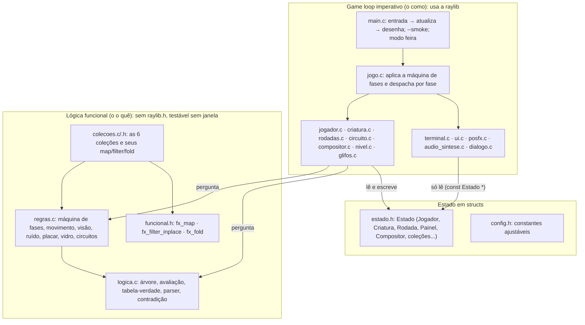
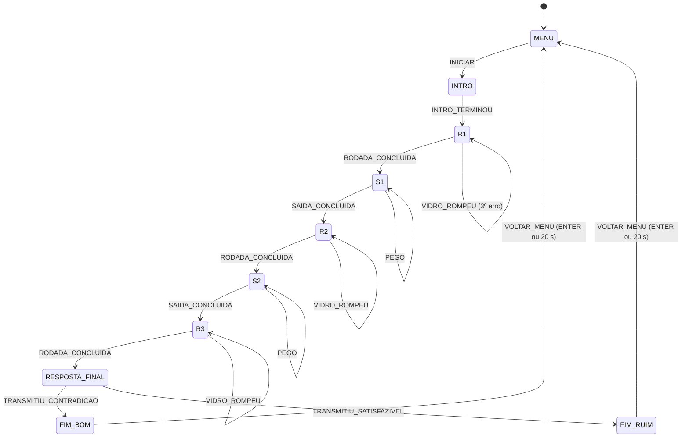

# Arquitetura

A tese dos slides guia o código: **o game loop imperativo orquestra (o "como"), a lógica em estilo funcional decide (o "o quê") e o estado em structs guarda tudo.** Cada camada mora em arquivos diferentes, e a fronteira é visível nos `#include`: a camada de decisão não inclui `raylib.h`.

## Um quadro

1. **Entrada** (`main.c`): lê teclado e mouse uma vez e preenche `Estado.in`. No `--smoke`, quem preenche é o piloto automático; o resto do jogo não sabe a diferença.
2. **Atualiza** (`jogo_atualiza` e os `xxx_atualiza(Estado *e, float dt)`): cada módulo muda o estado e, quando a fase precisa mudar, só **pede** um evento (`e->evento = EV_RODADA_CONCLUIDA`). No fim do quadro, `jogo_aplica_evento` pergunta à função pura `regras_proxima_fase(fase, evento)` qual é a próxima fase e prepara o mundo. O `dt` vem de `GetFrameTime()`, limitado a 0,05 s, e multiplica todo movimento, temporizador e animação.
3. **Desenha** (`xxx_desenha(const Estado *e)`): o `const` garante que desenhar não muda o estado. A cena 3D vai para um render target a 60% da janela (`posfx.c`), recebe luz e névoa por shader e o filtro VHS; a interface (terminal, painéis, HUD, legendas) é desenhada por cima, na resolução da janela.

## Puro × impuro

| Puro (sem efeitos, testado em `tests/`) | Impuro (efeitos: tela, som, entrada) |
| :---- | :---- |
| `logica.c`: `logica_avalia`, `logica_tabela_verdade`, `logica_eh_contradicao`, `logica_parse_fichas` | `rodadas.c` converte os glifos em fichas e pergunta à lógica o valor de cada linha |
| `regras.c`: `regras_proxima_fase`, `regras_nova_posicao`, `regras_criatura_ve_jogador`, `regras_ruido_percebido`, `regras_proximo_estado_criatura`, `regras_placar`, `regras_integridade_vidro`, `regras_avaliar_circuito` | `jogador.c`, `criatura.c`, `circuito.c`, `compositor.c`, `jogo.c` aplicam as respostas ao estado |
| `funcional.h` e os laços de `colecoes.c` (o `TraceLog` do vetor cheio é o único efeito) | `nivel.c`, `glifos.c`, `terminal.c`, `ui.c`, `posfx.c`, `audio_sintese.c` desenham e tocam |

Por exemplo, a criatura: `criatura.c` faz o raycast contra as paredes (`GetRayCollisionBox`) e o fold dos ruídos, monta uma `PercepcaoCriatura` e entrega a `regras_proximo_estado_criatura`, que decide PATRULHA, INVESTIGA, PERSEGUE ou PROCURA. O caminho sai de um A* na grade do mapa.

## Máquina de fases

## Módulos

| Arquivo | Responsabilidade |
| :---- | :---- |
| `main.c` | janela, game loop, leitura da entrada, capturas, `--smoke` (piloto automático) |
| `jogo.c` | aplica `regras_proxima_fase`, prepara cada fase, pontua, pausa, debug, modo feira |
| `config.h` · `estado.h` | constantes · todo o estado do jogo |
| `logica.c` · `regras.c` · `funcional.h` · `colecoes.c` | a camada pura |
| `nivel.c` | mapa ASCII → paredes, móveis, interativos, luzes; desenho do Posto 7 |
| `jogador.c` | câmera, movimento com colisão, fôlego, passos, armário, mira |
| `criatura.c` | o Precursor: corpo procedural, IA, A*, captura, susto |
| `rodadas.c` · `terminal.c` · `glifos.c` | as 3 rodadas (o ENTER decide), o analisador SNI-85 (setas e Esc), a língua dos glifos |
| `circuito.c` | os painéis 1 e 2 |
| `compositor.c` | a resposta final por fichas e os dois finais |
| `dialogo.c` | todos os textos |
| `audio_sintese.c` | os sons gerados em código |
| `posfx.c` | render target, luz e névoa, VHS |
| `ui.c` | fonte com fallback, menu, HUD, legendas, diário, tela de fim |

Módulos sem nada para desenhar (`audio_sintese.c`) ou puros (`logica.c`, `regras.c`, `colecoes.c`, `dialogo.c`) não têm `xxx_desenha`.

## Como estender

- **Nova fala ou texto:** só `src/dialogo.c`.
- **Novo som:** um caso em `sintetiza()` (`src/audio_sintese.c`) e um nome em `NOMES`; um `.ogg` com o mesmo nome em `assets/audio/` substitui.
- **Mudar o mapa:** edite o texto ASCII em `src/nivel.c`. Paredes, colisão, interativos e o A* saem dele.
- **Nova regra de jogo:** escreva a função pura em `regras.c`, teste em `tests/test_regras.c` e chame do módulo impuro.
- **Nova fase:** um valor em `Fase`, as transições em `regras_proxima_fase` (com teste em `test_fluxo.c`), a preparação em `entra_fase` (`jogo.c`) e o roteiro em `regras_roteiro_partida` para o smoke continuar jogando a partida inteira.
