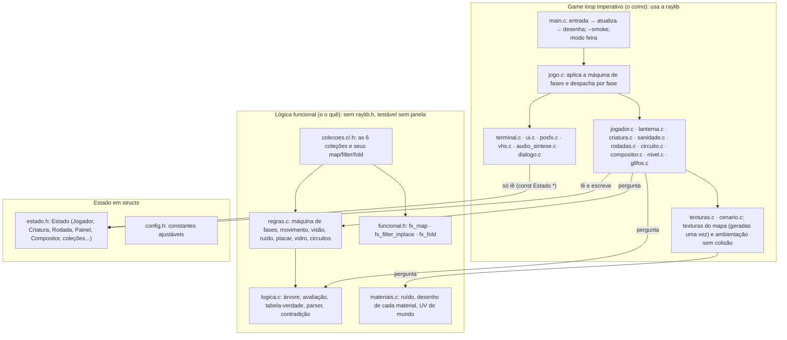

# Arquitetura

A tese dos slides guia o código: **o game loop imperativo orquestra (o "como"), a lógica em estilo funcional decide (o "o quê") e o estado em structs guarda tudo.** Cada camada mora em arquivos diferentes, e a fronteira é visível nos `#include`: a camada de decisão não inclui `raylib.h`.



## Um quadro

1. **Entrada** (`main.c`): lê teclado e mouse uma vez e preenche `Estado.in`. No `--smoke`, quem preenche é o piloto automático; o resto do jogo não sabe a diferença.
2. **Atualiza** (`jogo_atualiza` e os `xxx_atualiza(Estado *e, float dt)`): cada módulo muda o estado e, quando a fase precisa mudar, só **pede** um evento (`e->evento = EV_RODADA_CONCLUIDA`). No fim do quadro, `jogo_aplica_evento` pergunta à função pura `regras_proxima_fase(fase, evento)` qual é a próxima fase e prepara o mundo. O `dt` vem de `GetFrameTime()`, limitado a 0,05 s, e multiplica todo movimento, temporizador e animação. `sanidade_atualiza` roda logo depois de `criatura_atualiza` (usa a distância deste quadro para a queda e o grão); os bônus de sanidade das tarefas entram em `jogo_aplica_evento`, junto com o placar. A barra (`sanidade_desenha`) é desenhada na interface, depois do shader; o grão vai para o shader do VHS.
3. **Desenha** (`xxx_desenha(const Estado *e)`): o `const` garante que desenhar não muda o estado. A cena 3D vai para um render target a 60% da janela (`posfx.c`), recebe luz e névoa por shader e o filtro VHS (`vhs.c`); a interface (terminal, painéis, HUD, legendas) é desenhada por cima, na resolução da janela.
   Dentro do shader de luz, a ordem é: `nivel_desenha` (piso, teto, paredes em passadas por material, móveis) → `cenario_desenha` (eletrodutos, grelhas, fios e, por último, os decalques com alfa, sem escrever profundidade) → criatura → lanterna. Fora do shader, `nivel_desenha_emissivos` desenha as lâmpadas e os halos (soma de luz, sem profundidade).

## Recursos carregados uma vez

`main.c` chama `carrega_recursos` antes do primeiro quadro e `descarrega_recursos` ao sair. Tudo o que vai para a GPU fica em `Estado.rec` (`Recursos`): render targets e shaders (`posfx.c`), fonte (`ui.c`), **texturas do mapa** (`texturas_carrega`, depois da fonte, porque as placas em estêncil usam a fonte), sons e modelos. Nenhum desses é criado por quadro. `texturas_carrega` gera cada material a partir de `materiais_pixel` (puro) ou lê `assets/texturas/<material>.png`, gera mipmaps e manda para a GPU; `texturas_descarrega` libera todas.

## Puro × impuro

| Puro (sem efeitos, testado em `tests/`) | Impuro (efeitos: tela, som, entrada) |
| :---- | :---- |
| `logica.c`: `logica_avalia`, `logica_tabela_verdade`, `logica_eh_contradicao`, `logica_parse_fichas` | `rodadas.c` converte os glifos em fichas e pergunta à lógica o valor de cada linha |
| `regras.c`: `regras_proxima_fase`, `regras_nova_posicao`, `regras_criatura_ve_jogador`, `regras_ruido_percebido`, `regras_proximo_estado_criatura`, `regras_placar`, `regras_integridade_vidro`, `regras_avaliar_circuito` | `jogador.c`, `criatura.c`, `circuito.c`, `compositor.c`, `jogo.c` aplicam as respostas ao estado |
| `funcional.h` e os laços de `colecoes.c` (o `TraceLog` do vetor cheio é o único efeito) | `nivel.c`, `glifos.c`, `terminal.c`, `ui.c`, `posfx.c`, `audio_sintese.c` desenham e tocam |
| `materiais.c`: `materiais_pixel`, `materiais_fbm`, `materiais_mancha`, `materiais_uv` | `texturas.c` transforma em imagem e textura (uma vez); `cenario.c` e `nivel.c` desenham |

Por exemplo, a criatura: `criatura.c` faz o raycast contra as paredes (`GetRayCollisionBox`) e o fold dos ruídos, monta uma `PercepcaoCriatura` e entrega a `regras_proximo_estado_criatura`, que decide PATRULHA, INVESTIGA, PERSEGUE ou PROCURA. O caminho sai de um A* na grade do mapa.

## Máquina de fases

```mermaid
stateDiagram-v2
    [*] --> MENU
    MENU --> INTRO: INICIAR
    note right of INTRO: etapas: professor ou professora, nome, texto datilografado, carta pelo rádio
    INTRO --> R1: INTRO_TERMINOU
    R1 --> S1: RODADA_CONCLUIDA
    S1 --> R2: SAIDA_CONCLUIDA (na volta à sala, quando a porta bate)
    R2 --> S2: RODADA_CONCLUIDA
    S2 --> R3: SAIDA_CONCLUIDA (idem)
    R3 --> RESPOSTA_FINAL: RODADA_CONCLUIDA
    RESPOSTA_FINAL --> FIM_BOM: TRANSMITIU_CONTRADICAO
    RESPOSTA_FINAL --> FIM_RUIM: TRANSMITIU_SATISFAZIVEL
    FIM_BOM --> MENU: VOLTAR_MENU (ENTER ou 20 s)
    FIM_RUIM --> MENU: VOLTAR_MENU (ENTER ou 20 s)
    note right of MENU: VOLTAR_MENU vale de qualquer fase (pausa, inatividade no modo feira) e apaga o nome
    R1 --> R1: VIDRO_ROMPEU (3º erro)
    R2 --> R2: VIDRO_ROMPEU
    R3 --> R3: VIDRO_ROMPEU
    S1 --> S1: PEGO
    S2 --> S2: PEGO
```

## Módulos

| Arquivo | Responsabilidade |
| :---- | :---- |
| `main.c` | janela, game loop, leitura da entrada, capturas, `--smoke` (piloto automático) |
| `jogo.c` | aplica `regras_proxima_fase`, prepara cada fase, pontua, pausa, debug, modo feira |
| `config.h` · `estado.h` | constantes · todo o estado do jogo |
| `logica.c` · `regras.c` · `regras_texto.c` · `regras_ranking.c` · `regras_porta.c` · `regras_cena.c` · `funcional.h` · `colecoes.c` | a camada pura (`regras_texto.c`: marcadores do roteiro, nome digitado e legenda com defeito do rádio falso; `regras_ranking.c`: o lugar da partida no ranking e a linha do arquivo; `regras_porta.c`: a folha da porta da sala e a coreografia da volta à sala; `regras_cena.c`: a coreografia da cena do final bom) |
| `nivel.c` | mapa ASCII → paredes, móveis, interativos, luzes; desenho do bloco de contenção com as texturas |
| `materiais.c` | puro: ruído contínuo nas bordas, o desenho de cada material (`materiais_pixel`), manchas, desgaste do estêncil e `materiais_uv` (UV em metros) |
| `texturas.c` | gera ou carrega as texturas uma vez, libera ao sair; `texturas_caixa` (6 faces, UV de mundo ou local) e `texturas_quadro` (decalque) |
| `cenario.c` | ambientação sem colisão: placas em estêncil, umidade, arrasto do duto, eletrodutos, grelhas, fios e halo das lâmpadas |
| `jogador.c` | câmera, movimento com colisão, fôlego, passos, armário, mira; o passo até o console (E) e o passo para trás ao sair dele, sem teleporte |
| `respiracao.c` | o armário: esconde; se o Precursor vinha atrás de quem entrou (`regras_armario_perseguido`), ele vai até lá e, a 3 m (`regras_armario_chegou`), para na porta e a pessoa segura a respiração (ESPAÇO sobre a faixa branca; 3 chances). Sem tutorial: a tecla ESPAÇO aparece embaixo da barra |
| `lanterna.c` | a lanterna: F liga e desliga, a 5ª luz do shader (cone saindo dos olhos) e o modelo na mão |
| `criatura.c` | o Precursor: IA, A*, captura e o desenho do corpo |
| `esqueleto.c` | o rig do Precursor (puro): o modelo escolhido (`esqueleto_usa`), cinemática direta, matrizes de skinning e IK de dois ossos |
| `modelos_criatura.c` | os modelos do Precursor (puro, só dados): para cada .glb, os 22 ossos medidos no arquivo, a caixa, o queixo, os olhos, o rosto do susto, a fenda, a altura do peito, o avanço na cela e a postura extra; `--criatura papelao` troca o padrão (`precursor`) pelo alien do papelão |
| `regras_animacao.c`, `regras_animacao_cenas.c` | a animação dele (pura): camadas com crossfade, passada com os pés plantados, cabeça, tiques, saída do bueiro, distorção e convulsão |
| `animacao.c` | liga o jogo à animação: lê a fase, a IA, a cela, a lanterna e o armário e pede a pose; roda todo quadro, mesmo com a IA parada |
| `rig.c` | os pesos dos ossos em cada vértice do `.glb` (calculados ao carregar) e o skinning no shader de luz |
| `cela.c` | o Precursor contido: no centro da cela, olhando o vidro (a lanterna não o move; ela falha ao mirá-lo, em `lanterna.c`) |
| `susto.c` | o jumpscare: silêncio, grito e o rosto do modelo pulando até a câmera e tremendo (movimento em `regras_quadro_susto`); dura o trecho alto do `jumpscare.mp3` |
| `rodadas.c` · `terminal.c` · `glifos.c` | as 3 rodadas (o ENTER decide), o analisador SNI-85 (setas, H e Esc), a língua dos glifos |
| `manual.c` | o manual dos conectivos que o terminal e os painéis compartilham: lâmpada, ✓/✗, mini-tabela e cartão |
| `crt.c` | a cara de monitor de fósforo das telas de tarefa (analisador, painéis, manual): moldura com quinas, scanlines, varredura descendo, caixas com legenda e opções em faixa |
| `teclas.c` | as teclas que valem no contexto: na partida, um "B Comandos" pequeno no canto inferior esquerdo abre e fecha a lista; no menu e nas telas depois do final, a barra do rodapé |
| `controle.c` | o controle de Xbox: soma botões e analógicos na mesma `Entrada` do teclado e decide se as dicas mostram botões ou teclas; `controle_inicia` ensina à raylib os controles que ela não conhece (`MAPEAMENTOS` e, opcional, `assets/gamecontrollerdb.txt`) |
| `botoes.c` | os ícones dos botões do controle (`assets/botoes/`), carregados uma vez; sem um arquivo, a barra de teclas mostra o nome do botão em texto |
| `clique.c` | o mouse nas telas de interface: ao desenhar, cada tela registra as áreas clicáveis do quadro (`clique_area`); no quadro seguinte, o atualiza pergunta o que está sob o ponteiro (`clique_escolhe`: passar por cima escolhe, clicar confirma). Um clique numa tecla da barra do rodapé vale como apertá-la |
| `circuito.c` | os painéis 1 e 2: corrente nos fios, o ponto que trava (`regras_circuito_bloqueio`), barulho e movimentos |
| `compositor.c` | a resposta final por fichas e os dois finais |
| `identidade.c` | as perguntas do começo da intro: "Professor ou professora?" e o nome (a edição é `regras_nome_edita`) |
| `dialogo.c` | todos os textos; `dialogo_personaliza` troca `{NOME}`, `{PROF}` e `{x\|y}` (regra em `regras_monta_texto`) |
| `audio_sintese.c` | os sons curtos gerados em código (ou lidos de `assets/audio/`) |
| `trilhas.c` | os sons longos gravados: trilha do menu, vozes, coração e passos (o volume vem de `regras_volumes_trilhas`) |
| `tubulacao_som.c` | os sons da tubulação: a tampa ao entrar na da cela e ao sair pelo duto do corredor (dois trechos cortados de um arquivo ao carregar) e os passos dele por dentro dos canos, numa fonte que anda em linha reta de uma boca à outra |
| `posfx.c` | render target, luz e névoa |
| `vhs.c` | filtro VHS: shader, presets (`VHS_PRESETS`), troca com F1 e o efeito de sanidade (cansaço + fita) |
| `sanidade.c` | sanidade: queda pela distância da criatura, recuperação, bônus e a barra no topo (regras em `regras_sanidade.c`) |
| `ui.c` | fonte com fallback, HUD, legendas, diário, pausa |
| `menu.c` | a tela de início como gravação de fita (▶ PLAY, ● REC, AGO 1985): título que pifa, gancho, frases subliminares, opções em faixas, convite do 1º lugar e a tabela do ranking por cima |
| `fita.c` | a fita do avistamento por trás da intro datilografada: 3 fotos de `assets/fita/` com zoom lento, tremida, franjas de cor, OSD da câmera (▶ PLAY, hora, 05.06.1985) e o sinal caindo antes da 3ª linha (`regras_fita_tomada`) |
| `console_modelo.c` | o computador de época (`assets/modelos/terminal.glb`) em cima da mesa do console, girado para quem chega; sem o arquivo, a tela verde de antes |
| `caixas.c` | pilhas de caixotes de madeira encostadas nas paredes das salas (`assets/modelos/caixas.glb`), com colisão e as placas "EXÉRCITO BRASILEIRO / CHÃ DE ALEGRIA - PE" sobre o "Fragile" do modelo; sem o arquivo, caixas simples |
| `mesa_bilhete.c` | a mesa do bilhete no fundo do Arquivo, de frente para a porta (`mesa.glb`, `papeis.glb`), a lâmpada âmbar pendurada que pisca (a única luz da sala, sempre acesa a até 14 m) e o brilho que respira no bilhete até ele ser lido |
| `armario_modelo.c` | o armário de metal de duas portas no lugar da caixa dos esconderijos, girado para o corredor e com a frente rente à colisão; só o desenho (o esconderijo e a respiração não mudam) |
| `porta_bunker.c` | o modelo da porta da sala de observação: ao carregar, separa a folha do batente (peças da mesma malha) pelo plano da folha; a folha gira na dobradiça até a abertura que `porta_sala.c` manda |
| `porta_sala.c` | a porta da sala de observação: trancada nas rodadas; nas saídas começa fechada e abre e fecha com E (sem som); a criatura, chegando nela fechada, abre com um tranco; quase fechada (`regras_porta_solida`), a folha entra nas paredes de colisão, e ao abrir sai delas (filter) |
| `retorno.c` | a volta à sala depois de religar a energia, como cena: ao entrar na sala, vira para a porta, fecha, e entra virando para a cela, com faixas de cinema; a saída é concluída quando a folha bate e a rodada seguinte começa com o jogador ali (`jogo.c` não teleporta); a coreografia é `regras_retorno_pose` |
| `cameras.c` | 7 câmeras de segurança presas retas no alto das paredes das salas e corredores, inclinadas para baixo, com o LED de REC |
| `quadro.c` | o quadro de investigação na parede sul da sala de observação, atrás do console; desenhado sem descartar faces de trás (os papéis do modelo vêm com a face invertida) |
| `corpo.c` | o corpo coberto do consultor americano no fim do rastro de arrasto, perto do gerador; interativo nas saídas (`INTER_CORPO`) |
| `cena_final.c` | o final bom como cena (no esquema de `retorno.c`): levanta do console, a porta abre, as luminárias acendem uma a uma, a lanterna do Varela ofusca e a tela estoura em branco; lá fora, a fita do Exército na mão de alguém sai pela entrada da base (`base.glb`), olha em volta com a mata (`arvores.glb`, duas árvores e alguns tufos repetidos) e termina na nave subindo; a base é desenhada longe do mapa, com as próprias luzes, e o shader de luz recorta o alambrado, as folhas e o capim (`recorte`) |
| `tela_fim.c` | depois do final: desempenho (resultado, placar, lugar no ranking), avaliação em estrelas e a tabela do ranking |
| `ranking.c` | só arquivo: lê e grava `ranking.txt` (temporário + troca) e anexa `avaliacoes.csv`; nada no `--smoke` |

Módulos sem nada para desenhar (`audio_sintese.c`) ou puros (`logica.c`, `regras.c`, `regras_texto.c`, `regras_ranking.c`, `colecoes.c`, `dialogo.c`, `materiais.c`) não têm `xxx_desenha`. `texturas.c` e `cenario.c` só desenham a partir do estado e não têm nada para atualizar por quadro, então não têm `xxx_atualiza`.

## Como estender

- **Nova fala ou texto:** só `src/dialogo.c`.
- **Novo som:** um caso em `sintetiza()` (`src/audio_sintese.c`) e um nome em `NOMES`; um `.ogg` com o mesmo nome em `assets/audio/` substitui.
- **Mudar o mapa:** edite o texto ASCII em `src/nivel.c`. Paredes, colisão, interativos e o A* saem dele.
- **Nova regra de jogo:** escreva a função pura em `regras.c`, teste em `tests/test_regras.c` e chame do módulo impuro.
- **Nova fase:** um valor em `Fase`, as transições em `regras_proxima_fase` (com teste em `test_fluxo.c`), a preparação em `entra_fase` (`jogo.c`) e o roteiro em `regras_roteiro_partida` para o smoke continuar jogando a partida inteira.
